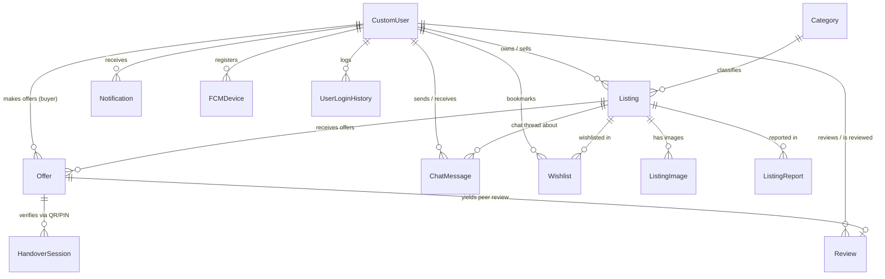

# 🗄️ CampusXChange (LPUTrade) — Complete Database Layer Documentation

> **Document Version**: 1.0  
> **Last Updated**: October 2026  
> **Target Framework**: Django REST Framework + MongoDB  
> **Database Engine**: `django_mongodb_backend`  

---

## 📌 Executive Summary

CampusXChange uses **MongoDB** as its primary document-relational database, integrated seamlessly into the **Django ORM** using `django_mongodb_backend`. This architecture gives the system the flexible document storage and high-throughput capabilities of MongoDB while preserving Django's rich Model definitions, relationships, querysets, validation, and multi-document ACID transactions.

---

## 1. ⚙️ Database Engine & Infrastructure Configuration

The database connection is defined in [`server/server/settings.py`](file:///c:/Users/anshu/OneDrive/Desktop/Projects/LPUTrade/server/server/settings.py#L140-L167):

```python
MONGODB_URI = os.environ.get('MONGODB_URI', 'mongodb://localhost:27017/campxchange')
MONGODB_NAME = os.environ.get('MONGODB_NAME', 'campxchange')

_mongo_options = {
    'maxPoolSize': int(os.environ.get('MONGO_MAX_POOL_SIZE', 50)),
    'minPoolSize': int(os.environ.get('MONGO_MIN_POOL_SIZE', 0)),
    'maxIdleTimeMS': 30000,
    'serverSelectionTimeoutMS': int(os.environ.get('MONGO_TIMEOUT_MS', 5000)),
    'connectTimeoutMS': 5000,
    'socketTimeoutMS': 15000,
    'waitQueueTimeoutMS': 5000,
    'retryWrites': True,
    'retryReads': True,
}

if 'mongodb+srv' in MONGODB_URI or 'ssl=true' in MONGODB_URI.lower():
    _mongo_options['tlsCAFile'] = certifi.where()

DATABASES = {
    'default': {
        'ENGINE': 'django_mongodb_backend',
        'HOST': MONGODB_URI,
        'NAME': MONGODB_NAME,
        'OPTIONS': _mongo_options,
        'CONN_MAX_AGE': int(os.environ.get('CONN_MAX_AGE', 0)),
    }
}
```

### Key Infrastructure Highlights
- **High Concurrency Connection Pool**: Configured with `maxPoolSize = 50` and dynamic idle connection recycling (`maxIdleTimeMS = 30000`) to handle high-traffic campus spikes.
- **Enterprise TLS Security**: Mozilla's root CA certificate bundle (`certifi.where()`) is loaded automatically when connecting to MongoDB Atlas (`mongodb+srv`).
- **Resilient Operations**: Native `retryWrites = True` and `retryReads = True` protect against network hiccups on cloud instances.

---

## 2. 🔑 Primary Key & Identifier Architecture (`ObjectId`)

Unlike SQL databases that generate auto-incrementing integers (`1, 2, 3...`), MongoDB generates **12-byte / 24-character hexadecimal BSON ObjectIds** (e.g. `6aadf2cb480098f068bb0245`).

### How IDs Work in this Project:
1. Every model instance inherits an automatic `id` of type `django_mongodb_backend.fields.ObjectIdAutoField`.
2. When performing queries via Django ORM (e.g., `Listing.objects.get(pk=id)`), the input **must be a 24-character hexadecimal string** or an `ObjectId` instance.
3. **Resilient Client Adapters**: Serializers and views implement smart fallback resolution:
   - If an integer index (e.g., `"5"`) or slug is passed from legacy mobile clients, the backend automatically resolves it to the correct BSON `ObjectId` before querying the database.

---

## 3. 🗺️ Entity Relationship Diagram (ERD)



---

## 4. 📦 Data Models & Schemas Breakdown

### App 1: `users` ([`server/users/models.py`](file:///c:/Users/anshu/OneDrive/Desktop/Projects/LPUTrade/server/users/models.py))

#### 1. `CustomUser` (Extends `AbstractUser`)
Represents students, sellers, buyers, and administrative staff.
- **Identity & Verification**:
  - `email` *(EmailField, Unique)*: Student college email (e.g., `@lpu.in`).
  - `college_domain` *(CharField)*: College domain tag.
  - `is_verified_student` *(BooleanField)*: College email verification status.
  - `is_id_verified` *(BooleanField)*: Student physical ID card verification status.
  - `id_card_image` *(TextField)*: ID card photo URI or Cloudinary URL.
  - `id_card_data` *(JSONField)*: OCR/extracted metadata from ID card.
  - `trust_score` *(IntegerField, 0-100)*: Algorithmic student trust score based on verification, completed trades, and review ratings.
- **Dual-Device Session Isolation**:
  - `web_session_id`, `web_session_device`, `web_session_created_at` *(Isolated Web session)*.
  - `android_session_id`, `android_session_device`, `android_session_created_at` *(Isolated Android session)*.
- **Role-Based Access Control (RBAC)**:
  - `role` *(BUYER, SELLER)*.
  - `admin_role` *(SUPER_ADMIN, MODERATOR, ID_VERIFIER)*.
  - `admin_permissions` *(JSONField)*: Granular module access list across 12 permission categories.
- **Indexes**: `['role', 'is_id_verified']`, `['-date_joined']`.

#### 2. `OTPVerification`
Manages encrypted one-time passwords for college email signup.
- Fields: `email`, `otp` (AES encrypted), `attempts`, `is_verified`, `created_at` (10-minute expiry).

#### 3. `PasswordResetToken` & `PasswordResetOTP`
Handles secure token and numeric PIN reset flows with brute-force lockout safeguards (`attempts >= 5`).

#### 4. `UserLoginHistory`
Forensic audit trail of all student and staff login attempts.
- Fields: `user`, `email_attempted`, `reg_no_attempted`, `login_method` (PASSWORD / GOOGLE), `client_type` (web / android), `ip_address`, `user_agent`, `status` (SUCCESS / FAILED), `failure_reason`, `created_at`.
- Indexes: `['login_method', 'status']`, `['-created_at']`.

---

### App 2: `marketplace` ([`server/marketplace/models.py`](file:///c:/Users/anshu/OneDrive/Desktop/Projects/LPUTrade/server/marketplace/models.py))

#### 1. `Category`
Product taxonomy and catalog grouping.
- Fields: `name`, `slug` (Unique), `icon` (Lucide icon name).

#### 2. `Listing`
Marketplace product post created by students.
- **Core Attributes**: `seller` (FK User), `category` (FK Category), `title`, `description`, `price`, `original_price`, `sale_end_time`.
- **Trading Modes**:
  - `transaction_type`: `SELL`, `DONATE`, `EXCHANGE`.
  - `is_exchange_allowed`, `exchange_preferences`, `rent_period`.
- **Item Quality**: `condition` (`NEW`, `LIKE_NEW`, `GOOD`, `FAIR`, `POOR`).
- **Campus Localization**: `location` (e.g. `BH-4`, `Uni-Mall`, `Block 34`).
- **Contact & Lifecycle**: `contact_preference`, `contact_phone`, `contact_whatsapp`, `status` (`ACTIVE`, `PENDING`, `SOLD`, `HIDDEN`), `views_count`.
- **Indexes**: `['status', '-created_at']`, `['category', 'status']`, `['seller', 'status']`, `['price', 'status']`, `['-created_at']`.

#### 3. `ListingImage`
Cloudinary CDN photo attachments for listings.
- Fields: `listing` (FK Listing), `image_url` (CDN URL), `is_primary` (Boolean), `created_at`.

#### 4. `Offer`
Peer transaction negotiations, price counter-offers, and deal contracts.
- Fields: `buyer` (FK User), `listing` (FK Listing), `offer_amount`, `counter_amount`, `seller_note`, `buyer_message`, `is_exchange_offer`, `exchange_item_title`.
- `status`: `PENDING`, `ACCEPTED`, `REJECTED`, `COUNTERED`, `COMPLETED`, `CANCELLED`.
- Indexes: `['listing', 'status']`, `['buyer', '-created_at']`, `['status']`, `['-created_at']`.

#### 5. `HandoverSession`
In-person campus meet-up security verification.
- Fields: `offer` (FK Offer), `token` (UUID4 Unique for QR scanner), `pin_code` (6-digit numeric OTP), `expires_at` (30-minute validity), `status` (`ACTIVE`, `USED`, `EXPIRED`, `CANCELLED`), `failed_attempts`, `completed_at`.

#### 6. `Review`
Verified peer feedback and trust rating submitted upon handover completion.
- Fields: `deal` (FK Offer), `listing` (FK Listing), `reviewer` (FK User), `reviewed_user` (FK User), `rating` (1 to 5 stars), `comment`, `quick_tags` (JSON array), `created_at`.
- Constraint: `unique_together = ('deal', 'reviewer')`.

#### 7. `ChatMessage`
In-app peer-to-peer messaging thread for active listings.
- Fields: `listing` (FK Listing), `sender` (FK User), `recipient` (FK User), `message`, `is_read`, `created_at`.
- Indexes: `['sender', 'recipient', '-created_at']`, `['listing', '-created_at']`, `['recipient', 'is_read']`.

#### 8. `Notification` & `FCMDevice`
Real-time student alerts and Firebase Cloud Messaging push tokens.
- Fields: `recipient`, `sender`, `notification_type` (`BUY_REQUEST`, `ITEM_SOLD`, `NEW_CHAT_MESSAGE`, `BROADCAST`, etc.), `priority`, `title`, `message`, `is_read`, `link`.
- Indexes: `['recipient', 'is_read', '-created_at']`, `['recipient', '-created_at']`.

#### 9. Supporting Governance & Marketing Models
- `Wishlist`: Saved bookmarks (`unique_together = ('user', 'listing')`).
- `ListingReport`: Student reports submitted for fraud / guideline violations.
- `AdminAuditLog`: Immutable governance history (`action`, `admin_username`, `target_type`, `target_id`, `details` JSON, `ip_address`).
- `Banner`: Homepage carousel slides (`image_url`, `link_url`, `is_active`, `display_order`).
- `PlatformSetting`: Dynamic key-value configuration.

---

## 5. ⚡ In-Memory Caching & Scalability Layer

To support **1,000+ simultaneous students** without saturating MongoDB connections, an in-memory caching layer is configured in [`server/server/settings.py`](file:///c:/Users/anshu/OneDrive/Desktop/Projects/LPUTrade/server/server/settings.py#L273-L283):

```python
CACHES = {
    'default': {
        'BACKEND': 'django.core.cache.backends.locmem.LocMemCache',
        'LOCATION': 'campxchange-locmem-cache',
        'TIMEOUT': 300,
        'OPTIONS': {
            'MAX_ENTRIES': 2000,
            'CULL_FREQUENCY': 3,
        }
    }
}
```

### Micro-Caching & Invalidation Strategy:
1. **Public Listing Feed (`cxc_public_default_active_listings`)**:
   - Cached in RAM with a 15-second TTL.
   - When any listing is created, modified, or deleted, a Django post-save signal immediately executes `cache.delete('cxc_public_default_active_listings')`.
2. **Chat Inbox (`cxc_user_conversations_<user_id>`)**:
   - Cached for 10 seconds per student.
   - Whenever a new chat message is posted, the cache for both sender and recipient is automatically invalidated.
3. **Banner Slideshow (`cxc_public_active_banners`)**:
   - Cached for 120 seconds in RAM and flushed when banners are modified in admin.

---

## 6. 🔒 ACID Transactions in MongoDB

When physical handovers are confirmed, multiple documents across collections must be updated simultaneously:
1. Handover Session marked `USED`.
2. Offer marked `COMPLETED`.
3. Listing marked `SOLD`.
4. Trust scores recalculated and saved for both students.
5. In-app notifications generated for buyer and seller.

This is executed within a database transaction in [`server/marketplace/views.py`](file:///c:/Users/anshu/OneDrive/Desktop/Projects/LPUTrade/server/marketplace/views.py#L1983):

```python
with transaction.atomic():
    session = HandoverSession.objects.select_for_update().get(token=token)
    session.status = 'USED'
    session.save()

    offer = session.offer
    offer.status = 'COMPLETED'
    offer.save()

    listing = offer.listing
    listing.status = 'SOLD'
    listing.save()
```

MongoDB executes these operations inside a multi-document replica set transaction, ensuring **all-or-nothing atomicity** without orphan records or race conditions.
