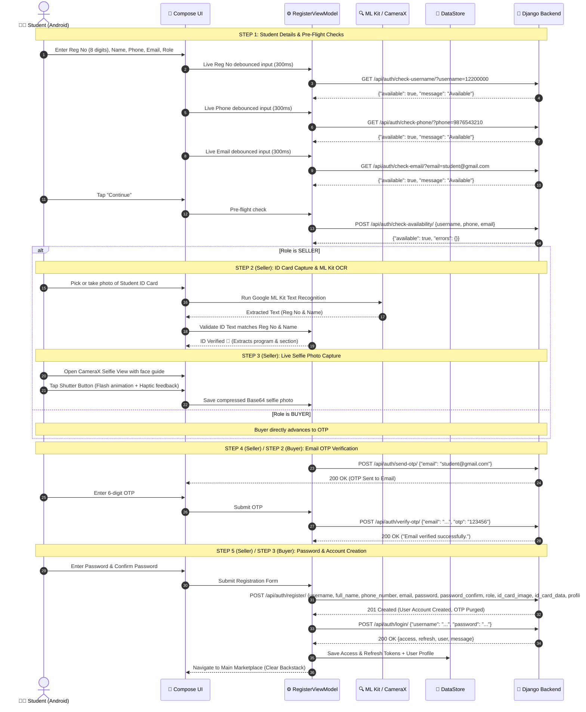
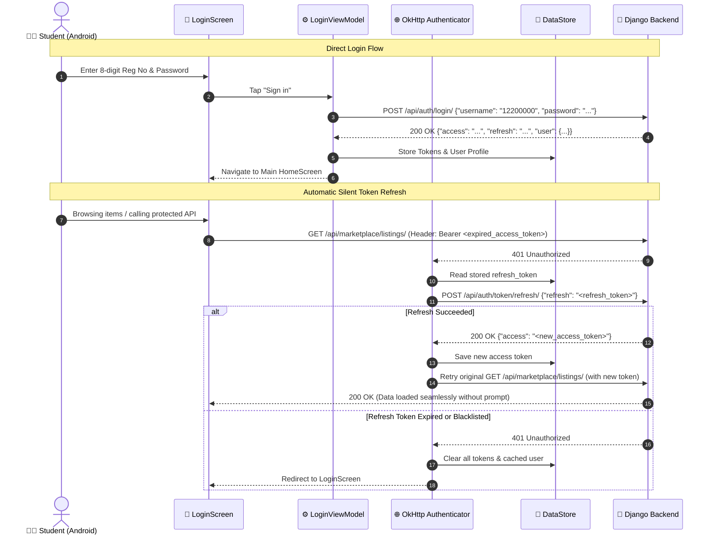

# 📱 CampusXChange — Android Login & Registration Complete Specification

> **Target Platform:** Android (Native)  
> **Tech Stack:** Kotlin, Jetpack Compose, Material 3, Clean Architecture + MVVM, Retrofit, OkHttp, Jetpack DataStore, Hilt, CameraX, Google ML Kit  
> **Backend Service:** Django REST Framework + SimpleJWT (`http://<server-ip>:8000/api/auth/`)  
> **Last Updated:** September 2026  
> **Version:** 2.0 (Dual-Path Buyer & Seller Onboarding + ML Kit OCR + CameraX Selfie)

---

## 📑 Table of Contents
1. [Architecture & System Flow](#1-architecture--system-flow)
   - [1.1 Architectural Pattern](#11-architectural-pattern)
   - [1.2 Dual-Path Onboarding Overview (Buyer vs Seller)](#12-dual-path-onboarding-overview-buyer-vs-seller)
   - [1.3 Sequence Diagrams](#13-sequence-diagrams)
2. [Complete Business & Validation Logic](#2-complete-business--validation-logic)
   - [2.1 Input Validation Rules](#21-input-validation-rules)
   - [2.2 Pre-Flight Availability Checking](#22-pre-flight-availability-checking)
   - [2.3 Student ID Card OCR & Spoof Detection Rules](#23-student-id-card-ocr--spoof-detection-rules)
   - [2.4 Live Face Selfie Capture Rules](#24-live-face-selfie-capture-rules)
   - [2.5 OTP Engine & Security Rules](#25-otp-engine--security-rules)
   - [2.6 Dynamic Trust Score Formula](#26-dynamic-trust-score-formula)
   - [2.7 Token Lifecycle & Refresh Engine](#27-token-lifecycle--refresh-engine)
3. [Color Palette & Design Tokens (Material 3)](#3-color-palette--design-tokens-material-3)
4. [Typography, Shapes & Components](#4-typography-shapes--components)
5. [Jetpack Compose Navigation & App Routes](#5-jetpack-compose-navigation--app-routes)
6. [Complete REST API Contract & Endpoints](#6-complete-rest-api-contract--endpoints)
   - [6.1 Live Username Check (`GET /check-username/`)](#61-live-username-check)
   - [6.2 Live Phone Check (`GET /check-phone/`)](#62-live-phone-check)
   - [6.3 Live Email Check (`GET /check-email/`)](#63-live-email-check)
   - [6.4 Pre-Flight Batch Check (`POST /check-availability/`)](#64-pre-flight-batch-check)
   - [6.5 Send OTP (`POST /send-otp/`)](#65-send-otp)
   - [6.6 Verify OTP (`POST /verify-otp/`)](#66-verify-otp)
   - [6.7 User Registration (`POST /register/`)](#67-user-registration)
   - [6.8 User Login (`POST /login/`)](#68-user-login)
   - [6.9 Refresh Token (`POST /token/refresh/`)](#69-refresh-token)
   - [6.10 Logout (`POST /logout/`)](#610-logout)
   - [6.11 Auth Status (`GET /status/`)](#611-auth-status)
   - [6.12 Upgrade to Seller (`POST /upgrade-to-seller/`)](#612-upgrade-to-seller)
   - [6.13 Verify ID Card (`POST /verify-id/`)](#613-verify-id-card)
7. [Android Implementation Blueprint (Kotlin Code)](#7-android-implementation-blueprint-kotlin-code)
   - [7.1 Retrofit API Service & DTOs](#71-retrofit-api-service--dtos)
   - [7.2 Token Management (Jetpack DataStore)](#72-token-management-jetpack-datastore)
   - [7.3 OkHttp Auth Interceptor & Token Authenticator](#73-okhttp-auth-interceptor--token-authenticator)
   - [7.4 On-Device ID Card OCR Analyzer (Google ML Kit)](#74-on-device-id-card-ocr-analyzer-google-ml-kit)
   - [7.5 Live Selfie Camera Capture Component (CameraX)](#75-live-selfie-camera-capture-component-camerax)
   - [7.6 ViewModels & State Management](#76-viewmodels--state-management)
   - [7.7 Jetpack Compose UI Screens](#77-jetpack-compose-ui-screens)
8. [Post-Registration Upgrade to Seller Workflow](#8-post-registration-upgrade-to-seller-workflow)
9. [Security & Production Checklist](#9-security--production-checklist)

---

## 1. Architecture & System Flow

### 1.1 Architectural Pattern
The Android authentication module is built with **Clean Architecture**, **MVVM (Model-View-ViewModel)**, and **MVI-inspired Unidirectional Data Flow (UDF)** using Kotlin `StateFlow`.

```
┌────────────────────────────────────────────────────────────────────────┐
│                      Jetpack Compose UI (Screens)                      │
│   (LoginScreen, RegisterDetails, RegisterIdCard, RegisterSelfie,       │
│                RegisterOtp, RegisterPassword, Stepper)                 │
└───────────────────────────────────▲────────────────────────────────────┘
                                    │ UI Events / UiState
┌───────────────────────────────────▼────────────────────────────────────┐
│                             ViewModels                                 │
│                (LoginViewModel, RegisterViewModel)                     │
└───────────────────────────────────▲────────────────────────────────────┘
                                    │ UseCases / Coroutines
┌───────────────────────────────────▼────────────────────────────────────┐
│                      AuthRepository & ML Kit/CameraX                   │
└─────────────┬─────────────────────┬─────────────────────┬──────────────┘
              ▼                     ▼                     ▼
┌───────────────────────────┐ ┌───────────┐ ┌───────────────────────────┐
│     Local Token Store     │ │  ML Kit   │ │      Remote Network       │
│    (Jetpack DataStore)    │ │ CameraX   │ │   (Retrofit + OkHttp)     │
└───────────────────────────┘ └───────────┘ └─────────────┬─────────────┘
                                                          ▼
                                                Django REST API Server
```

---

### 1.2 Dual-Path Onboarding Overview (Buyer vs Seller)

CampusXChange gives students the flexibility to sign up as a **Buyer** (fast 3-step sign up) or as a **Verified Seller** (complete 5-step sign up with student ID card and selfie verification):

```
                       ┌────────────────────────────┐
                       │   Step 1: Student Details  │
                       │ (Reg No, Name, Phone, Mail)│
                       └──────────────┬─────────────┘
                                      │
                         Role Selection: BUYER or SELLER?
                                      │
              ┌───────────────────────┴───────────────────────┐
              ▼                                               ▼
          [ BUYER ]                                       [ SELLER ]
       (Fast 3-Step)                                   (Full 5-Step)
              │                                               │
              │                                   ┌───────────▼───────────┐
              │                                   │ Step 2: Student ID    │
              │                                   │ Card OCR Verification │
              │                                   │ (ML Kit Card Scan)    │
              │                                   └───────────┬───────────┘
              │                                               │
              │                                   ┌───────────▼───────────┐
              │                                   │ Step 3: Live Selfie   │
              │                                   │ Camera Capture        │
              │                                   │ (CameraX Face Frame)  │
              │                                   └───────────┬───────────┘
              │                                               │
              ├───────────────────────────────────────────────┘
              ▼
   ┌───────────────────────┐
   │ Step 4 (Buyer Step 2) │
   │ Email OTP Verification│
   │ (6 digits, 10 min)    │
   └──────────┬────────────┘
              ▼
   ┌───────────────────────┐
   │ Step 5 (Buyer Step 3) │
   │ Password & Confirm    │
   └──────────┬────────────┘
              ▼
   ┌───────────────────────┐
   │ Auto-Login & Redirect │
   │ (Save JWT & User DTO) │
   └───────────────────────┘
```

---

### 1.3 Sequence Diagrams

#### A. Multi-Step Registration Flow (Seller & Buyer)



#### B. Direct Login Flow & Silent Token Refresh



---

## 2. Complete Business & Validation Logic

### 2.1 Input Validation Rules

| Field | Requirement | Validation Regex / Rule | Error Message on Failure |
|---|---|---|---|
| **Registration Number** | Exactly 8 numeric digits | `^\d{8}$` | *"Registration number must be exactly 8 digits."* |
| **Full Name** | 3 to 50 characters | `name.trim().length in 3..50` | *"Name must be between 3 and 50 characters."* |
| **Phone Number** | Exactly 10 numeric digits | `^\d{10}$` | *"Phone number must be exactly 10 digits."* |
| **Email Address** | Standard email ending with `@gmail.com` | `^[\w\.-]+@gmail\.com$` *(case-insensitive)* | *"Only @gmail.com email addresses are allowed."* |
| **Role Selection** | Choice between BUYER or SELLER | `role in ["BUYER", "SELLER"]` | *"Please choose your role."* |
| **Student ID Card** | Physical card photo uploaded (Required for Seller) | Valid Base64 JPEG/PNG string, > 100 bytes | *"A valid student ID card photo is required."* |
| **Live Selfie Photo** | Real-time camera capture of face (Required for Seller) | Valid Base64 JPEG string, > 100 bytes | *"A clear selfie photo is required to verify identity."* |
| **OTP Code** | 6 numeric digits | `^\d{6}$` | *"Please enter a valid 6-digit code."* |
| **Password** | Min 8 chars, 1+ special char | `password.length >= 8 && Regex("[^a-zA-Z0-9]").containsMatchIn(password)` | *"Must be at least 8 characters and contain a special character."* |
| **Confirm Password** | Must match password exactly | `password == confirmPassword` | *"Passwords do not match."* |

---

### 2.2 Pre-Flight Availability Checking

To avoid students filling out the multi-step form only to find out a field is already taken, the Android app runs **debounced (300ms) pre-flight checks**:
1. `GET /api/auth/check-username/?username={val}`: Checks if registration number exists in DB.
2. `GET /api/auth/check-phone/?phone={val}`: Checks if 10-digit phone exists in DB.
3. `GET /api/auth/check-email/?email={val}`: Checks if email address exists in DB.
4. `POST /api/auth/check-availability/`: Pre-flight batch validator called immediately when student taps **"Continue"** on Step 1.

---

### 2.3 Student ID Card OCR & Spoof Detection Rules (Seller Step 2)
1. **Document Authenticity Check:**
   - Image resolution must be at least 600x400.
   - Blur detection (variance of Laplacian or gradient check).
   - Rejects blank, dark, or corrupted images.
2. **Google ML Kit Text Recognition:**
   - Uses on-device `com.google.mlkit:text-recognition:16.0.1`.
   - Card text must contain university markers (e.g., `LOVELY PROFESSIONAL UNIVERSITY` or `LPU`).
   - The recognized text must match the student's entered 8-digit **Registration Number**.
   - The recognized text must contain the student's entered **Full Name** (fuzzy match with > 70% confidence).
3. **Structured Card Data Extraction:**
   - Extracts Registration Number, Student Name, Program/Course (e.g. `B.Tech CSE`), and Section into a JSON object `id_card_data`.
4. **Skip Option:**
   - Sellers can choose **"Skip for now"** which converts their role to `BUYER` and immediately advances them to Email OTP.

---

### 2.4 Live Face Selfie Capture Rules (Seller Step 3)
1. Uses Android **CameraX** with the front-facing camera (`CameraSelector.LENS_FACING_FRONT`).
2. Renders an **oval facial guide** overlay on the camera viewfinder.
3. Shutter button triggers:
   - Visual screen flash animation.
   - Haptic vibration feedback (`Vibrator.vibrate(50ms)`).
4. Image is compressed to max dimensions of 800x800, JPEG quality 80% (Base64 string).
5. Stored as `profile_photo` which awards an instant **+3 Trust Score bonus**.

---

### 2.5 OTP Engine & Security Rules
- **Validity Window:** OTP is valid for **10 minutes** from generation.
- **Maximum Verification Attempts:** Limited to **5 attempts**.
- **Lockout Mechanism:** After 5 failed attempts, the backend locks out the session with `HTTP 429 Too Many Requests`. User must request a new OTP.
- **Rate Throttling:**
  - `send-otp/`, `verify-otp/`, `register/`: `5 requests / minute`.
  - `login/`: `10 requests / minute`.
- **Purge on Registration:** When account creation succeeds, the backend deletes the OTP record from `OTPVerification` to prevent replay attacks.

---

### 2.6 Dynamic Trust Score Formula
The backend recalculates the student's `trust_score` (0 to 100) on each verification step:
```
+ 5 Points: Email Authenticated via OTP
+ 5 Points: Student ID Card Verified (Seller)
+ 3 Points: Live Selfie Profile Photo Added (Seller)
+ 5 Points: Per Successful Completed Trade (Handovers)
+ Up to 15 Points: High Peer Review Ratings (avg >= 4.5 -> +15, avg >= 3.5 -> +8, avg < 2.5 -> -15)
---------------------------------------------------------------------------------------------
Initial Buyer Score:  5 Points
Initial Seller Score: 13 Points (5 Email + 5 ID Card + 3 Selfie)
Max Score:            100 Points
```

---

### 2.7 Token Lifecycle & Refresh Engine
- **Access Token:** JWT valid for **60 minutes**. Passed in HTTP headers as `Authorization: Bearer <access_token>`.
- **Refresh Token:** JWT valid for **24 hours**. Stored securely in Jetpack DataStore.
- **Silent Refresh Interceptor:** OkHttp `Authenticator` automatically catches `401 Unauthorized` responses, calls `/api/auth/token/refresh/`, updates the DataStore, and replays the failed request transparently.
- **Logout:** Explicitly calls `/api/auth/logout/` which blacklists the refresh token server-side and clears local DataStore tokens.

---

## 3. Color Palette & Design Tokens (Material 3)

The Android app adheres strictly to the CampusXChange Design System:

| Token Name | Hex Code | Jetpack Compose Color | Role in UI |
|---|---|---|---|
| **Brand Primary (500)** | `#FB5607` | `Color(0xFFFB5607)` | Primary buttons, active stepper dots, focused borders |
| **Brand Pressed (600)** | `#EA4300` | `Color(0xFFEA4300)` | Button pressed state, gradient accent |
| **Brand Light (400)** | `#FF732C` | `Color(0xFFFF732C)` | Accent highlights, icon tint |
| **Brand Subtle (100)** | `#FFE5D3` | `Color(0xFFFFE5D3)` | Icon container background, tag background |
| **Brand Ultra Light (50)**| `#FFF4ED` | `Color(0xFFFFF4ED)` | Tinted input backgrounds, active role card background |
| **Background (Light)** | `#FCFBF8` | `Color(0xFFFCFBF8)` | Main screen scaffold background (Warm Cream) |
| **Surface White** | `#FFFFFF` | `Color(0xFFFFFFFF)` | White cards, dialogs, bottom sheets |
| **Text Primary (Ink 900)**| `#111111` | `Color(0xFF111111)` | Titles, headers, field inputs, active text |
| **Text Secondary (Gray)** | `#6B7280` | `Color(0xFF6B7280)` | Subtitles, input placeholders, helper labels |
| **Border Normal** | `#E5E7EB` | `Color(0xFFE5E7EB)` | Inactive input borders, card outlines |
| **Border Focused** | `#FB5607` | `Color(0xFFFB5607)` | Active text field outline |
| **Success Emerald** | `#10B981` | `Color(0xFF10B981)` | Username available badge, verified checkmark |
| **Error Red** | `#EF4444` | `Color(0xFFEF4444)` | Validation errors, username taken badge |

---

## 4. Typography, Shapes & Components

### 4.1 Typography Guidelines (`Type.kt`)
- **Font Family:** Inter or Outfit (`FontFamily.SansSerif`).
- **Heading 1:** Bold / ExtraBold, 26-28sp, `TextInkPrimary`.
- **Section Headers:** SemiBold, 18sp.
- **Input Text:** Medium, 15sp.
- **Labels:** SemiBold / Black uppercase tracking, 11sp.

### 4.2 Shapes (`Shape.kt`)
- **Inputs & Buttons:** `RoundedCornerShape(8.dp)` to `10.dp`.
- **Cards & Modals:** `RoundedCornerShape(16.dp)`.
- **Selfie Viewfinder:** Oval / Circle mask.

---

## 5. Jetpack Compose Navigation & App Routes

### 5.1 Route Tree Structure
```
AuthNavGraph ("auth_graph")
 ├── LoginRoute ("auth/login")
 ├── RegisterDetailsRoute ("auth/register_details")
 ├── RegisterIdCardRoute ("auth/register_id_card") [Seller Step 2]
 ├── RegisterSelfieRoute ("auth/register_selfie")   [Seller Step 3]
 ├── RegisterOtpRoute ("auth/register_otp")         [Buyer Step 2 / Seller Step 4]
 ├── RegisterPasswordRoute ("auth/register_password")[Buyer Step 3 / Seller Step 5]
 └── UpgradeToSellerRoute ("auth/upgrade_to_seller")
```

### 5.2 Navigation Implementation (`AuthNavigation.kt`)

```kotlin
package com.CampusXChange.app.navigation

import androidx.navigation.NavController
import androidx.navigation.NavGraphBuilder
import androidx.navigation.compose.composable
import androidx.navigation.navigation
import com.CampusXChange.app.ui.auth.login.LoginScreen
import com.CampusXChange.app.ui.auth.register.*

sealed class AuthRoute(val route: String) {
    object Login : AuthRoute("auth/login")
    object RegisterDetails : AuthRoute("auth/register_details")
    object RegisterIdCard : AuthRoute("auth/register_id_card")
    object RegisterSelfie : AuthRoute("auth/register_selfie")
    object RegisterOtp : AuthRoute("auth/register_otp")
    object RegisterPassword : AuthRoute("auth/register_password")
    object UpgradeToSeller : AuthRoute("auth/upgrade_to_seller")
}

fun NavGraphBuilder.authNavGraph(
    navController: NavController,
    onAuthSuccess: () -> Unit
) {
    navigation(startDestination = AuthRoute.Login.route, route = "auth_graph") {
        composable(AuthRoute.Login.route) {
            LoginScreen(
                onNavigateToRegister = { navController.navigate(AuthRoute.RegisterDetails.route) },
                onLoginSuccess = onAuthSuccess
            )
        }
        composable(AuthRoute.RegisterDetails.route) {
            RegisterDetailsScreen(
                onNavigateToLogin = { navController.popBackStack() },
                onProceedToIdCard = { navController.navigate(AuthRoute.RegisterIdCard.route) },
                onProceedToOtp = { navController.navigate(AuthRoute.RegisterOtp.route) }
            )
        }
        composable(AuthRoute.RegisterIdCard.route) {
            RegisterIdCardScreen(
                onBack = { navController.popBackStack() },
                onProceedToSelfie = { navController.navigate(AuthRoute.RegisterSelfie.route) },
                onSkipToOtp = { navController.navigate(AuthRoute.RegisterOtp.route) }
            )
        }
        composable(AuthRoute.RegisterSelfie.route) {
            RegisterSelfieScreen(
                onBack = { navController.popBackStack() },
                onProceedToOtp = { navController.navigate(AuthRoute.RegisterOtp.route) }
            )
        }
        composable(AuthRoute.RegisterOtp.route) {
            RegisterOtpScreen(
                onBack = { navController.popBackStack() },
                onVerified = { navController.navigate(AuthRoute.RegisterPassword.route) }
            )
        }
        composable(AuthRoute.RegisterPassword.route) {
            RegisterPasswordScreen(
                onBack = { navController.popBackStack() },
                onRegistrationComplete = onAuthSuccess
            )
        }
    }
}
```

---

## 6. Complete REST API Contract & Endpoints

Base URL: `http://<SERVER_IP>:8000/api/auth/`

### Summary Table

| Endpoint | Method | Auth Required | Throttle Scope | Description |
|---|---|---|---|---|
| `check-username/` | `GET` | No | Default | Live reg no availability check |
| `check-phone/` | `GET` | No | Default | Live phone availability check |
| `check-email/` | `GET` | No | Default | Live email availability check |
| `check-availability/` | `POST` | No | Default | Pre-flight batch uniqueness check |
| `send-otp/` | `POST` | No | `signup` (5/min) | Generates & dispatches 6-digit OTP |
| `verify-otp/` | `POST` | No | `signup` (5/min) | Validates OTP (10 min expiry, 5 attempts max) |
| `register/` | `POST` | No | `signup` (5/min) | Creates account with student status |
| `login/` | `POST` | No | `login` (10/min) | Authenticates student & returns JWT + user DTO |
| `token/refresh/` | `POST` | No | Default | Exchanges refresh token for new access token |
| `logout/` | `POST` | No | Default | Blacklists refresh token server-side |
| `status/` | `GET` | Optional | Default | Checks active session status & role |
| `upgrade-to-seller/`| `POST` | **Bearer JWT** | Default | Upgrades Buyer to Verified Seller |
| `verify-id/` | `POST` | **Bearer JWT** | Default | Direct ID verification submission |

---

### 6.1 Live Username Check
- **URL:** `GET /api/auth/check-username/?username={reg_no}`
- **Query Params:** `username` (e.g. `12200000`)
- **Response 200:**
  ```json
  {
    "available": true,
    "message": "Available"
  }
  ```
- **Response if Taken:**
  ```json
  {
    "available": false,
    "message": "This registration number is already registered."
  }
  ```

---

### 6.2 Live Phone Check
- **URL:** `GET /api/auth/check-phone/?phone={phone_number}`
- **Query Params:** `phone` (e.g. `9876543210`)
- **Response 200:**
  ```json
  {
    "available": true,
    "message": "Available"
  }
  ```

---

### 6.3 Live Email Check
- **URL:** `GET /api/auth/check-email/?email={email_address}`
- **Query Params:** `email` (e.g. `student@gmail.com`)
- **Response 200:**
  ```json
  {
    "available": true,
    "message": "Available"
  }
  ```

---

### 6.4 Pre-Flight Batch Check
- **URL:** `POST /api/auth/check-availability/`
- **Request Body:**
  ```json
  {
    "username": "12200000",
    "phone": "9876543210",
    "email": "student@gmail.com"
  }
  ```
- **Response 200:**
  ```json
  {
    "available": true,
    "errors": {}
  }
  ```

---

### 6.5 Send OTP
- **URL:** `POST /api/auth/send-otp/`
- **Request Body:**
  ```json
  {
    "email": "student@gmail.com"
  }
  ```
- **Response 200:**
  ```json
  {
    "message": "OTP sent successfully."
  }
  ```

---

### 6.6 Verify OTP
- **URL:** `POST /api/auth/verify-otp/`
- **Request Body:**
  ```json
  {
    "email": "student@gmail.com",
    "otp": "123456"
  }
  ```
- **Response 200:**
  ```json
  {
    "message": "Email verified successfully."
  }
  ```
- **Response 429 (Locked):**
  ```json
  {
    "error": "Too many failed attempts. OTP has been invalidated. Please request a new one."
  }
  ```

---

### 6.7 User Registration
- **URL:** `POST /api/auth/register/`
- **Request Body:**
  ```json
  {
    "username": "12200000",
    "full_name": "Aryan Sharma",
    "phone_number": "9876543210",
    "email": "student@gmail.com",
    "password": "StrongPassword@123",
    "password_confirm": "StrongPassword@123",
    "role": "SELLER",
    "id_card_image": "data:image/jpeg;base64,...",
    "id_card_data": {
      "reg_no": "12200000",
      "name": "Aryan Sharma",
      "program": "B.Tech CSE",
      "section": "K22AA"
    },
    "profile_photo": "data:image/jpeg;base64,..."
  }
  ```
- **Response 201 Created:**
  ```json
  {
    "username": "12200000",
    "email": "student@gmail.com",
    "full_name": "Aryan Sharma",
    "phone_number": "9876543210",
    "role": "SELLER",
    "id_card_image": "...",
    "id_card_data": { ... },
    "profile_photo": "..."
  }
  ```

---

### 6.8 User Login
- **URL:** `POST /api/auth/login/`
- **Request Body:**
  ```json
  {
    "username": "12200000",
    "password": "StrongPassword@123"
  }
  ```
- **Response 200:**
  ```json
  {
    "access": "eyJhbGciOiJIUzI1NiIsInR5cCI6IkpXVCJ9...",
    "refresh": "eyJhbGciOiJIUzI1NiIsInR5cCI6IkpXVCJ9...",
    "user": {
      "id": 14,
      "username": "12200000",
      "email": "student@gmail.com",
      "full_name": "Aryan Sharma",
      "phone_number": "9876543210",
      "role": "SELLER",
      "is_active": true,
      "is_verified_student": true,
      "is_id_verified": true,
      "has_id_card": true,
      "college_domain": "gmail.com",
      "trust_score": 13,
      "completed_trades_count": 0,
      "profile_photo": "data:image/jpeg;base64,...",
      "date_joined": "2026-09-14T10:00:00Z",
      "is_staff": false,
      "is_superuser": false,
      "admin_role": "MODERATOR",
      "admin_permissions": [],
      "effective_permissions": []
    },
    "message": "Successfully logged in."
  }
  ```

---

### 6.9 Refresh Token
- **URL:** `POST /api/auth/token/refresh/`
- **Request Body:**
  ```json
  {
    "refresh": "eyJhbGciOiJIUzI1NiIsInR5cCI6IkpXVCJ9..."
  }
  ```
- **Response 200:**
  ```json
  {
    "access": "eyJhbGciOiJIUzI1NiIsInR5cCI6IkpXVCJ9...",
    "message": "Token refreshed successfully."
  }
  ```

---

### 6.10 Logout
- **URL:** `POST /api/auth/logout/`
- **Request Body:**
  ```json
  {
    "refresh": "eyJhbGciOiJIUzI1NiIsInR5cCI6IkpXVCJ9..."
  }
  ```
- **Response 200:**
  ```json
  {
    "message": "Successfully logged out."
  }
  ```

---

### 6.11 Auth Status
- **URL:** `GET /api/auth/status/`
- **Headers:** `Authorization: Bearer <access_token>` *(optional)*
- **Response 200:**
  ```json
  {
    "isAuthenticated": true,
    "is_staff": false,
    "is_superuser": false,
    "role": "SELLER",
    "admin_role": null,
    "admin_permissions": [],
    "username": "12200000",
    "user": { ... }
  }
  ```

---

### 6.12 Upgrade to Seller
- **URL:** `POST /api/auth/upgrade-to-seller/`
- **Headers:** `Authorization: Bearer <access_token>`
- **Request Body:**
  ```json
  {
    "reg_no": "12200000",
    "id_card_image": "data:image/jpeg;base64,...",
    "id_card_data": { "reg_no": "12200000", "name": "Aryan Sharma" },
    "profile_photo": "data:image/jpeg;base64,...",
    "otp": "654321"
  }
  ```
- **Response 200:**
  ```json
  {
    "message": "Congratulations! You have been successfully upgraded to a Verified Seller.",
    "user": { ... }
  }
  ```

---

### 6.13 Verify ID Card
- **URL:** `POST /api/auth/verify-id/`
- **Headers:** `Authorization: Bearer <access_token>`
- **Request Body:**
  ```json
  {
    "reg_no": "12200000",
    "id_card_image": "data:image/jpeg;base64,...",
    "id_card_data": { "reg_no": "12200000", "name": "Aryan Sharma" },
    "profile_photo": "data:image/jpeg;base64,..."
  }
  ```
- **Response 200:**
  ```json
  {
    "message": "Student ID verified successfully! You are now a Verified Seller.",
    "user": { ... }
  }
  ```

---

## 7. Android Implementation Blueprint (Kotlin Code)

### 7.1 Retrofit API Service & DTOs

#### A. Data Transfer Objects (`AuthModels.kt`)

```kotlin
package com.CampusXChange.app.data.remote.dto

import com.google.gson.annotations.SerializedName

data class CheckAvailabilityResponse(
    @SerializedName("available") val available: Boolean,
    @SerializedName("message") val message: String? = null,
    @SerializedName("errors") val errors: Map<String, String>? = null
)

data class AvailabilityCheckRequest(
    @SerializedName("username") val username: String,
    @SerializedName("phone") val phone: String,
    @SerializedName("email") val email: String
)

data class SendOtpRequest(
    @SerializedName("email") val email: String
)

data class VerifyOtpRequest(
    @SerializedName("email") val email: String,
    @SerializedName("otp") val otp: String
)

data class MessageResponse(
    @SerializedName("message") val message: String? = null,
    @SerializedName("error") val error: String? = null
)

data class RegisterRequest(
    @SerializedName("username") val username: String,
    @SerializedName("full_name") val fullName: String,
    @SerializedName("phone_number") val phoneNumber: String,
    @SerializedName("email") val email: String,
    @SerializedName("password") val password: String,
    @SerializedName("password_confirm") val passwordConfirm: String,
    @SerializedName("role") val role: String = "BUYER",
    @SerializedName("id_card_image") val idCardImage: String? = null,
    @SerializedName("id_card_data") val idCardData: Map<String, Any>? = null,
    @SerializedName("profile_photo") val profilePhoto: String? = null
)

data class LoginRequest(
    @SerializedName("username") val username: String,
    @SerializedName("password") val password: String
)

data class TokenRefreshRequest(
    @SerializedName("refresh") val refresh: String
)

data class LogoutRequest(
    @SerializedName("refresh") val refresh: String
)

data class UpgradeToSellerRequest(
    @SerializedName("reg_no") val regNo: String,
    @SerializedName("id_card_image") val idCardImage: String,
    @SerializedName("id_card_data") val idCardData: Map<String, Any>? = null,
    @SerializedName("profile_photo") val profilePhoto: String,
    @SerializedName("otp") val otp: String
)

data class UserDto(
    @SerializedName("id") val id: Int,
    @SerializedName("username") val username: String,
    @SerializedName("email") val email: String,
    @SerializedName("full_name") val fullName: String?,
    @SerializedName("phone_number") val phoneNumber: String?,
    @SerializedName("role") val role: String,
    @SerializedName("is_active") val isActive: Boolean,
    @SerializedName("is_verified_student") val isVerifiedStudent: Boolean,
    @SerializedName("is_id_verified") val isIdVerified: Boolean,
    @SerializedName("has_id_card") val hasIdCard: Boolean,
    @SerializedName("college_domain") val collegeDomain: String?,
    @SerializedName("trust_score") val trustScore: Int,
    @SerializedName("completed_trades_count") val completedTradesCount: Int,
    @SerializedName("profile_photo") val profilePhoto: String?,
    @SerializedName("date_joined") val dateJoined: String?,
    @SerializedName("is_staff") val isStaff: Boolean,
    @SerializedName("is_superuser") val isSuperuser: Boolean
)

data class LoginResponse(
    @SerializedName("access") val access: String,
    @SerializedName("refresh") val refresh: String,
    @SerializedName("user") val user: UserDto,
    @SerializedName("message") val message: String?
)

data class RefreshResponse(
    @SerializedName("access") val access: String,
    @SerializedName("message") val message: String?
)

data class AuthStatusResponse(
    @SerializedName("isAuthenticated") val isAuthenticated: Boolean,
    @SerializedName("role") val role: String?,
    @SerializedName("user") val user: UserDto?
)
```

#### B. Retrofit Interface (`AuthApiService.kt`)

```kotlin
package com.CampusXChange.app.data.remote

import com.CampusXChange.app.data.remote.dto.*
import retrofit2.Response
import retrofit2.http.*

interface AuthApiService {

    @GET("api/auth/check-username/")
    suspend fun checkUsername(@Query("username") username: String): Response<CheckAvailabilityResponse>

    @GET("api/auth/check-phone/")
    suspend fun checkPhone(@Query("phone") phone: String): Response<CheckAvailabilityResponse>

    @GET("api/auth/check-email/")
    suspend fun checkEmail(@Query("email") email: String): Response<CheckAvailabilityResponse>

    @POST("api/auth/check-availability/")
    suspend fun checkAvailability(@Body request: AvailabilityCheckRequest): Response<CheckAvailabilityResponse>

    @POST("api/auth/send-otp/")
    suspend fun sendOtp(@Body request: SendOtpRequest): Response<MessageResponse>

    @POST("api/auth/verify-otp/")
    suspend fun verifyOtp(@Body request: VerifyOtpRequest): Response<MessageResponse>

    @POST("api/auth/register/")
    suspend fun register(@Body request: RegisterRequest): Response<UserDto>

    @POST("api/auth/login/")
    suspend fun login(@Body request: LoginRequest): Response<LoginResponse>

    @POST("api/auth/token/refresh/")
    suspend fun refreshToken(@Body request: TokenRefreshRequest): Response<RefreshResponse>

    @POST("api/auth/logout/")
    suspend fun logout(@Body request: LogoutRequest): Response<MessageResponse>

    @GET("api/auth/status/")
    suspend fun getStatus(): Response<AuthStatusResponse>

    @POST("api/auth/upgrade-to-seller/")
    suspend fun upgradeToSeller(@Body request: UpgradeToSellerRequest): Response<MessageResponse>
}
```

---

### 7.2 Token Management (Jetpack DataStore)

```kotlin
package com.CampusXChange.app.data.local

import android.content.Context
import androidx.datastore.core.DataStore
import androidx.datastore.preferences.core.*
import androidx.datastore.preferences.preferencesDataStore
import com.CampusXChange.app.data.remote.dto.UserDto
import com.google.gson.Gson
import dagger.hilt.android.qualifiers.ApplicationContext
import kotlinx.coroutines.flow.Flow
import kotlinx.coroutines.flow.firstOrNull
import kotlinx.coroutines.flow.map
import javax.inject.Inject
import javax.inject.Singleton

val Context.dataStore: DataStore<Preferences> by preferencesDataStore(name = "auth_prefs")

@Singleton
class TokenManager @Inject constructor(
    @ApplicationContext private val context: Context,
    private val gson: Gson
) {
    companion object {
        val ACCESS_TOKEN_KEY = stringPreferencesKey("access_token")
        val REFRESH_TOKEN_KEY = stringPreferencesKey("refresh_token")
        val USER_DATA_KEY = stringPreferencesKey("user_data")
    }

    val accessTokenFlow: Flow<String?> = context.dataStore.data.map { it[ACCESS_TOKEN_KEY] }
    val refreshTokenFlow: Flow<String?> = context.dataStore.data.map { it[REFRESH_TOKEN_KEY] }
    
    val userFlow: Flow<UserDto?> = context.dataStore.data.map { prefs ->
        prefs[USER_DATA_KEY]?.let { json ->
            try { gson.fromJson(json, UserDto::class.java) } catch (e: Exception) { null }
        }
    }

    suspend fun saveTokens(access: String, refresh: String, user: UserDto?) {
        context.dataStore.edit { prefs ->
            prefs[ACCESS_TOKEN_KEY] = access
            prefs[REFRESH_TOKEN_KEY] = refresh
            user?.let { prefs[USER_DATA_KEY] = gson.toJson(it) }
        }
    }

    suspend fun updateAccessToken(access: String) {
        context.dataStore.edit { prefs ->
            prefs[ACCESS_TOKEN_KEY] = access
        }
    }

    suspend fun getAccessToken(): String? = context.dataStore.data.firstOrNull()?.get(ACCESS_TOKEN_KEY)
    suspend fun getRefreshToken(): String? = context.dataStore.data.firstOrNull()?.get(REFRESH_TOKEN_KEY)

    suspend fun clearAuth() {
        context.dataStore.edit { prefs ->
            prefs.remove(ACCESS_TOKEN_KEY)
            prefs.remove(REFRESH_TOKEN_KEY)
            prefs.remove(USER_DATA_KEY)
        }
    }
}
```

---

### 7.3 OkHttp Auth Interceptor & Token Authenticator

```kotlin
package com.CampusXChange.app.data.remote

import com.CampusXChange.app.data.local.TokenManager
import com.CampusXChange.app.data.remote.dto.TokenRefreshRequest
import kotlinx.coroutines.runBlocking
import okhttp3.*
import javax.inject.Inject
import javax.inject.Provider
import javax.inject.Singleton

@Singleton
class AuthInterceptor @Inject constructor(
    private val tokenManager: TokenManager
) : Interceptor {
    override fun intercept(chain: Interceptor.Chain): Response {
        val original = chain.request()
        val accessToken = runBlocking { tokenManager.getAccessToken() }

        val isAuthEndpoint = original.url.encodedPath.contains("/api/auth/login") ||
                             original.url.encodedPath.contains("/api/auth/register") ||
                             original.url.encodedPath.contains("/api/auth/send-otp") ||
                             original.url.encodedPath.contains("/api/auth/check")

        val request = if (!accessToken.isNullOrEmpty() && !isAuthEndpoint) {
            original.newBuilder()
                .header("Authorization", "Bearer $accessToken")
                .header("Accept", "application/json")
                .build()
        } else {
            original.newBuilder()
                .header("Accept", "application/json")
                .build()
        }
        return chain.proceed(request)
    }
}

@Singleton
class TokenAuthenticator @Inject constructor(
    private val tokenManager: TokenManager,
    private val apiServiceProvider: Provider<AuthApiService>
) : Authenticator {
    override fun authenticate(route: Route?, response: Response): Request? {
        if (responseCount(response) >= 3) return null

        val refreshToken = runBlocking { tokenManager.getRefreshToken() } ?: return null

        return synchronized(this) {
            val currentAccessToken = runBlocking { tokenManager.getAccessToken() }
            val requestToken = response.request.header("Authorization")?.removePrefix("Bearer ")

            if (currentAccessToken != null && currentAccessToken != requestToken) {
                return@synchronized response.request.newBuilder()
                    .header("Authorization", "Bearer $currentAccessToken")
                    .build()
            }

            val refreshResponse = runBlocking {
                try {
                    apiServiceProvider.get().refreshToken(TokenRefreshRequest(refreshToken))
                } catch (e: Exception) {
                    null
                }
            }

            if (refreshResponse != null && refreshResponse.isSuccessful && refreshResponse.body() != null) {
                val newAccessToken = refreshResponse.body()!!.access
                runBlocking { tokenManager.updateAccessToken(newAccessToken) }
                response.request.newBuilder()
                    .header("Authorization", "Bearer $newAccessToken")
                    .build()
            } else {
                runBlocking { tokenManager.clearAuth() }
                null
            }
        }
    }

    private fun responseCount(response: Response): Int {
        var result = 1
        var prior = response.priorResponse
        while (prior != null) {
            result++
            prior = prior.priorResponse
        }
        return result
    }
}
```

---

### 7.4 On-Device ID Card OCR Analyzer (Google ML Kit)

```kotlin
package com.CampusXChange.app.utils

import android.graphics.Bitmap
import com.google.mlkit.vision.common.InputImage
import com.google.mlkit.vision.text.TextRecognition
import com.google.mlkit.vision.text.latin.TextRecognizerOptions
import kotlinx.coroutines.suspendCancellableCoroutine
import kotlin.coroutines.resume

data class IdCardOcrResult(
    val isValid: Boolean,
    val regNoMatched: Boolean,
    val nameMatched: Boolean,
    val extractedData: Map<String, String>,
    val reason: String? = null
)

object IdCardOcrAnalyzer {
    private val recognizer = TextRecognition.getClient(TextRecognizerOptions.DEFAULT_OPTIONS)

    suspend fun analyzeIdCard(
        bitmap: Bitmap,
        expectedRegNo: String,
        expectedName: String
    ): IdCardOcrResult = suspendCancellableCoroutine { continuation ->
        val image = InputImage.fromBitmap(bitmap, 0)
        recognizer.process(image)
            .addOnSuccessListener { visionText ->
                val fullText = visionText.text
                val upper = fullText.uppercase()

                // 1. Check university signature
                val hasUnivMarker = upper.contains("LOVELY") || upper.contains("LPU") || upper.contains("PUNJAB")
                if (!hasUnivMarker) {
                    continuation.resume(
                        IdCardOcrResult(
                            isValid = false,
                            regNoMatched = false,
                            nameMatched = false,
                            extractedData = emptyMap(),
                            reason = "Card does not appear to be an official LPU Student ID."
                        )
                    )
                    return@addOnSuccessListener
                }

                // 2. Extract Registration Number
                val regNoRegex = Regex("\\b\\d{8}\\b")
                val foundRegNo = regNoRegex.find(fullText)?.value ?: ""
                val regNoMatches = foundRegNo == expectedRegNo.trim() || fullText.contains(expectedRegNo.trim())

                // 3. Extract and check Student Name
                val nameNormalized = expectedName.trim().uppercase()
                val nameMatches = upper.contains(nameNormalized) || 
                    nameNormalized.split(" ").any { part -> part.length > 2 && upper.contains(part) }

                if (!regNoMatches) {
                    continuation.resume(
                        IdCardOcrResult(
                            isValid = false,
                            regNoMatched = false,
                            nameMatched = nameMatches,
                            extractedData = emptyMap(),
                            reason = "Registration number ($expectedRegNo) not found on ID card."
                        )
                    )
                    return@addOnSuccessListener
                }

                val data = mutableMapOf<String, String>()
                data["reg_no"] = expectedRegNo
                data["name"] = expectedName
                
                val programRegex = Regex("(B\\.TECH|MBA|BBA|BCA|MCA|DIPLOMA|B\\.SC|M\\.TECH)", RegexOption.IGNORE_CASE)
                programRegex.find(fullText)?.let { data["program"] = it.value }

                continuation.resume(
                    IdCardOcrResult(
                        isValid = true,
                        regNoMatched = true,
                        nameMatched = nameMatches,
                        extractedData = data
                    )
                )
            }
            .addOnFailureListener { exc ->
                continuation.resume(
                    IdCardOcrResult(
                        isValid = false,
                        regNoMatched = false,
                        nameMatched = false,
                        extractedData = emptyMap(),
                        reason = "Failed to read ID card: ${exc.localizedMessage}"
                    )
                )
            }
    }
}
```

---

### 7.5 Live Selfie Camera Capture Component (CameraX)

```kotlin
package com.CampusXChange.app.utils

import android.content.Context
import android.graphics.Bitmap
import android.graphics.Matrix
import android.util.Base64
import androidx.camera.core.*
import androidx.camera.lifecycle.ProcessCameraProvider
import androidx.core.content.ContextCompat
import java.io.ByteArrayOutputStream
import kotlin.coroutines.resume
import kotlin.coroutines.suspendCoroutine

object ImageUtils {
    fun bitmapToBase64(bitmap: Bitmap, quality: Int = 80): String {
        val outputStream = ByteArrayOutputStream()
        bitmap.compress(Bitmap.CompressFormat.JPEG, quality, outputStream)
        val byteArray = outputStream.toByteArray()
        return "data:image/jpeg;base64," + Base64.encodeToString(byteArray, Base64.NO_WRAP)
    }

    fun rotateBitmap(bitmap: Bitmap, degrees: Float): Bitmap {
        val matrix = Matrix().apply { postRotate(degrees) }
        return Bitmap.createBitmap(bitmap, 0, 0, bitmap.width, bitmap.height, matrix, true)
    }
}

suspend fun Context.getCameraProvider(): ProcessCameraProvider = suspendCoroutine { continuation ->
    ProcessCameraProvider.getInstance(this).also { provider ->
        provider.addListener({
            continuation.resume(provider.get())
        }, ContextCompat.getMainExecutor(this))
    }
}
```

---

### 7.6 ViewModels & State Management

#### A. Login ViewModel (`LoginViewModel.kt`)

```kotlin
package com.CampusXChange.app.ui.auth.login

import androidx.lifecycle.ViewModel
import androidx.lifecycle.viewModelScope
import com.CampusXChange.app.data.local.TokenManager
import com.CampusXChange.app.data.remote.AuthApiService
import com.CampusXChange.app.data.remote.dto.LoginRequest
import dagger.hilt.android.lifecycle.HiltViewModel
import kotlinx.coroutines.flow.MutableStateFlow
import kotlinx.coroutines.flow.StateFlow
import kotlinx.coroutines.flow.asStateFlow
import kotlinx.coroutines.launch
import javax.inject.Inject

data class LoginUiState(
    val username: String = "",
    val password: String = "",
    val isPasswordVisible: Boolean = false,
    val isLoading: Boolean = false,
    val errorMessage: String? = null,
    val isSuccess: Boolean = false
)

@HiltViewModel
class LoginViewModel @Inject constructor(
    private val authApi: AuthApiService,
    private val tokenManager: TokenManager
) : ViewModel() {

    private val _uiState = MutableStateFlow(LoginUiState())
    val uiState: StateFlow<LoginUiState> = _uiState.asStateFlow()

    fun onUsernameChange(value: String) {
        val clean = value.filter { it.isDigit() }.take(8)
        _uiState.value = _uiState.value.copy(username = clean, errorMessage = null)
    }

    fun onPasswordChange(value: String) {
        _uiState.value = _uiState.value.copy(password = value, errorMessage = null)
    }

    fun togglePasswordVisibility() {
        _uiState.value = _uiState.value.copy(isPasswordVisible = !_uiState.value.isPasswordVisible)
    }

    fun login(onSuccess: () -> Unit) {
        val state = _uiState.value
        if (state.username.length != 8) {
            _uiState.value = state.copy(errorMessage = "Registration number must be exactly 8 digits.")
            return
        }
        if (state.password.isEmpty()) {
            _uiState.value = state.copy(errorMessage = "Password is required.")
            return
        }

        viewModelScope.launch {
            _uiState.value = _uiState.value.copy(isLoading = true, errorMessage = null)
            try {
                val res = authApi.login(LoginRequest(state.username, state.password))
                if (res.isSuccessful && res.body() != null) {
                    val body = res.body()!!
                    tokenManager.saveTokens(body.access, body.refresh, body.user)
                    _uiState.value = _uiState.value.copy(isLoading = false, isSuccess = true)
                    onSuccess()
                } else {
                    val msg = res.errorBody()?.string() ?: "Login failed. Please verify your credentials."
                    _uiState.value = _uiState.value.copy(isLoading = false, errorMessage = msg)
                }
            } catch (e: Exception) {
                _uiState.value = _uiState.value.copy(
                    isLoading = false,
                    errorMessage = "Unable to connect to server. Please check your network."
                )
            }
        }
    }
}
```

#### B. Register ViewModel (`RegisterViewModel.kt`)

```kotlin
package com.CampusXChange.app.ui.auth.register

import android.graphics.Bitmap
import androidx.lifecycle.ViewModel
import androidx.lifecycle.viewModelScope
import com.CampusXChange.app.data.local.TokenManager
import com.CampusXChange.app.data.remote.AuthApiService
import com.CampusXChange.app.data.remote.dto.*
import com.CampusXChange.app.utils.IdCardOcrAnalyzer
import com.CampusXChange.app.utils.ImageUtils
import dagger.hilt.android.lifecycle.HiltViewModel
import kotlinx.coroutines.Job
import kotlinx.coroutines.delay
import kotlinx.coroutines.flow.MutableStateFlow
import kotlinx.coroutines.flow.StateFlow
import kotlinx.coroutines.flow.asStateFlow
import kotlinx.coroutines.launch
import javax.inject.Inject

enum class CheckStatus { IDLE, CHECKING, AVAILABLE, TAKEN }

data class RegisterUiState(
    // Step 1: Details & Role
    val username: String = "",
    val fullName: String = "",
    val phoneNumber: String = "",
    val email: String = "",
    val role: String = "BUYER",
    val usernameStatus: CheckStatus = CheckStatus.IDLE,
    val phoneStatus: CheckStatus = CheckStatus.IDLE,
    val emailStatus: CheckStatus = CheckStatus.IDLE,

    // Step 2 (Seller): ID Card OCR
    val idCardBitmap: Bitmap? = null,
    val isIdCardVerified: Boolean = false,
    val isScanningId: Boolean = false,
    val scanProgress: Int = 0,
    val extractedCardData: Map<String, String>? = null,
    val idRejectionReason: String? = null,

    // Step 3 (Seller): Live Selfie Photo
    val selfieBitmap: Bitmap? = null,
    val selfieBase64: String? = null,

    // Step 4 (Seller) / Step 2 (Buyer): Email OTP
    val otp: String = "",
    val isOtpVerified: Boolean = false,
    val otpCountdown: Int = 0,

    // Step 5 (Seller) / Step 3 (Buyer): Password
    val password: String = "",
    val passwordConfirm: String = "",
    val isPasswordVisible: Boolean = false,

    // Common State
    val isLoading: Boolean = false,
    val errorMessage: String? = null,
    val successMessage: String? = null
)

@HiltViewModel
class RegisterViewModel @Inject constructor(
    private val authApi: AuthApiService,
    private val tokenManager: TokenManager
) : ViewModel() {

    private val _uiState = MutableStateFlow(RegisterUiState())
    val uiState: StateFlow<RegisterUiState> = _uiState.asStateFlow()

    private var usernameCheckJob: Job? = null
    private var phoneCheckJob: Job? = null
    private var emailCheckJob: Job? = null

    fun onUsernameChange(value: String) {
        val clean = value.filter { it.isDigit() }.take(8)
        _uiState.value = _uiState.value.copy(username = clean, errorMessage = null)

        usernameCheckJob?.cancel()
        if (clean.length == 8) {
            usernameCheckJob = viewModelScope.launch {
                delay(300)
                _uiState.value = _uiState.value.copy(usernameStatus = CheckStatus.CHECKING)
                try {
                    val res = authApi.checkUsername(clean)
                    if (res.isSuccessful && res.body()?.available == true) {
                        _uiState.value = _uiState.value.copy(usernameStatus = CheckStatus.AVAILABLE)
                    } else {
                        _uiState.value = _uiState.value.copy(usernameStatus = CheckStatus.TAKEN)
                    }
                } catch (e: Exception) {
                    _uiState.value = _uiState.value.copy(usernameStatus = CheckStatus.IDLE)
                }
            }
        } else {
            _uiState.value = _uiState.value.copy(usernameStatus = CheckStatus.IDLE)
        }
    }

    fun onFullNameChange(value: String) {
        _uiState.value = _uiState.value.copy(fullName = value, errorMessage = null)
    }

    fun onPhoneChange(value: String) {
        val clean = value.filter { it.isDigit() }.take(10)
        _uiState.value = _uiState.value.copy(phoneNumber = clean, errorMessage = null)

        phoneCheckJob?.cancel()
        if (clean.length == 10) {
            phoneCheckJob = viewModelScope.launch {
                delay(300)
                _uiState.value = _uiState.value.copy(phoneStatus = CheckStatus.CHECKING)
                try {
                    val res = authApi.checkPhone(clean)
                    if (res.isSuccessful && res.body()?.available == true) {
                        _uiState.value = _uiState.value.copy(phoneStatus = CheckStatus.AVAILABLE)
                    } else {
                        _uiState.value = _uiState.value.copy(phoneStatus = CheckStatus.TAKEN)
                    }
                } catch (e: Exception) {
                    _uiState.value = _uiState.value.copy(phoneStatus = CheckStatus.IDLE)
                }
            }
        } else {
            _uiState.value = _uiState.value.copy(phoneStatus = CheckStatus.IDLE)
        }
    }

    fun onEmailChange(value: String) {
        val clean = value.trim()
        _uiState.value = _uiState.value.copy(email = clean, errorMessage = null)

        emailCheckJob?.cancel()
        if (clean.endsWith("@gmail.com") && clean.length > 10) {
            emailCheckJob = viewModelScope.launch {
                delay(300)
                _uiState.value = _uiState.value.copy(emailStatus = CheckStatus.CHECKING)
                try {
                    val res = authApi.checkEmail(clean)
                    if (res.isSuccessful && res.body()?.available == true) {
                        _uiState.value = _uiState.value.copy(emailStatus = CheckStatus.AVAILABLE)
                    } else {
                        _uiState.value = _uiState.value.copy(emailStatus = CheckStatus.TAKEN)
                    }
                } catch (e: Exception) {
                    _uiState.value = _uiState.value.copy(emailStatus = CheckStatus.IDLE)
                }
            }
        } else {
            _uiState.value = _uiState.value.copy(emailStatus = CheckStatus.IDLE)
        }
    }

    fun onRoleChange(newRole: String) {
        _uiState.value = _uiState.value.copy(role = newRole)
    }

    fun proceedFromDetails(
        onProceedToIdCard: () -> Unit,
        onProceedToOtp: () -> Unit
    ) {
        val state = _uiState.value
        if (state.username.length != 8) {
            _uiState.value = state.copy(errorMessage = "Registration number must be exactly 8 digits.")
            return
        }
        if (state.fullName.length < 3) {
            _uiState.value = state.copy(errorMessage = "Full name must be at least 3 characters.")
            return
        }
        if (state.phoneNumber.length != 10) {
            _uiState.value = state.copy(errorMessage = "Phone number must be exactly 10 digits.")
            return
        }
        if (!state.email.endsWith("@gmail.com")) {
            _uiState.value = state.copy(errorMessage = "Only @gmail.com email addresses are allowed.")
            return
        }
        if (state.usernameStatus == CheckStatus.TAKEN || state.phoneStatus == CheckStatus.TAKEN || state.emailStatus == CheckStatus.TAKEN) {
            _uiState.value = state.copy(errorMessage = "Please resolve duplicate fields before proceeding.")
            return
        }

        viewModelScope.launch {
            _uiState.value = _uiState.value.copy(isLoading = true, errorMessage = null)
            try {
                val check = authApi.checkAvailability(AvailabilityCheckRequest(state.username, state.phoneNumber, state.email))
                if (check.isSuccessful && check.body()?.available == true) {
                    _uiState.value = _uiState.value.copy(isLoading = false)
                    if (state.role == "SELLER") {
                        onProceedToIdCard()
                    } else {
                        sendOtp(onProceedToOtp)
                    }
                } else {
                    val errs = check.body()?.errors?.values?.firstOrNull() ?: "One or more fields are already taken."
                    _uiState.value = _uiState.value.copy(isLoading = false, errorMessage = errs)
                }
            } catch (e: Exception) {
                _uiState.value = _uiState.value.copy(isLoading = false, errorMessage = "Server connection error.")
            }
        }
    }

    // ID Card OCR Verification (Seller Step 2)
    fun scanAndVerifyIdCard(bitmap: Bitmap) {
        _uiState.value = _uiState.value.copy(
            idCardBitmap = bitmap,
            isScanningId = true,
            idRejectionReason = null,
            scanProgress = 30
        )

        viewModelScope.launch {
            val result = IdCardOcrAnalyzer.analyzeIdCard(
                bitmap = bitmap,
                expectedRegNo = _uiState.value.username,
                expectedName = _uiState.value.fullName
            )
            _uiState.value = _uiState.value.copy(
                isScanningId = false,
                scanProgress = 100,
                isIdCardVerified = result.isValid,
                extractedCardData = result.extractedData,
                idRejectionReason = result.reason
            )
        }
    }

    fun skipIdCardVerification(onProceedToOtp: () -> Unit) {
        _uiState.value = _uiState.value.copy(
            role = "BUYER",
            idCardBitmap = null,
            isIdCardVerified = false,
            extractedCardData = null
        )
        sendOtp(onProceedToOtp)
    }

    // Live Selfie Capture (Seller Step 3)
    fun onSelfieCaptured(bitmap: Bitmap, onProceedToOtp: () -> Unit) {
        val base64 = ImageUtils.bitmapToBase64(bitmap, 80)
        _uiState.value = _uiState.value.copy(
            selfieBitmap = bitmap,
            selfieBase64 = base64
        )
        sendOtp(onProceedToOtp)
    }

    // OTP Sending & Verification (Step 4 Seller / Step 2 Buyer)
    fun sendOtp(onSuccess: (() -> Unit)? = null) {
        viewModelScope.launch {
            _uiState.value = _uiState.value.copy(isLoading = true, errorMessage = null)
            try {
                val res = authApi.sendOtp(SendOtpRequest(_uiState.value.email))
                if (res.isSuccessful) {
                    _uiState.value = _uiState.value.copy(
                        isLoading = false,
                        successMessage = "OTP sent to ${_uiState.value.email}"
                    )
                    startOtpTimer()
                    onSuccess?.invoke()
                } else {
                    val err = res.errorBody()?.string() ?: "Failed to send OTP."
                    _uiState.value = _uiState.value.copy(isLoading = false, errorMessage = err)
                }
            } catch (e: Exception) {
                _uiState.value = _uiState.value.copy(isLoading = false, errorMessage = "Failed to dispatch OTP.")
            }
        }
    }

    private fun startOtpTimer() {
        viewModelScope.launch {
            _uiState.value = _uiState.value.copy(otpCountdown = 60)
            while (_uiState.value.otpCountdown > 0) {
                delay(1000)
                _uiState.value = _uiState.value.copy(otpCountdown = _uiState.value.otpCountdown - 1)
            }
        }
    }

    fun onOtpChange(value: String) {
        val clean = value.filter { it.isDigit() }.take(6)
        _uiState.value = _uiState.value.copy(otp = clean, errorMessage = null)
    }

    fun verifyOtp(onVerified: () -> Unit) {
        val state = _uiState.value
        if (state.otp.length != 6) {
            _uiState.value = state.copy(errorMessage = "Please enter the 6-digit OTP.")
            return
        }

        viewModelScope.launch {
            _uiState.value = _uiState.value.copy(isLoading = true, errorMessage = null)
            try {
                val res = authApi.verifyOtp(VerifyOtpRequest(state.email, state.otp))
                if (res.isSuccessful) {
                    _uiState.value = _uiState.value.copy(isLoading = false, isOtpVerified = true)
                    onVerified()
                } else {
                    val err = res.errorBody()?.string() ?: "Invalid OTP."
                    _uiState.value = _uiState.value.copy(isLoading = false, errorMessage = err)
                }
            } catch (e: Exception) {
                _uiState.value = _uiState.value.copy(isLoading = false, errorMessage = "Failed to verify OTP.")
            }
        }
    }

    // Password Creation & Final Registration (Step 5 Seller / Step 3 Buyer)
    fun onPasswordChange(value: String) {
        _uiState.value = _uiState.value.copy(password = value, errorMessage = null)
    }

    fun onPasswordConfirmChange(value: String) {
        _uiState.value = _uiState.value.copy(passwordConfirm = value, errorMessage = null)
    }

    fun togglePasswordVisibility() {
        _uiState.value = _uiState.value.copy(isPasswordVisible = !_uiState.value.isPasswordVisible)
    }

    fun completeRegistration(onSuccess: () -> Unit) {
        val s = _uiState.value
        if (s.password.length < 8 || !Regex("[^a-zA-Z0-9]").containsMatchIn(s.password)) {
            _uiState.value = s.copy(errorMessage = "Password must be 8+ chars and contain 1 special character.")
            return
        }
        if (s.password != s.passwordConfirm) {
            _uiState.value = s.copy(errorMessage = "Passwords do not match.")
            return
        }

        viewModelScope.launch {
            _uiState.value = _uiState.value.copy(isLoading = true, errorMessage = null)
            try {
                val idImageBase64 = if (s.role == "SELLER" && s.idCardBitmap != null) {
                    ImageUtils.bitmapToBase64(s.idCardBitmap, 75)
                } else null

                val regPayload = RegisterRequest(
                    username = s.username,
                    fullName = s.fullName,
                    phoneNumber = s.phoneNumber,
                    email = s.email,
                    password = s.password,
                    passwordConfirm = s.passwordConfirm,
                    role = s.role,
                    idCardImage = idImageBase64,
                    idCardData = if (s.role == "SELLER") s.extractedCardData else null,
                    profilePhoto = if (s.role == "SELLER") s.selfieBase64 else null
                )

                val regRes = authApi.register(regPayload)
                if (regRes.isSuccessful) {
                    val loginRes = authApi.login(LoginRequest(s.username, s.password))
                    if (loginRes.isSuccessful && loginRes.body() != null) {
                        val body = loginRes.body()!!
                        tokenManager.saveTokens(body.access, body.refresh, body.user)
                        _uiState.value = _uiState.value.copy(isLoading = false)
                        onSuccess()
                    } else {
                        _uiState.value = _uiState.value.copy(
                            isLoading = false,
                            errorMessage = "Account created, but automatic login failed. Please sign in manually."
                        )
                    }
                } else {
                    val err = regRes.errorBody()?.string() ?: "Registration failed."
                    _uiState.value = _uiState.value.copy(isLoading = false, errorMessage = err)
                }
            } catch (e: Exception) {
                _uiState.value = _uiState.value.copy(isLoading = false, errorMessage = "Network error during registration.")
            }
        }
    }
}
```

---

### 7.7 Jetpack Compose UI Screens

#### A. Stepper Component (`RegisterStepper.kt`)

```kotlin
package com.CampusXChange.app.ui.auth.register

import androidx.compose.animation.animateColorAsState
import androidx.compose.foundation.background
import androidx.compose.foundation.layout.*
import androidx.compose.foundation.shape.CircleShape
import androidx.compose.material3.Text
import androidx.compose.runtime.Composable
import androidx.compose.runtime.getValue
import androidx.compose.ui.Alignment
import androidx.compose.ui.Modifier
import androidx.compose.ui.draw.clip
import androidx.compose.ui.graphics.Color
import androidx.compose.ui.text.font.FontWeight
import androidx.compose.ui.unit.dp
import androidx.compose.ui.unit.sp
import com.CampusXChange.app.ui.theme.*

@Composable
fun RegisterStepper(
    currentStep: Int,
    role: String
) {
    val totalSteps = if (role == "SELLER") 5 else 3
    val stepLabels = if (role == "SELLER") {
        listOf("Details", "ID Card", "Selfie", "OTP", "Password")
    } else {
        listOf("Details", "OTP", "Password")
    }

    Column(modifier = Modifier.fillMaxWidth().padding(horizontal = 16.dp, vertical = 12.dp)) {
        Row(
            modifier = Modifier.fillMaxWidth(),
            verticalAlignment = Alignment.CenterVertically,
            horizontalArrangement = Arrangement.SpaceBetween
        ) {
            for (i in 1..totalSteps) {
                val isCompleted = i < currentStep
                val isCurrent = i == currentStep
                val dotColor by animateColorAsState(
                    targetValue = when {
                        isCompleted -> StatusSuccess
                        isCurrent -> Brand500
                        else -> BorderLight
                    }
                )

                Box(
                    modifier = Modifier
                        .size(28.dp)
                        .clip(CircleShape)
                        .background(dotColor),
                    contentAlignment = Alignment.Center
                ) {
                    Text(
                        text = if (isCompleted) "✓" else "$i",
                        color = Color.White,
                        fontSize = 12.sp,
                        fontWeight = FontWeight.Bold
                    )
                }

                if (i < totalSteps) {
                    Box(
                        modifier = Modifier
                            .weight(1f)
                            .height(3.dp)
                            .padding(horizontal = 4.dp)
                            .background(if (isCompleted) StatusSuccess else BorderLight)
                    )
                }
            }
        }
        
        Spacer(modifier = Modifier.height(4.dp))
        Row(
            modifier = Modifier.fillMaxWidth(),
            horizontalArrangement = Arrangement.SpaceBetween
        ) {
            stepLabels.forEachIndexed { index, label ->
                Text(
                    text = label,
                    fontSize = 10.sp,
                    fontWeight = if (index + 1 == currentStep) FontWeight.Bold else FontWeight.Normal,
                    color = if (index + 1 == currentStep) Brand500 else TextMutedSecondary
                )
            }
        }
    }
}
```

#### B. Step 1: Personal Details & Role Screen (`RegisterDetailsScreen.kt`)

```kotlin
package com.CampusXChange.app.ui.auth.register

import androidx.compose.foundation.background
import androidx.compose.foundation.border
import androidx.compose.foundation.clickable
import androidx.compose.foundation.layout.*
import androidx.compose.foundation.shape.RoundedCornerShape
import androidx.compose.foundation.text.KeyboardOptions
import androidx.compose.material3.*
import androidx.compose.runtime.*
import androidx.compose.ui.Alignment
import androidx.compose.ui.Modifier
import androidx.compose.ui.draw.clip
import androidx.compose.ui.graphics.Color
import androidx.compose.ui.text.font.FontWeight
import androidx.compose.ui.text.input.KeyboardType
import androidx.compose.ui.unit.dp
import androidx.compose.ui.unit.sp
import com.CampusXChange.app.ui.theme.*

@Composable
fun RegisterDetailsScreen(
    viewModel: RegisterViewModel,
    onNavigateToLogin: () -> Unit,
    onProceedToIdCard: () -> Unit,
    onProceedToOtp: () -> Unit
) {
    val state by viewModel.uiState.collectAsState()

    Column(
        modifier = Modifier
            .fillMaxSize()
            .background(CreamBackground)
            .padding(20.dp)
    ) {
        RegisterStepper(currentStep = 1, role = state.role)
        
        Spacer(modifier = Modifier.height(16.dp))
        Text(
            text = "Create Student Account",
            fontSize = 24.sp,
            fontWeight = FontWeight.Black,
            color = TextInkPrimary
        )
        Text(
            text = "Join CampusXChange to buy, sell, or donate on campus.",
            fontSize = 13.sp,
            color = TextMutedSecondary
        )

        Spacer(modifier = Modifier.height(20.dp))

        // Role Selector: Buyer vs Seller
        Row(modifier = Modifier.fillMaxWidth(), horizontalArrangement = Arrangement.spacedBy(10.dp)) {
            RoleCard(
                title = "Buyer",
                subtitle = "Fast sign-up (3 steps)",
                isSelected = state.role == "BUYER",
                modifier = Modifier.weight(1f),
                onClick = { viewModel.onRoleChange("BUYER") }
            )
            RoleCard(
                title = "Seller",
                subtitle = "Verified ID (5 steps)",
                isSelected = state.role == "SELLER",
                modifier = Modifier.weight(1f),
                onClick = { viewModel.onRoleChange("SELLER") }
            )
        }

        Spacer(modifier = Modifier.height(16.dp))

        // Reg No Field with Live Status Indicator
        OutlinedTextField(
            value = state.username,
            onValueChange = { viewModel.onUsernameChange(it) },
            label = { Text("Registration Number (8 Digits)") },
            placeholder = { Text("e.g. 12200000") },
            keyboardOptions = KeyboardOptions(keyboardType = KeyboardType.Number),
            trailingIcon = {
                when (state.usernameStatus) {
                    CheckStatus.CHECKING -> CircularProgressIndicator(modifier = Modifier.size(16.dp), strokeWidth = 2.dp)
                    CheckStatus.AVAILABLE -> Text("✓ Available", color = StatusSuccess, fontSize = 11.sp)
                    CheckStatus.TAKEN -> Text("✗ Taken", color = StatusError, fontSize = 11.sp)
                    CheckStatus.IDLE -> {}
                }
            },
            modifier = Modifier.fillMaxWidth(),
            colors = OutlinedTextFieldDefaults.colors(focusedBorderColor = Brand500)
        )

        Spacer(modifier = Modifier.height(10.dp))

        // Full Name Field
        OutlinedTextField(
            value = state.fullName,
            onValueChange = { viewModel.onFullNameChange(it) },
            label = { Text("Full Name") },
            placeholder = { Text("Aryan Sharma") },
            modifier = Modifier.fillMaxWidth(),
            colors = OutlinedTextFieldDefaults.colors(focusedBorderColor = Brand500)
        )

        Spacer(modifier = Modifier.height(10.dp))

        // Phone Number Field
        OutlinedTextField(
            value = state.phoneNumber,
            onValueChange = { viewModel.onPhoneChange(it) },
            label = { Text("Phone Number (10 Digits)") },
            placeholder = { Text("9876543210") },
            keyboardOptions = KeyboardOptions(keyboardType = KeyboardType.Phone),
            modifier = Modifier.fillMaxWidth(),
            colors = OutlinedTextFieldDefaults.colors(focusedBorderColor = Brand500)
        )

        Spacer(modifier = Modifier.height(10.dp))

        // Email Field
        OutlinedTextField(
            value = state.email,
            onValueChange = { viewModel.onEmailChange(it) },
            label = { Text("Email (@gmail.com)") },
            placeholder = { Text("student@gmail.com") },
            keyboardOptions = KeyboardOptions(keyboardType = KeyboardType.Email),
            modifier = Modifier.fillMaxWidth(),
            colors = OutlinedTextFieldDefaults.colors(focusedBorderColor = Brand500)
        )

        if (state.errorMessage != null) {
            Spacer(modifier = Modifier.height(8.dp))
            Text(text = state.errorMessage!!, color = StatusError, fontSize = 12.sp)
        }

        Spacer(modifier = Modifier.weight(1f))

        // Continue Button
        Button(
            onClick = {
                viewModel.proceedFromDetails(
                    onProceedToIdCard = onProceedToIdCard,
                    onProceedToOtp = onProceedToOtp
                )
            },
            enabled = !state.isLoading,
            colors = ButtonDefaults.buttonColors(containerColor = Brand500),
            modifier = Modifier.fillMaxWidth().height(48.dp),
            shape = RoundedCornerShape(8.dp)
        ) {
            if (state.isLoading) {
                CircularProgressIndicator(color = Color.White, modifier = Modifier.size(20.dp))
            } else {
                Text(text = if (state.role == "SELLER") "Next: ID Card Scan →" else "Next: Verify Email →", fontWeight = FontWeight.Bold)
            }
        }

        Spacer(modifier = Modifier.height(12.dp))
        Row(
            modifier = Modifier.fillMaxWidth(),
            horizontalArrangement = Arrangement.Center
        ) {
            Text("Already have an account? ", color = TextMutedSecondary, fontSize = 13.sp)
            Text(
                "Sign In",
                color = Brand500,
                fontWeight = FontWeight.Bold,
                fontSize = 13.sp,
                modifier = Modifier.clickable { onNavigateToLogin() }
            )
        }
    }
}

@Composable
fun RoleCard(
    title: String,
    subtitle: String,
    isSelected: Boolean,
    modifier: Modifier = Modifier,
    onClick: () -> Unit
) {
    Box(
        modifier = modifier
            .clip(RoundedCornerShape(10.dp))
            .background(if (isSelected) Brand50 else SurfaceWhite)
            .border(
                width = if (isSelected) 2.dp else 1.dp,
                color = if (isSelected) Brand500 else BorderLight,
                shape = RoundedCornerShape(10.dp)
            )
            .clickable { onClick() }
            .padding(12.dp)
    ) {
        Column {
            Text(text = title, fontWeight = FontWeight.Bold, fontSize = 15.sp, color = if (isSelected) Brand500 else TextInkPrimary)
            Text(text = subtitle, fontSize = 11.sp, color = TextMutedSecondary)
        }
    }
}
```

#### C. Login Screen (`LoginScreen.kt`)

```kotlin
package com.CampusXChange.app.ui.auth.login

import androidx.compose.foundation.background
import androidx.compose.foundation.clickable
import androidx.compose.foundation.layout.*
import androidx.compose.foundation.shape.RoundedCornerShape
import androidx.compose.foundation.text.KeyboardOptions
import androidx.compose.material3.*
import androidx.compose.runtime.*
import androidx.compose.ui.Alignment
import androidx.compose.ui.Modifier
import androidx.compose.ui.graphics.Color
import androidx.compose.ui.text.font.FontWeight
import androidx.compose.ui.text.input.KeyboardType
import androidx.compose.ui.text.input.PasswordVisualTransformation
import androidx.compose.ui.text.input.VisualTransformation
import androidx.compose.ui.unit.dp
import androidx.compose.ui.unit.sp
import com.CampusXChange.app.ui.theme.*

@Composable
fun LoginScreen(
    viewModel: LoginViewModel,
    onNavigateToRegister: () -> Unit,
    onLoginSuccess: () -> Unit
) {
    val state by viewModel.uiState.collectAsState()

    Column(
        modifier = Modifier
            .fillMaxSize()
            .background(CreamBackground)
            .padding(24.dp),
        horizontalAlignment = Alignment.CenterHorizontally,
        verticalArrangement = Arrangement.Center
    ) {
        Text(
            text = "Welcome Back",
            fontSize = 28.sp,
            fontWeight = FontWeight.Black,
            color = TextInkPrimary
        )
        Text(
            text = "Sign in with your student registration number",
            fontSize = 13.sp,
            color = TextMutedSecondary
        )

        Spacer(modifier = Modifier.height(32.dp))

        OutlinedTextField(
            value = state.username,
            onValueChange = { viewModel.onUsernameChange(it) },
            label = { Text("Registration Number") },
            placeholder = { Text("12200000") },
            keyboardOptions = KeyboardOptions(keyboardType = KeyboardType.Number),
            modifier = Modifier.fillMaxWidth(),
            colors = OutlinedTextFieldDefaults.colors(focusedBorderColor = Brand500)
        )

        Spacer(modifier = Modifier.height(14.dp))

        OutlinedTextField(
            value = state.password,
            onValueChange = { viewModel.onPasswordChange(it) },
            label = { Text("Password") },
            placeholder = { Text("••••••••") },
            visualTransformation = if (state.isPasswordVisible) VisualTransformation.None else PasswordVisualTransformation(),
            trailingIcon = {
                Text(
                    text = if (state.isPasswordVisible) "Hide" else "Show",
                    fontSize = 12.sp,
                    color = Brand500,
                    modifier = Modifier.clickable { viewModel.togglePasswordVisibility() }.padding(8.dp)
                )
            },
            modifier = Modifier.fillMaxWidth(),
            colors = OutlinedTextFieldDefaults.colors(focusedBorderColor = Brand500)
        )

        if (state.errorMessage != null) {
            Spacer(modifier = Modifier.height(10.dp))
            Text(text = state.errorMessage!!, color = StatusError, fontSize = 12.sp)
        }

        Spacer(modifier = Modifier.height(24.dp))

        Button(
            onClick = { viewModel.login(onLoginSuccess) },
            enabled = !state.isLoading,
            colors = ButtonDefaults.buttonColors(containerColor = Brand500),
            modifier = Modifier.fillMaxWidth().height(48.dp),
            shape = RoundedCornerShape(8.dp)
        ) {
            if (state.isLoading) {
                CircularProgressIndicator(color = Color.White, modifier = Modifier.size(20.dp))
            } else {
                Text(text = "Sign in →", fontWeight = FontWeight.Bold, fontSize = 15.sp)
            }
        }

        Spacer(modifier = Modifier.height(16.dp))

        Row {
            Text("Don't have an account? ", color = TextMutedSecondary, fontSize = 13.sp)
            Text(
                "Create Account",
                color = Brand500,
                fontWeight = FontWeight.Bold,
                fontSize = 13.sp,
                modifier = Modifier.clickable { onNavigateToRegister() }
            )
        }
    }
}
```

---

## 8. Post-Registration Upgrade to Seller Workflow

If a student initially registers as a **BUYER**, they can upgrade to a **Verified Seller** at any time from their Profile page or when tapping "Sell Item":

1. **Trigger:** User taps "Upgrade to Seller" on Android Profile Screen.
2. **Step 1:** Upload / Capture Physical Student ID Card photo. Run on-device ML Kit OCR to verify name & registration number.
3. **Step 2:** Open CameraX live selfie modal with oval face guide to capture face photo matching ID card.
4. **Step 3:** Request 6-digit email OTP via `POST /api/auth/send-otp/`.
5. **Step 4:** Submit upgrade request:
   ```kotlin
   val request = UpgradeToSellerRequest(
       regNo = user.username,
       idCardImage = idCardBase64,
       idCardData = ocrExtractedData,
       profilePhoto = selfieBase64,
       otp = otpCode
   )
   authApiService.upgradeToSeller(request)
   ```
6. **Result:** Backend upgrades user `role` from `BUYER` to `SELLER`, sets `is_id_verified = true`, boosts `trust_score` (+5 ID Card + 3 Selfie), and refreshes the stored user profile in Jetpack DataStore.

---

## 9. Security & Production Checklist

- [x] **Strict Regex Validations:** 8-digit Reg No, 10-digit Phone, `@gmail.com` Email, 8+ character special password.
- [x] **Pre-Flight Live Checks:** Debounced API calls ensure no duplicate accounts can be created.
- [x] **On-Device ML Kit OCR:** Real-time text extraction ensures only authentic LPU ID cards matching registration numbers are accepted.
- [x] **Live CameraX Selfie:** Prevents impersonation and photo spoofing; boosts student trust score.
- [x] **OTP Lockout Protection:** Max 5 verification attempts; 10-minute validity; purged upon registration completion.
- [x] **Secure DataStore Storage:** Access & Refresh tokens stored in Jetpack DataStore (or EncryptedSharedPreferences).
- [x] **OkHttp Synchronous Token Rotation:** 401 Unauthorized seamlessly caught and retried via Authenticator without user disruption.
- [x] **Clear Backstack Navigation:** On successful login or registration, the auth navigation graph is completely cleared so the back button cannot return to login.
