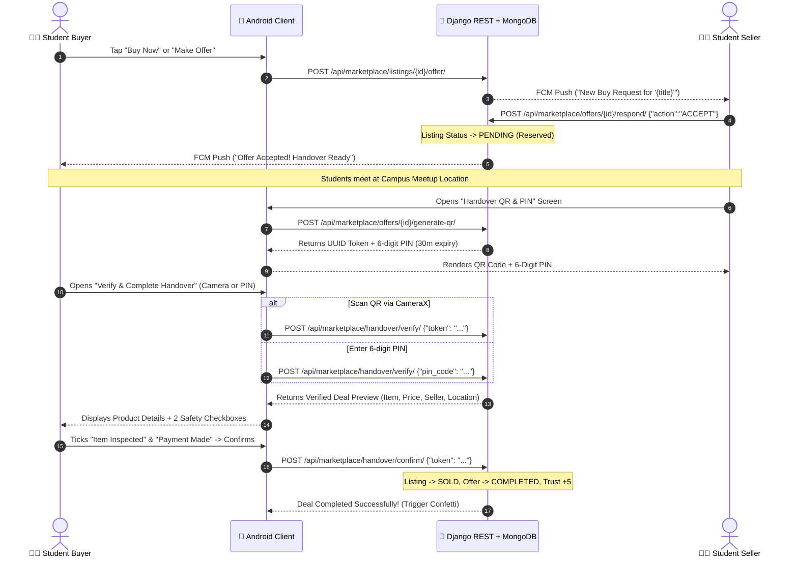

# 🤝 CampXChange — Android Offers, Purchases & QR Handover Specification (Website Parity)

> **Target Platform:** Android (Native Jetpack Compose)  
> **Web Source of Truth:** `client/src/components/handover/` (`HandoverQRModal.jsx`, `HandoverScannerModal.jsx`), `client/src/pages/ProductDetail.jsx`, `client/src/components/profile/OrdersSellsTab.jsx`  
> **Backend Service:** Django REST Framework (`/api/marketplace/offers/`, `/api/marketplace/handover/`, `/api/marketplace/my-offers/`)  
> **Tech Stack:** Kotlin, Jetpack Compose, CameraX, Google ML Kit Barcode Scanning, ZXing QR Generator, Coil, Material 3  
> **Last Updated:** October 2026

---

## 📑 Table of Contents
1. [Architecture & Web-Parity Handover Overview](#1-architecture--web-parity-handover-overview)
2. [End-to-End Deal Lifecycle & Sequence](#2-end-to-end-deal-lifecycle--sequence)
3. [REST API Contract & Endpoints](#3-rest-api-contract--endpoints)
   - [3.1 Submit & Respond to Offers](#31-submit--respond-to-offers)
   - [3.2 Generate Handover QR (Seller)](#32-generate-handover-qr-seller)
   - [3.3 Verify Handover Token / PIN (Buyer)](#33-verify-handover-token--pin-buyer)
   - [3.4 Confirm Handover Deal (Buyer)](#34-confirm-handover-deal-buyer)
   - [3.5 Fetch Buyer Purchases & Orders (`/my-offers/`)](#35-fetch-buyer-purchases--orders-my-offers)
4. [DTOs & MongoDB ObjectIds Compatibility](#4-dtos--mongodb-objectids-compatibility)
5. [Android UI & Navigation Architecture](#5-android-ui--navigation-architecture)
   - [5.1 MyPurchasesScreen (Buyer Orders Dashboard)](#51-mypurchasesscreen-buyer-orders-dashboard)
   - [5.2 ProductDetailScreen (Green Accepted Status Banner & CTA)](#52-productdetailscreen-green-accepted-status-banner--cta)
   - [5.3 SellerQRDisplayScreen (QR Code & Live 6-Digit PIN)](#53-sellerqrdisplayscreen-qr-code--live-6-digit-pin)
   - [5.4 BuyerHandoverScreen (CameraX Scanner + PIN + Dual Checklist)](#54-buyerhandoverscreen-camerax-scanner--pin--dual-checklist)
6. [Security, Safety Checklist & Anti-Fraud Measures](#6-security-safety-checklist--anti-fraud-measures)

---

## 1. Architecture & Web-Parity Handover Overview

CampXChange enforces an in-person, verified physical handover on campus to eliminate ghosting, uninspected items, and online advance payment fraud:

1. **Buyer Makes Offer:** Submitted via `POST /api/marketplace/listings/{id}/offer/`.
2. **Seller Accepts Deal:** Accepted via `POST /api/marketplace/offers/{id}/respond/` with `action="ACCEPT"`. Listing atomically moves to `PENDING` (Reserved) so other buyers cannot purchase it.
3. **Buyer Discovers Order:**
   - On the web, buyer accesses `/profile` (Orders tab) or the product page.
   - On Android, buyer accesses the **"My Purchases & Active Orders"** screen (via Profile menu or bottom nav) or opens the product detail page where a prominent **Green Accepted Status Banner** is displayed.
4. **Physical Meetup on Campus:** Both students meet at a public campus spot (e.g., Uni-Mall, Central Library, or Hostel Common Room).
5. **Seller Generates Dynamic QR & PIN:** Seller opens Handover screen (`POST /api/marketplace/offers/{id}/generate-qr/`). Displays dynamic QR code, 6-digit numeric PIN, and live countdown timer.
6. **Buyer Verifies Code:** Buyer scans QR via CameraX or inputs 6-digit PIN (`POST /api/marketplace/handover/verify/`).
7. **Inspection & Payment Checklist:** Buyer verifies deal details, inspects item condition, pays cash/UPI, and ticks both confirmation checkboxes.
8. **Final Confirmation:** Buyer taps "Confirm Final Handover & Deal" (`POST /api/marketplace/handover/confirm/`). Listing becomes `SOLD`, deal marks `COMPLETED`, and both students receive **+5 Trust Score points**.

---

## 2. End-to-End Deal Lifecycle & Sequence



---

## 3. REST API Contract & Endpoints

### 3.1 Submit & Respond to Offers
- **Make Offer:** `POST /api/marketplace/listings/{id}/offer/`
  ```json
  { "offer_amount": 1200.0, "buyer_message": "Can we meet at Central Library?" }
  ```
- **Respond to Offer (Seller Only):** `POST /api/marketplace/offers/{id}/respond/`
  ```json
  { "action": "ACCEPT" } // or "REJECT" or "COUNTER" with "counter_amount": 1300.0
  ```

### 3.2 Generate Handover QR (Seller)
- **Endpoint:** `POST /api/marketplace/offers/{id}/generate-qr/`
- **Headers:** `Authorization: Bearer <jwt_token>`
- **Response `201 Created`:**
  ```json
  {
    "id": "671249b1a2c3d4e5f6001234",
    "token": "e89c10f8-3e42-411a-96bd-58134707293a",
    "pin_code": "849201",
    "expires_at": "2026-10-18T13:30:00Z",
    "remaining_seconds": 1800,
    "status": "ACTIVE"
  }
  ```

### 3.3 Verify Handover Token / PIN (Buyer)
- **Endpoint:** `POST /api/marketplace/handover/verify/`
- **Request Body (supports either token or PIN):**
  ```json
  { "pin_code": "849201" }
  ```
  *or*
  ```json
  { "token": "e89c10f8-3e42-411a-96bd-58134707293a" }
  ```
- **Response `200 OK`:**
  ```json
  {
    "session_id": "671249b1a2c3d4e5f6001234",
    "token": "e89c10f8-3e42-411a-96bd-58134707293a",
    "listing_id": "66fd3b8a1c9e84b2a3f4e123",
    "listing_title": "Calculus Early Transcendentals - 8th Edition",
    "listing_price": "1200.00",
    "listing_image": "https://cxc.anshuman892494.online/media/listings/calc.jpg",
    "seller_name": "Rahul Verma",
    "seller_reg": "12204891",
    "meetup_location": "Central Library, Ground Floor",
    "verified": true
  }
  ```

### 3.4 Confirm Handover Deal (Buyer)
- **Endpoint:** `POST /api/marketplace/handover/confirm/`
- **Request Body:**
  ```json
  { "token": "e89c10f8-3e42-411a-96bd-58134707293a" }
  ```
- **Response `200 OK`:**
  ```json
  {
    "success": true,
    "message": "Handover confirmed! Listing marked as SOLD.",
    "trust_score_awarded": 5
  }
  ```

### 3.5 Fetch Buyer Purchases & Orders (`/my-offers/`)
- **Endpoint:** `GET /api/marketplace/my-offers/`
- **Headers:** `Authorization: Bearer <jwt_token>`
- **Returns:** List of offers submitted by the current authenticated user. Matches web's `OrdersSellsTab.jsx` order history.

---

## 4. DTOs & MongoDB ObjectIds Compatibility

```kotlin
data class VerifyHandoverResponse(
    @SerializedName("session_id") val rawSessionId: Any? = null,
    val token: String = "",
    @SerializedName("listing_id") val rawListingId: Any? = null,
    @SerializedName(value = "listing_title", alternate = ["listingTitle"]) val listingTitle: String = "",
    @SerializedName(value = "listing_price", alternate = ["listingPrice"]) val listingPrice: String = "",
    @SerializedName(value = "listing_image", alternate = ["listingImage"]) val listingImage: String? = null,
    @SerializedName(value = "seller_name", alternate = ["sellerName"]) val sellerName: String = "",
    @SerializedName(value = "meetup_location", alternate = ["meetupLocation"]) val meetupLocation: String = "",
    val verified: Boolean = false
) {
    val sessionIdString: String get() = rawSessionId?.toString() ?: ""
    val listingIdString: String get() = rawListingId?.toString() ?: ""
}
```

---

## 5. Android UI & Navigation Architecture

### 5.1 MyPurchasesScreen (Buyer Orders Dashboard)
- **Route:** `Screen.MyOrders` (`"profile/my_orders"`)
- Displays all requests/orders grouped into 4 tabs: `All`, `Handover Ready (Accepted)`, `Pending`, and `Completed`.
- Any accepted offer renders a green status badge and a prominent button: **"Scan QR / Handover"** linking directly to `Screen.HandoverBuyer`.

### 5.2 ProductDetailScreen Green Accepted Banner
- When buyer opens a product that the seller has accepted:
  - Renders a green card at the top:
    *"Your Purchase Request Was Accepted! Meet the seller on campus to inspect the item, make payment (Cash/UPI), and scan their Handover QR code or enter their 6-digit PIN."*
  - Bottom CTA button updates to: **"Deal Reserved / Handover QR"**. Clicking it directly opens `Screen.HandoverBuyer`.

### 5.3 SellerQRDisplayScreen
- Displays dynamic ZXing QR code, animated countdown timer (30 minutes), and large 6-digit PIN code.

### 5.4 BuyerHandoverScreen (Checklist)
- Has 2 tabs:
  1. **Camera QR Scan:** Integrated CameraX preview scanning seller's phone screen.
  2. **6-Digit PIN Input:** 6-digit OTP-style box.
- After code verification, displays product details + 2 mandatory safety checkboxes:
  - `[ ] I have inspected the item in person and confirmed its condition.`
  - `[ ] I have completed payment (Cash / UPI) to the seller.`
- "Confirm Final Handover & Deal" button unlocks only when both checkboxes are checked.

---

## 6. Security, Safety Checklist & Anti-Fraud Measures

1. **Transaction Isolation:** Handover confirmation executes inside a Django atomic transaction with `select_for_update()`, preventing double redemptions.
2. **Buyer-Only Execution:** Only the authenticated user matching `offer.buyer` can verify and complete the handover.
3. **Brute-Force Lockout:** After 3 consecutive failed verification attempts on an active session, the session is invalidated (`status = EXPIRED`).
4. **Physical Inspection Guarantee:** The buyer must confirm physical verification before the system marks the item as `SOLD` and transfers trust score points.
