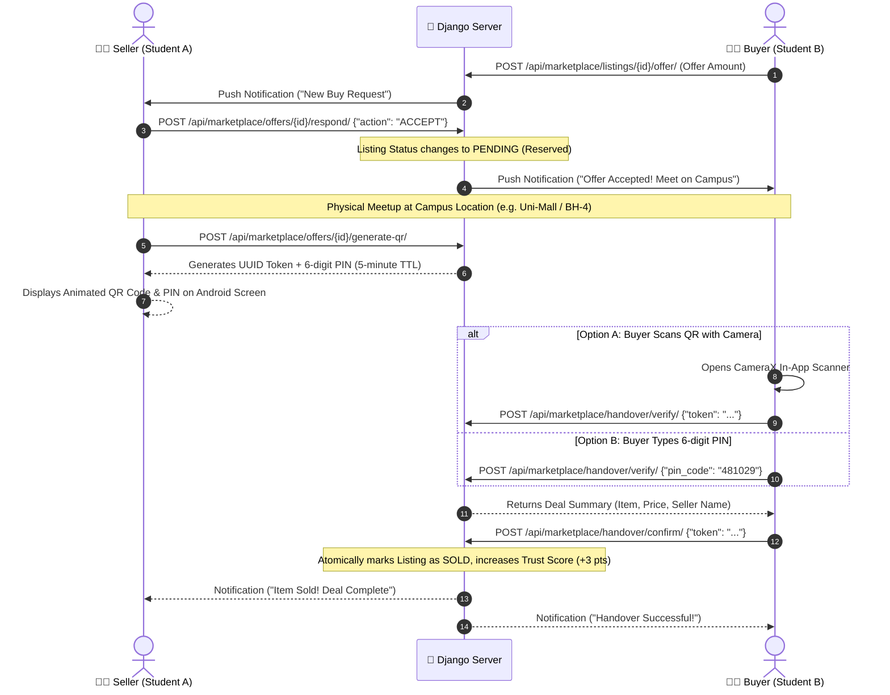

# 🤝 CampusXChange — Android Offers & QR Handover Deal Completion Specification

> **Target Platform:** Android (Native)  
> **Tech Stack:** Kotlin, Jetpack Compose, CameraX, Google ML Kit Barcode Scanning, ZXing QR Generator, Material 3, Hilt  
> **Backend Service:** Django REST Framework (`/api/marketplace/offers/`, `/api/marketplace/handover/`)  
> **Last Updated:** September 2026

---

## 📑 Table of Contents
1. [System Architecture & Deal Lifecycle](#1-system-architecture--deal-lifecycle)
2. [Complete Business & Verification Logic](#2-complete-business--verification-logic)
   - [2.1 Offer Lifecycle States](#21-offer-lifecycle-states)
   - [2.2 QR Code & 6-Digit PIN Generation](#22-qr-code--6-digit-pin-generation)
   - [2.3 Dual-Mode Handover Verification (Camera Scanner vs PIN)](#23-dual-mode-handover-verification-camera-scanner-vs-pin)
   - [2.4 Atomic Completion & Trust Score Boost](#24-atomic-completion--trust-score-boost)
3. [Color Palette & Material 3 Tokens](#3-color-palette--material-3-tokens)
4. [Navigation & Compose Routes](#4-navigation--compose-routes)
5. [Complete REST API Contract](#5-complete-rest-api-contract)
6. [Android Implementation Blueprint (Kotlin Code)](#6-android-implementation-blueprint-kotlin-code)
   - [6.1 DTOs & Retrofit Handover Service](#61-dtos--retrofit-handover-service)
   - [6.2 Handover ViewModel (Countdown Timer & Verification)](#62-handover-viewmodel-countdown-timer--verification)
   - [6.3 QR Code Generator Composable (ZXing)](#63-qr-code-generator-composable-zxing)
   - [6.4 CameraX QR Scanner Composable (Google ML Kit)](#64-camerax-qr-scanner-composable-google-ml-kit)
   - [6.5 HandoverScreens (Seller QR Display & Buyer Confirmation)](#65-handoverscreens-seller-qr-display--buyer-confirmation)
7. [Security, Anti-Fraud & Edge Case Handling](#7-security-anti-fraud--edge-case-handling)

---

## 1. System Architecture & Deal Lifecycle

CampusXChange features a **safe campus physical exchange mechanism** preventing ghosting, cash fraud, and disputed handovers.



---

## 2. Complete Business & Verification Logic

### 2.1 Offer Lifecycle States

| State | Who Triggers? | Description |
|---|---|---|
| `PENDING` | Buyer | Initial purchase request submitted. Listing remains Active. |
| `ACCEPTED`| Seller | Seller accepts the offer. Listing status changes to **PENDING (Reserved)**. Other pending offers are automatically rejected with notice. |
| `REJECTED`| Seller | Seller declines the request. |
| `COMPLETED`| Buyer (via QR) | In-person verification successful. Listing becomes **SOLD**. |
| `CANCELLED`| Either party | Cancels deal before physical meetup. Listing resets to **ACTIVE**. |

### 2.2 QR Code & 6-Digit PIN Generation
- **Validity Window:** Generated session expires in **5 minutes** (`expires_at = now + 5 min`). A live countdown timer is displayed.
- **Fail-Safe PIN:** If the buyer's camera is scratched or lighting is poor, the seller displays a prominent 6-digit numeric PIN.
- **Anti-Spam Invalidation:** Generating a new code automatically expires any prior session for that offer.

### 2.3 Dual-Mode Handover Verification
- **Camera Scanning Mode:** Integrated CameraX preview analyzing frames with Google ML Kit Barcode Scanning. Instant haptic vibration on barcode lock.
- **PIN Entry Mode:** 6-box numeric text input for manual entry.
- **Lockout Limit:** After **3 failed verification attempts**, the handover session is invalidated (`status = EXPIRED`) to prevent brute-forcing.

### 2.4 Atomic Completion & Trust Score Boost
- Handover confirmation executes inside a database transaction (`select_for_update()`).
- Prevents double-spending or simultaneous confirmations.
- Awards **+3 Trust Score points** to both buyer and seller accounts upon completion.

---

## 3. Color Palette & Material 3 Tokens

```kotlin
package com.CampusXChange.app.ui.theme

import androidx.compose.ui.graphics.Color

val HandoverPrimaryOrange = Color(0xFFFB5607)
val QrContainerBg = Color(0xFFFFFFFF)
val TimerWarningAmber = Color(0xFFF59E0B)
val SuccessCompletedGreen = Color(0xFF10B981)
val SuccessCompletedBg = Color(0xFFECFDF5)
val CancelledRed = Color(0xFFEF4444)
val PinBoxBorder = Color(0xFFE5E7EB)
val PinBoxFocused = Color(0xFFFB5607)
```

---

## 4. Navigation & Compose Routes

```kotlin
sealed class HandoverRoute(val route: String) {
    fun sellerQR(offerId: Int): String = "handover/seller_qr/$offerId"
    object BuyerScanner : HandoverRoute("handover/buyer_scanner")
    fun dealComplete(listingTitle: String): String = "handover/complete?title=$listingTitle"
}
```

---

## 5. Complete REST API Contract

> **Base URL:**
> - Production: `https://cxc.anshuman892494.online/`
> - Local Emulator: `http://10.0.2.2:8000/` (or `http://127.0.0.1:8000/` via adb reverse)
>
> **Mandatory Headers (All Calls):**
> ```http
> X-App-Security-Key: campusXchange_secure_key_2026_@nshuman892494
> Authorization: Bearer <access_token>
> Content-Type: application/json
> Accept: application/json
> ```

### 5.1 Respond to Offer (Accept / Reject)
- **URL:** `POST /api/marketplace/offers/{id}/respond/`
- **Headers:** `Authorization: Bearer <access_token>`, `X-App-Security-Key: campusXchange_secure_key_2026_@nshuman892494`, `Content-Type: application/json`

#### Request Body:
```json
{
  "action": "ACCEPT"
}
```
*(Options: `ACCEPT`, `REJECT`)*

#### Response `200 OK`:
```json
{
  "id": 55,
  "listing": 101,
  "offer_amount": "1600.00",
  "status": "ACCEPTED"
}
```

---

### 5.2 Generate Handover QR & PIN (Seller)
- **URL:** `POST /api/marketplace/offers/{id}/generate-qr/`
- **Headers:** `Authorization: Bearer <access_token>`

#### Response `201 Created`:
```json
{
  "id": 18,
  "token": "a1b2c3d4-e5f6-7a8b-9c0d-1e2f3a4b5c6d",
  "pin_code": "849201",
  "expires_at": "2026-09-06T10:05:00Z",
  "status": "ACTIVE"
}
```

---

### 5.3 Verify Handover (Buyer)
- **URL:** `POST /api/marketplace/handover/verify/`
- **Headers:** `Authorization: Bearer <access_token>`, `Content-Type: application/json`

#### Request Body (Either Token or PIN):
```json
{
  "token": "a1b2c3d4-e5f6-7a8b-9c0d-1e2f3a4b5c6d",
  "pin_code": ""
}
```

#### Response `200 OK`:
```json
{
  "session_id": 18,
  "token": "a1b2c3d4-e5f6-7a8b-9c0d-1e2f3a4b5c6d",
  "listing_id": 101,
  "listing_title": "TI-84 Plus Graphing Calculator",
  "listing_price": "1600.00",
  "listing_image": "https://res.cloudinary.com/.../calc1.jpg",
  "seller_id": 42,
  "seller_name": "Aman Sharma",
  "seller_reg": "12200000",
  "meetup_location": "BH-4 Hostel, Ground Floor Common Room",
  "verified": true
}
```

---

### 5.4 Confirm Handover (Final Completion)
- **URL:** `POST /api/marketplace/handover/confirm/`
- **Headers:** `Authorization: Bearer <access_token>`, `Content-Type: application/json`

#### Request Body:
```json
{
  "token": "a1b2c3d4-e5f6-7a8b-9c0d-1e2f3a4b5c6d"
}
```

#### Response `200 OK`:
```json
{
  "success": true,
  "message": "Handover confirmed! Item marked as SOLD.",
  "listing_id": 101,
  "trust_score_awarded": 3
}
```

---

## 6. Android Implementation Blueprint (Kotlin Code)

### 6.1 DTOs & Retrofit Handover Service

```kotlin
package com.CampusXChange.app.data.remote

import com.google.gson.annotations.SerializedName
import retrofit2.Response
import retrofit2.http.*

data class RespondOfferRequest(val action: String)

data class HandoverSessionDto(
    val id: String,
    val token: String,
    @SerializedName("pin_code") val pinCode: String,
    @SerializedName("expires_at") val expiresAt: String,
    val status: String
)

data class VerifyHandoverRequest(
    val token: String? = null,
    @SerializedName("pin_code") val pinCode: String? = null
)

data class VerifyHandoverResponse(
    @SerializedName("session_id") val sessionId: Int,
    val token: String,
    @SerializedName("listing_id") val listingId: Int,
    @SerializedName("listing_title") val listingTitle: String,
    @SerializedName("listing_price") val listingPrice: String,
    @SerializedName("listing_image") val listingImage: String?,
    @SerializedName("seller_name") val sellerName: String,
    @SerializedName("meetup_location") val meetupLocation: String,
    val verified: Boolean
)

data class ConfirmHandoverRequest(val token: String)
data class ConfirmHandoverResponse(
    val success: Boolean,
    val message: String,
    @SerializedName("trust_score_awarded") val trustScoreAwarded: Int
)

interface HandoverApiService {
    @POST("api/marketplace/offers/{id}/respond/")
    suspend fun respondOffer(
        @Path("id") offerId: Int,
        @Body request: RespondOfferRequest
    ): Response<OfferDto>

    @POST("api/marketplace/offers/{id}/generate-qr/")
    suspend fun generateHandoverQR(@Path("id") offerId: Int): Response<HandoverSessionDto>

    @POST("api/marketplace/handover/verify/")
    suspend fun verifyHandover(@Body request: VerifyHandoverRequest): Response<VerifyHandoverResponse>

    @POST("api/marketplace/handover/confirm/")
    suspend fun confirmHandover(@Body request: ConfirmHandoverRequest): Response<ConfirmHandoverResponse>
}
```

---

### 6.2 Handover ViewModel (Countdown Timer & Verification)

```kotlin
package com.CampusXChange.app.ui.handover

import androidx.lifecycle.ViewModel
import androidx.lifecycle.viewModelScope
import com.CampusXChange.app.data.remote.*
import dagger.hilt.android.lifecycle.HiltViewModel
import kotlinx.coroutines.Job
import kotlinx.coroutines.delay
import kotlinx.coroutines.flow.MutableStateFlow
import kotlinx.coroutines.flow.StateFlow
import kotlinx.coroutines.flow.asStateFlow
import kotlinx.coroutines.launch
import javax.inject.Inject

data class HandoverUiState(
    val session: HandoverSessionDto? = null,
    val remainingSeconds: Int = 300, // 5 min
    val isExpired: Boolean = false,
    val verifiedDetails: VerifyHandoverResponse? = null,
    val isVerifying: Boolean = false,
    val isConfirming: Boolean = false,
    val isCompleted: Boolean = false,
    val errorMessage: String? = null
)

@HiltViewModel
class HandoverViewModel @Inject constructor(
    private val api: HandoverApiService
) : ViewModel() {

    private val _uiState = MutableStateFlow(HandoverUiState())
    val uiState: StateFlow<HandoverUiState> = _uiState.asStateFlow()

    private var timerJob: Job? = null

    fun generateQR(offerId: Int) {
        viewModelScope.launch {
            _uiState.value = _uiState.value.copy(errorMessage = null)
            try {
                val res = api.generateHandoverQR(offerId)
                if (res.isSuccessful && res.body() != null) {
                    _uiState.value = _uiState.value.copy(session = res.body()!, remainingSeconds = 300, isExpired = false)
                    startCountdownTimer()
                } else {
                    _uiState.value = _uiState.value.copy(errorMessage = "Failed to generate QR session.")
                }
            } catch (e: Exception) {
                _uiState.value = _uiState.value.copy(errorMessage = "Network failure.")
            }
        }
    }

    private fun startCountdownTimer() {
        timerJob?.cancel()
        timerJob = viewModelScope.launch {
            while (_uiState.value.remainingSeconds > 0) {
                delay(1000)
                val newSec = _uiState.value.remainingSeconds - 1
                _uiState.value = _uiState.value.copy(
                    remainingSeconds = newSec,
                    isExpired = (newSec == 0)
                )
            }
        }
    }

    fun verifyCode(token: String? = null, pin: String? = null) {
        viewModelScope.launch {
            _uiState.value = _uiState.value.copy(isVerifying = true, errorMessage = null)
            try {
                val res = api.verifyHandover(VerifyHandoverRequest(token = token, pinCode = pin))
                if (res.isSuccessful && res.body() != null) {
                    _uiState.value = _uiState.value.copy(isVerifying = false, verifiedDetails = res.body()!)
                } else {
                    _uiState.value = _uiState.value.copy(isVerifying = false, errorMessage = "Invalid or expired QR/PIN.")
                }
            } catch (e: Exception) {
                _uiState.value = _uiState.value.copy(isVerifying = false, errorMessage = "Network error verifying code.")
            }
        }
    }

    fun confirmDeal(token: String) {
        viewModelScope.launch {
            _uiState.value = _uiState.value.copy(isConfirming = true, errorMessage = null)
            try {
                val res = api.confirmHandover(ConfirmHandoverRequest(token))
                if (res.isSuccessful && res.body()?.success == true) {
                    _uiState.value = _uiState.value.copy(isConfirming = false, isCompleted = true)
                } else {
                    _uiState.value = _uiState.value.copy(isConfirming = false, errorMessage = "Failed to complete deal.")
                }
            } catch (e: Exception) {
                _uiState.value = _uiState.value.copy(isConfirming = false, errorMessage = "Network error confirming deal.")
            }
        }
    }
}
```

---

### 6.3 QR Code Generator Composable (ZXing)

```kotlin
package com.CampusXChange.app.ui.handover.components

import android.graphics.Bitmap
import android.graphics.Color as AndroidColor
import androidx.compose.foundation.Image
import androidx.compose.foundation.background
import androidx.compose.foundation.layout.*
import androidx.compose.foundation.shape.RoundedCornerShape
import androidx.compose.runtime.Composable
import androidx.compose.runtime.remember
import androidx.compose.ui.Modifier
import androidx.compose.ui.graphics.Color
import androidx.compose.ui.graphics.asImageBitmap
import androidx.compose.ui.unit.dp
import com.google.zxing.BarcodeFormat
import com.google.zxing.qrcode.QRCodeWriter

@Composable
fun QRCodeDisplay(
    content: String,
    modifier: Modifier = Modifier,
    sizePx: Int = 512
) {
    val bitmap = remember(content) {
        generateQrBitmap(content, sizePx)
    }

    bitmap?.let {
        Box(
            modifier = modifier
                .background(Color.White, RoundedCornerShape(12.dp))
                .padding(16.dp)
        ) {
            Image(
                bitmap = it.asImageBitmap(),
                contentDescription = "Handover QR Code",
                modifier = Modifier.fillMaxSize()
            )
        }
    }
}

fun generateQrBitmap(content: String, size: Int): Bitmap? {
    return try {
        val writer = QRCodeWriter()
        val bitMatrix = writer.encode(content, BarcodeFormat.QR_CODE, size, size)
        val bmp = Bitmap.createBitmap(size, size, Bitmap.Config.RGB_565)
        for (x in 0 until size) {
            for (y in 0 until size) {
                bmp.setPixel(x, y, if (bitMatrix[x, y]) AndroidColor.BLACK else AndroidColor.WHITE)
            }
        }
        bmp
    } catch (e: Exception) {
        null
    }
}
```

---

### 6.4 CameraX QR Scanner Composable (Google ML Kit)

```kotlin
package com.CampusXChange.app.ui.handover.components

import android.annotation.SuppressLint
import androidx.camera.core.*
import androidx.camera.lifecycle.ProcessCameraProvider
import androidx.camera.view.PreviewView
import androidx.compose.foundation.layout.fillMaxSize
import androidx.compose.runtime.*
import androidx.compose.ui.Modifier
import androidx.compose.ui.platform.LocalContext
import androidx.compose.ui.platform.LocalLifecycleOwner
import androidx.compose.ui.viewinterop.AndroidView
import androidx.core.content.ContextCompat
import com.google.mlkit.vision.barcode.BarcodeScanning
import com.google.mlkit.vision.common.InputImage

@SuppressLint("UnsafeOptInUsageError")
@Composable
fun CameraXQrScanner(
    onQrScanned: (String) -> Unit,
    modifier: Modifier = Modifier
) {
    val context = LocalContext.current
    val lifecycleOwner = LocalLifecycleOwner.current
    var hasScanned by remember { mutableStateOf(false) }

    AndroidView(
        factory = { ctx ->
            val previewView = PreviewView(ctx)
            val cameraProviderFuture = ProcessCameraProvider.getInstance(ctx)

            cameraProviderFuture.addListener({
                val cameraProvider = cameraProviderFuture.get()
                val preview = Preview.Builder().build().also {
                    it.setSurfaceProvider(previewView.surfaceProvider)
                }

                val scanner = BarcodeScanning.getClient()
                val analysis = ImageAnalysis.Builder()
                    .setBackpressureStrategy(ImageAnalysis.STRATEGY_KEEP_ONLY_LATEST)
                    .build()

                analysis.setAnalyzer(ContextCompat.getMainExecutor(ctx)) { imageProxy ->
                    val mediaImage = imageProxy.image
                    if (mediaImage != null && !hasScanned) {
                        val img = InputImage.fromMediaImage(mediaImage, imageProxy.imageInfo.rotationDegrees)
                        scanner.process(img)
                            .addOnSuccessListener { barcodes ->
                                for (barcode in barcodes) {
                                    barcode.rawValue?.let { raw ->
                                        hasScanned = true
                                        onQrScanned(raw)
                                        break
                                    }
                                }
                            }
                            .addOnCompleteListener {
                                imageProxy.close()
                            }
                    } else {
                        imageProxy.close()
                    }
                }

                try {
                    cameraProvider.unbindAll()
                    cameraProvider.bindToLifecycle(
                        lifecycleOwner,
                        CameraSelector.DEFAULT_BACK_CAMERA,
                        preview,
                        analysis
                    )
                } catch (e: Exception) {
                    e.printStackTrace()
                }
            }, ContextCompat.getMainExecutor(ctx))

            previewView
        },
        modifier = modifier.fillMaxSize()
    )
}
```

---

### 6.5 HandoverScreens (Seller QR Display & Buyer Confirmation)

#### Seller QR Display Screen
```kotlin
package com.CampusXChange.app.ui.handover

import androidx.compose.foundation.background
import androidx.compose.foundation.layout.*
import androidx.compose.foundation.shape.RoundedCornerShape
import androidx.compose.material3.*
import androidx.compose.runtime.*
import androidx.compose.ui.Alignment
import androidx.compose.ui.Modifier
import androidx.compose.ui.graphics.Color
import androidx.compose.ui.text.font.FontWeight
import androidx.compose.ui.unit.dp
import androidx.compose.ui.unit.sp
import com.CampusXChange.app.ui.handover.components.QRCodeDisplay
import com.CampusXChange.app.ui.theme.*

@Composable
fun SellerQRDisplayScreen(
    offerId: Int,
    viewModel: HandoverViewModel,
    onDealFinished: () -> Unit
) {
    val state by viewModel.uiState.collectAsState()

    LaunchedEffect(Unit) {
        viewModel.generateQR(offerId)
    }

    Column(
        modifier = Modifier
            .fillMaxSize()
            .background(Color(0xFFFCFBF8))
            .padding(24.dp),
        horizontalAlignment = Alignment.CenterHorizontally,
        verticalArrangement = Arrangement.Center
    ) {
        Text("Handover Verification", fontSize = 22.sp, fontWeight = FontWeight.Bold)
        Text(
            "Ask the buyer to scan this QR code or enter the PIN to complete the sale.",
            fontSize = 13.sp,
            color = Color(0xFF6B7280),
            modifier = Modifier.padding(top = 4.dp, bottom = 24.dp)
        )

        state.session?.let { session ->
            // QR Code Box
            QRCodeDisplay(
                content = session.token,
                modifier = Modifier.size(240.dp)
            )

            Spacer(modifier = Modifier.height(16.dp))

            // 6-Digit PIN Code Box
            Text("OR BACKUP PIN CODE", fontSize = 11.sp, fontWeight = FontWeight.Black, color = Color(0xFF9CA3AF))
            Surface(
                shape = RoundedCornerShape(8.dp),
                color = Color.White,
                border = androidx.compose.foundation.BorderStroke(1.dp, HandoverPrimaryOrange),
                modifier = Modifier.padding(vertical = 8.dp)
            ) {
                Text(
                    text = session.pinCode,
                    fontSize = 28.sp,
                    fontWeight = FontWeight.Black,
                    letterSpacing = 6.sp,
                    color = Color(0xFF111111),
                    modifier = Modifier.padding(horizontal = 24.dp, vertical = 8.dp)
                )
            }

            // Countdown Timer
            val minutes = state.remainingSeconds / 60
            val seconds = state.remainingSeconds % 60
            Text(
                text = "Expires in: %02d:%02d".format(minutes, seconds),
                fontWeight = FontWeight.Bold,
                color = if (state.remainingSeconds < 60) Color.Red else TimerWarningAmber,
                fontSize = 14.sp
            )

            if (state.isExpired) {
                Spacer(modifier = Modifier.height(16.dp))
                Button(
                    onClick = { viewModel.generateQR(offerId) },
                    colors = ButtonDefaults.buttonColors(containerColor = HandoverPrimaryOrange)
                ) {
                    Text("Generate New Code", fontWeight = FontWeight.Bold)
                }
            }
        } ?: run {
            CircularProgressIndicator(color = HandoverPrimaryOrange)
        }
    }
}
```

---

## 7. Security, Anti-Fraud & Edge Case Handling

- **Camera Permission Fallback:** If camera permission is denied by the buyer, the UI automatically falls back to manual 6-digit PIN entry with zero friction.
- **Mutual Verification Gate:** The deal cannot complete until the physical QR is scanned or PIN submitted.
- **Haptic Feedback:** The Android device vibrates (`VibrationEffect.createOneShot(100, 255)`) immediately upon valid QR recognition.
