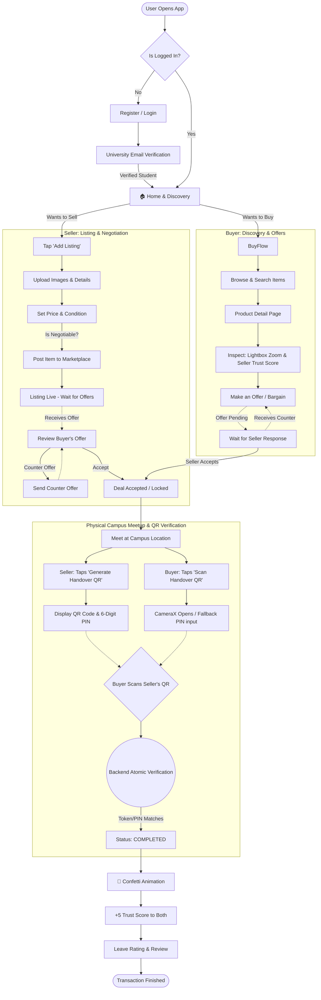

# 🎓 CampXChange (CXC) Complete Workflow Diagram & Documentation

This document explains the complete end-to-end flow of the **CampXChange (CXC)** Marketplace. It covers everything from user onboarding to the final product handover using the QR verification system.

---

## 🏗️ 1. Complete System Flow Diagram

Below is the complete state machine and user flow for the CXC Application:

---

## 📝 2. Detailed Step-by-Step Flow Explanation

### Phase 1: Onboarding & Authentication
1. **Registration:** Users register using standard methods (Google Auth or Email/Password).
2. **University Verification:** To ensure safety, students must verify their university email. Once verified, they get a **"Verified Student"** badge.
3. **DPDP Compliance:** User names are masked (e.g., `Rohan S.`) to protect privacy, and raw contact numbers are never exposed.

### Phase 2: Selling a Product (Seller Flow)
1. **Create Listing:** The seller takes pictures, adds a title, description, category, and sets the item condition.
2. **Pricing & Negotiation:** The seller sets an asking price and marks a toggle: `Is Negotiable` or `Firm Price`.
3. **Publish:** The item goes live on the marketplace. The seller's "Trust Score" and completed deals are displayed on the product card to build trust.

### Phase 3: Buying a Product (Buyer Flow)
1. **Discovery:** The buyer searches for items using filters (price, category, condition).
2. **Product Detail Page (PDP):** The buyer inspects the item. They can tap images to open the **Fullscreen Pinch-to-Zoom Lightbox** to see fine details.
3. **Offer Engine:** 
   - Instead of standard "Add to Cart", CXC uses a bargaining engine.
   - The buyer taps **"Make an Offer"**, enters a price (e.g., ₹500 for a ₹600 item), and can leave an optional note (e.g., *"Can meet at BH-4 today"*).

### Phase 4: Negotiation & Chat (State Machine)
1. The listing goes into a **`PENDING`** state.
2. The seller gets a push notification and can either **ACCEPT**, **REJECT**, or **COUNTER**.
3. If they counter, the buyer gets notified. This loops until both parties agree.
4. Once agreed, the state changes to **`ACCEPTED / DEAL LOCKED`**.

### Phase 5: The Physical Handover (QR Verification)
Because CXC is a campus-based marketplace, delivery happens physically. The app prevents fraud (like a buyer taking the item but claiming they didn't get it) using this verification system:
1. **Meetup:** Buyer and seller meet at a physical campus location.
2. **Seller's Screen:** The seller opens the accepted order and taps **"Generate Handover QR"**. The app generates a highly secure ZXing Vector QR Code and a 6-digit PIN (which expires in 15 minutes).
3. **Buyer's Screen:** The buyer taps **"Scan Handover QR"**, which opens a CameraX barcode scanner.
4. **The Scan:** The buyer scans the seller's screen. If the camera fails, they can manually enter the 6-digit PIN shown on the seller's phone.
5. **Atomic Verification:** The backend verifies the tokens. 
6. **Completion:** The listing status instantly changes from `PENDING` to `SOLD`. Both screens show a 🎉 Confetti Celebration.
7. **Trust Score:** Both the buyer and seller are awarded **+5 Trust Score Points** for a successful transaction, and are prompted to leave a review for each other.
