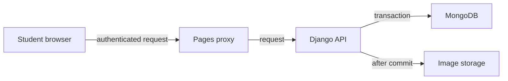

# Account deletion: focused security review

Scope: self-service account deletion and related browser session handling. This is
not a full security audit. The production path is the React profile through the
Cloudflare Pages proxy to the Django API and MongoDB Atlas/GridFS.

- A logged-in attacker must not delete another account. The endpoint identifies
  the subject from the authenticated request, checks the account password and
  requires an explicit confirmation; it ignores client-supplied account IDs.
- A stale access or refresh token must not revive a deleted account. API tests
  check rejection after deletion, and the client clears its session. The client
  also prevents a delayed retry or refresh from being replayed as a different
  account after a logout or account switch.
- A failed database operation must not leave an account partially deleted or
  remove its images prematurely. The MongoDB-specific transaction and post-commit
  cleanup are exercised with injected failures against a local replica set.
- Image storage is independent of the database transaction. Shared images are
  retained and incomplete cleanup is reported to the user. Provider failures and
  service interruptions remain possible; this is not a guarantee of complete
  erasure from external providers or backups.

Verification is limited to local isolated fixtures and the deployed checks noted
elsewhere. It does not establish that every unrelated application feature or
dependency is secure.
