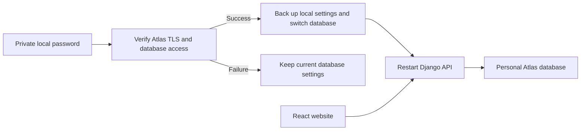

# Personal MongoDB Atlas setup

Atlas hosts MongoDB. Django still runs the API and React still runs the website.
Changing a local database setting does not deploy either application or change another repository.

## Connect safely

Use a separate Atlas project and cluster for this personal application. Give its database user
`readWrite` access only to the application's database and restrict it to that cluster.
Allow the development computer's current public IP, rather than all IP addresses.

Keep credentials in the ignored `server/.env`, never in React's `VITE_` variables or Git.
The connection helper reads `ATLAS_DATABASE_PASSWORD` from that file. It checks TLS,
authentication and database read access before updating `MONGODB_URI` and `MONGODB_NAME`.
Passwords with special characters are URL encoded automatically. The previous local
configuration is retained in an ignored `.env.before-atlas-*` file.

From the repository root, using the existing Windows virtual environment:

```powershell
.\venv\Scripts\python.exe server\configure_atlas.py --host YOUR_CLUSTER.mongodb.net --username YOUR_DATABASE_USER --database django_marketplace
```

Use the full SRV hostname shown by Atlas's Connect screen. The hostname above is a placeholder.
An empty password or failed connection leaves the current database settings unchanged.
Do not pass passwords on the command line.



After a successful connection, restart Django. For a new, empty database:

```powershell
cd server
..\venv\Scripts\python.exe manage.py migrate
..\venv\Scripts\python.exe seed_database.py
..\venv\Scripts\python.exe manage.py runserver 127.0.0.1:8000
```

The seed creates categories and platform settings, not product listings. Existing local
users, products and uploaded image files are not copied by changing the connection.
Plan a separate backup and data transfer before moving existing data.

## Check the result

Open `http://127.0.0.1:8000/api/health/`. A working database returns HTTP 200 and
`database: healthy`; a failed database check returns HTTP 503 and `database: unhealthy`.
The health endpoint sends a fresh MongoDB ping each time. `/api/ping/` only checks
that the API process responds and is not evidence of database connectivity.

If connection fails, check the database password, database permissions, current IP entry,
cluster status, DNS and network access. Keep certificate verification enabled.
If the public IP changes, update the personal Atlas project's access list.

## Verification commands

These tests use mocks and do not write to an Atlas application database:

```powershell
cd server
..\venv\Scripts\python.exe -m unittest test_configure_atlas
..\venv\Scripts\python.exe manage.py test server.test_health server.test_security
```
