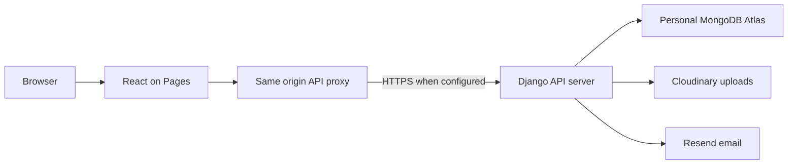

# Cloudflare Pages deployment

Status on 12 November 2026: **frontend deployment only; full-stack acceptance is blocked**.

| Interface | Public address |
| --- | --- |
| Buyer and seller client | https://django-marketplace-aikansh.pages.dev |
| Admin portal | https://django-marketplace-aikansh-admin.pages.dev |

Both are separate Direct Upload Pages projects in the personal Cloudflare account.
The source remains React JavaScript/JSX and Django with MongoDB. Only the personal
`Aikansh-Official/django_marketplace` repository is updated.

## Responsibilities and request flow

`scripts/build_pages.mjs` builds either existing Vite app with `VITE_API_BASE_URL=/api`,
then adds `deploy/cloudflare/pages-worker.js`, `_routes.json` and security headers to
the generated `dist` directory. Generated files and upload ZIPs are not committed.

The Worker handles only `/api` and `/media`. It forwards requests to the fixed HTTPS
`BACKEND_ORIGIN` configured in each Pages project's runtime settings. All other paths
use Pages static hosting, including React's single-page navigation. Authenticated API
responses and media are marked `no-store`. Tokens and cookies remain subject to
Django's existing authentication, authorization and CSRF checks.



The proxy is deployed, but `BACKEND_ORIGIN` is currently unset. API routes return
HTTP 503 JSON explaining that the service is not connected. The website does not
substitute invented listings, user accounts, authentication or successful transactions.

## Rebuild and publish

Install each application's dependencies with `npm ci` in its directory when needed.
From the repository root:

```powershell
node scripts/build_pages.mjs client
node scripts/build_pages.mjs admin
node --test deploy/cloudflare/pages-worker.test.mjs
```

Upload the contents of `client/dist` and `admin/dist` to their respective Pages projects.
Keep `_worker.js` and `_routes.json` in the upload. Future deployments are manual:
these projects are not connected to GitHub automatic deployment.

## Backend prerequisites still outstanding

A free Render service form was prepared for the personal repository, but no new
backend service was deployed. Use the Python 3 runtime with a supported Python
version at least 3.12 (the local environment tested here uses 3.14.6), branch `main`,
root directory `server`, and the Free compute plan.

Build command:

```sh
pip install -r requirements.txt && python manage.py collectstatic --noinput
```

Start command:

```sh
python manage.py migrate --noinput && gunicorn server.wsgi:application --bind 0.0.0.0:$PORT --workers 1 --threads 4 --timeout 120 --access-logfile - --error-logfile -
```

Configure server secrets only in the backend host's private environment settings:
`SECRET_KEY`, `MONGODB_URI`, `MONGODB_NAME`, `CLOUDINARY_CLOUD_NAME`,
`CLOUDINARY_API_KEY`, `CLOUDINARY_API_SECRET`, `RESEND_API_KEY` and `RESEND_FROM_EMAIL`.
Set `DEBUG=False`, exact `ALLOWED_HOSTS`, `FRONTEND_URL` to the client address, and
`CORS_ALLOWED_ORIGINS` / `CSRF_TRUSTED_ORIGINS` to the two exact Pages origins above.
Keep HTTPS and secure cookies enabled. Google sign-in, push notifications and AI ID
verification additionally require their existing Firebase/Google provider settings.
These optional providers are not replaced with fake successful verification.

The personal Atlas cluster `django-marketplace` exists. Its application database is
intended to be `django_marketplace`. The password input is still empty in the local
configuration. See [Atlas setup](ATLAS_SETUP.md) for connection verification. The
backend host's outbound IP ranges also need scoped Atlas access; the current local
computer IP entry alone does not authorize a hosted server.

Once Django and Atlas are connected, configure each Pages project's `BACKEND_ORIGIN`
to the exact backend HTTPS origin, then redeploy. Do not put database credentials
in Pages or any `VITE_` variable. Verify database health before seeding the empty
database with `python seed_database.py`. This does not copy local products or images.

## Acceptance checks

| Check | Observed result |
| --- | --- |
| Client and admin production builds | Passed |
| Proxy unit tests | 4 passed |
| Client root and direct About route | Loaded in Chrome |
| Client Retry | Remained usable and displayed the unavailable state |
| Client Google sign-in without Firebase | Displayed a clear unavailable message |
| Unauthenticated seller route | Returned to home with the sign-in window |
| Admin root | Redirected to sign-in |
| Admin login connectivity probe | Displayed backend-not-connected error; no access granted |
| Client and admin narrow layout | DOM width 390 with no horizontal overflow; admin visually inspected |
| Hosted health route | Returned the proxy's not-connected JSON in Chrome |
| Command-line external HTTP probe | Returned 403 before reaching the app; not accepted as functional proof |
| Database health, persistence and role journeys | Blocked; not verified |

The requested accounts have **not been created**. After the database works, provision
the admin display name **Aikansh**, buyer **Test Buyer**, and seller **Test Seller**
with separate strong passwords. Buyer/seller registration usernames must be distinct
eight-digit numbers because the current client login requires registration numbers.
Keep their credentials private and label any example listings as test data.

Before accepting the full-stack deployment, test real admin sign-in and moderation;
seller sign-in, image upload, listing creation/editing and handover; buyer sign-in,
search, offers/chat and handover; and negative cases preventing buyers from accessing
admin features or modifying a seller's listing. Recheck persistence after an API
restart. None of those successful end-to-end flows is claimed in this deployment.

Cloudflare's [Direct Upload documentation](https://developers.cloudflare.com/pages/get-started/direct-upload/)
supports `_worker.js` uploads. Render's [free-service documentation](https://render.com/docs/free)
describes inactivity spin-down and free-instance limitations. A free API instance can
have a slow first request after sleeping; it has no persistent disk for uploaded files.
