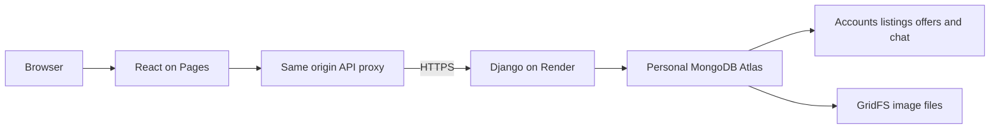

# Cloudflare Pages deployment

Status on 13 November 2026: **the hosted Django API, personal Atlas database and both
Pages interfaces are connected. The live API acceptance run passed 76 of 76 checks.**
Admin, buyer and seller browser acceptance passed. A post-deployment read-only
comparison passed 22 of 22 checks, including persisted records and identical image
bytes. The lightweight heartbeat is deployed and its first automatic success is verified.

| Component | Public address |
| --- | --- |
| Buyer and seller client | https://django-marketplace-aikansh.pages.dev |
| Admin portal | https://django-marketplace-aikansh-admin.pages.dev |
| Django API | https://django-marketplace-aikansh-api.onrender.com |
| Database health | https://django-marketplace-aikansh-api.onrender.com/api/health/ |

The frontends are separate Direct Upload Pages projects in the personal Cloudflare
account. Django runs on the Free Render service `srv-dbqsca0u01pc73d7ej0g`. The stack
remains React JavaScript/JSX, Django and MongoDB. Source changes are limited to the
personal `Aikansh-Official/django_marketplace` repository.

## Responsibilities and request flow

`scripts/build_pages.mjs` builds either existing Vite app with `VITE_API_BASE_URL=/api`,
then adds `deploy/cloudflare/pages-worker.js`, `_routes.json` and security headers to
the generated `dist` directory. Generated files and upload ZIPs are not committed.

The Worker handles only `/api` and `/media`. Both Pages projects have runtime
`BACKEND_ORIGIN=https://django-marketplace-aikansh-api.onrender.com` and have been
redeployed to production. Other routes use Pages static hosting and React navigation.
The proxy preserves the browser Origin and forwards requests to the fixed HTTPS API
origin. Authenticated API/media responses are marked `no-store`. Django enforces
authentication, active sessions, roles, CSRF and image-access checks.



The personal Atlas cluster is `django-marketplace`; its application database is
`django_marketplace`. The hosted API has authenticated successfully and reports a
healthy database. Backend credentials remain private; they are not stored in Pages,
frontend `VITE_` variables or source control.

## Durable image storage

Render is configured with `MEDIA_STORAGE_BACKEND=mongodb`. The existing application
database stores normalized WebP image files in MongoDB GridFS, using the
`campxchange_media.files` and `campxchange_media.chunks` collections. The implementation
is in `server/marketplace/mongodb_media.py`; existing upload helpers select it through
`mongodb_media_enabled()`.

References such as `/media/mongodb/<random-id>.webp` are not public download endpoints.
The application serves images through its signed `/api/media/secure-image/` gateway,
including authorization checks for private documents. Upload normalization and the
5 MB image limit remain enforced. The live API run verified a seller upload and
retrieval of the resulting raster image.

Cloudinary remains an optional alternative provider. It is not required for this
deployment's photos, and ephemeral Render filesystem storage is not the selected
media backend. Storage survives independently of the API process because its bytes
are in Atlas. A post-deployment restart comparison verified the same image IDs and
SHA-256 byte hashes, alongside the ACTIVE/SOLD listing records.

## Rebuild and publish

Install each application's dependencies with `npm ci` in its directory when needed.
From the repository root:

```powershell
node scripts/build_pages.mjs client
node scripts/build_pages.mjs admin
node --test deploy/cloudflare/pages-worker.test.mjs
```

Upload the contents of `client/dist` and `admin/dist` to their respective Pages projects,
including `_worker.js` and `_routes.json`. Pages deployments are manual; these projects
are not connected to GitHub automatic deployment. Retain the configured runtime
`BACKEND_ORIGIN` when publishing another version.

The backend uses branch `main`, root directory `server` and the Python 3 runtime.
Its Python dependencies require Python 3.12 or later. The startup commands are:

```sh
# Build
pip install -r requirements.txt && python manage.py collectstatic --noinput

# Start
python manage.py migrate --noinput && gunicorn server.wsgi:application --bind 0.0.0.0:$PORT --workers 1 --threads 4 --timeout 120 --access-logfile - --error-logfile -
```

Keep `SECRET_KEY`, `MONGODB_URI` and `MONGODB_NAME` in the backend host's private
environment settings. Keep `DEBUG=False`, exact `ALLOWED_HOSTS`, the client
`FRONTEND_URL`, and both exact Pages origins in `CORS_ALLOWED_ORIGINS` /
`CSRF_TRUSTED_ORIGINS`. Retain HTTPS, secure cookies, `MEDIA_STORAGE_BACKEND=mongodb`,
the scoped Atlas database user and the required hosted-server network access.
See [Atlas setup](ATLAS_SETUP.md) for connection-helper behavior. Do not reseed an
existing populated database as a substitute for a migration or backup.

## Example accounts and data

The three requested accounts have been provisioned in the personal database:

| Username | Display name | Access |
| --- | --- | --- |
| `aikansh` | Aikansh | Super admin |
| `12300001` | Test Buyer | Buyer; no staff access |
| `12300002` | Test Seller | Seller; no staff access |

Their separate generated passwords are stored only in the private local file:

`C:\Users\Aikan\.codex\private-backups\django-marketplace\deployment-test-accounts.json`

No password is included in this document. The seller's `id_card_data` explicitly
records synthetic test-fixture provenance; this is not a claim that a real student
identity was verified. Real signup and verification endpoints were not weakened.
The provisioning helper refuses to reset or promote an existing matching account.

The API acceptance run retained labelled TEST listings, a chat message, an offer and
a completed handover. One example listing remained ACTIVE with an image, and the
completed trade listing was SOLD. These are demonstration records, not real sales
or evidence that money changed hands.

## Verification evidence

| Check | Observed result |
| --- | --- |
| Client and admin production builds | Passed |
| Pages proxy unit tests | 4 passed in the recorded local run |
| Test-account provisioning unit tests | 7 passed in the recorded local run |
| Storage and security regression tests | 26 passed, including nine real isolated local GridFS checks |
| Lightweight heartbeat/readiness tests | 19 passed |
| Read-only recovery tests | 6 passed; both frontend production builds passed |
| Hosted backend and database health | HTTP 200; database reported healthy |
| Live API acceptance | 76 of 76 checks passed against Render using the client Pages Origin |
| Admin, buyer and seller login | All three passed with cookie and bearer session checks |
| Admin authorization | Admin dashboard accepted; buyer/seller access rejected |
| Seller upload and listing creation | Image upload/retrieval and two labelled TEST listings passed |
| Buyer authorization | Listing creation and modification of the seller's listing rejected |
| Chat and offer | Buyer message persisted and reached seller; offer persisted and was accepted |
| Handover | Seller PIN generation, buyer verification and completion passed; replay rejected |
| Handover privacy | Buyer could not generate or read the seller secret through ordinary metadata |
| Final API records | Completed listing SOLD; retained listing ACTIVE with images |
| Admin browser acceptance | Aikansh signed in; dashboard showed one active and one sold listing |
| Buyer browser acceptance | Signed in as Test Buyer; opened the example product and loaded its stored image |
| Seller browser acceptance | Signed in as Test Seller; listing form loaded categories, quota and all publishing fields |
| Persistence after API deployment/restart | 22 of 22 comparisons passed; prior record/image IDs and image bytes preserved |
| Automatic browser recovery | Temporary listing request blocked only in the test browser, restored, then recovered to HTTP 200 without pressing Retry |
| Live heartbeat | `/api/ready/` returned ready true, enabled true and a non-null automatic success timestamp |

The detailed API evidence is the local artifact
`output/deployment-tests/smoke-20261112-140720-606950.json`. It contains results and
test-record identifiers, not account passwords. That run exercised the live Render
API with the Pages Origin; it does not by itself prove every browser-to-Pages flow.
Earlier frontend-only unavailable-state checks are historical and are superseded by
the connected backend results above.

## Remaining limits

- New signup/password-reset email delivery still requires Resend configuration.
  The three provisioned accounts use password sign-in; no external email delivery
  or public signup completion is claimed by these tests.
- Google sign-in, push notifications and AI ID verification still require their
  existing Firebase/Google provider credentials. Missing providers must remain visibly
  unavailable. In-app notifications and the tested chat/offer flows use real database
  records independently of optional push delivery.
- Render Free can sleep after inactivity. A matching DSA-style internal heartbeat now
  runs after 60 seconds, then every five minutes; it is best effort, not a permanent
  uptime guarantee. See [availability behavior](AVAILABILITY.md). The selected
  instance has 512 MB RAM and no persistent disk. API/photo persistence relies on Atlas,
  not on that disk.
- The Atlas Free cluster has a 512 MB storage allowance shared by application records,
  indexes and GridFS images. Monitor usage and remove only authorized disposable test
  data; the free allowance is not unlimited image hosting.
- No concurrency/load or payment processing claim is made. Sequential handover replay
  rejection passed, but concurrent transaction atomicity was not evaluated in this run.

## Availability incident on 13 November 2026

The first Pages health request returned 502 after the backend had been idle. A direct
Render health request then took 54.85 seconds and returned HTTP 200 with a healthy
database; subsequent warm ping/health requests took under one second. This was a free
server cold start. Read-only comparison checks passed 22 of 22 and confirmed the same
listing identifiers, statuses and image hashes as the original acceptance snapshot.
The open in-app browser subsequently displayed the retained test product.

Evidence: `output/deployment-tests/smoke-20261112-193148-579565.json` (UTC timestamp;
the local India date was 13 November). The internal heartbeat and bounded read-only
request recovery are now deployed. The first automatic heartbeat succeeded at
`2026-11-12T19:39:45.304435+00:00` (13 November in India). Its readiness probe does not
query MongoDB or modify accounts. Post-deployment evidence is
`output/deployment-tests/smoke-20261112-193950-483254.json` and
`output/deployment-tests/heartbeat-ready-after-deploy.json`.

The browser recovery check temporarily blocked only its own listing GET request,
observed the failure, restored normal networking, and verified the automatic retry
returned 200 and displayed the product. No production outage was induced. The
temporary browser block was removed. No permanent-uptime guarantee is made.

Cloudflare's [Direct Upload documentation](https://developers.cloudflare.com/pages/get-started/direct-upload/)
describes `_worker.js` uploads. Render's [free-service documentation](https://render.com/docs/free)
describes inactivity spin-down and free-instance limitations.
