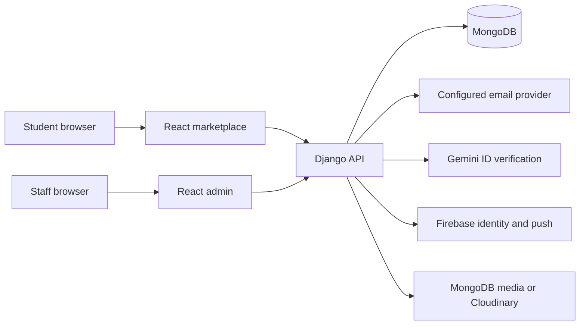
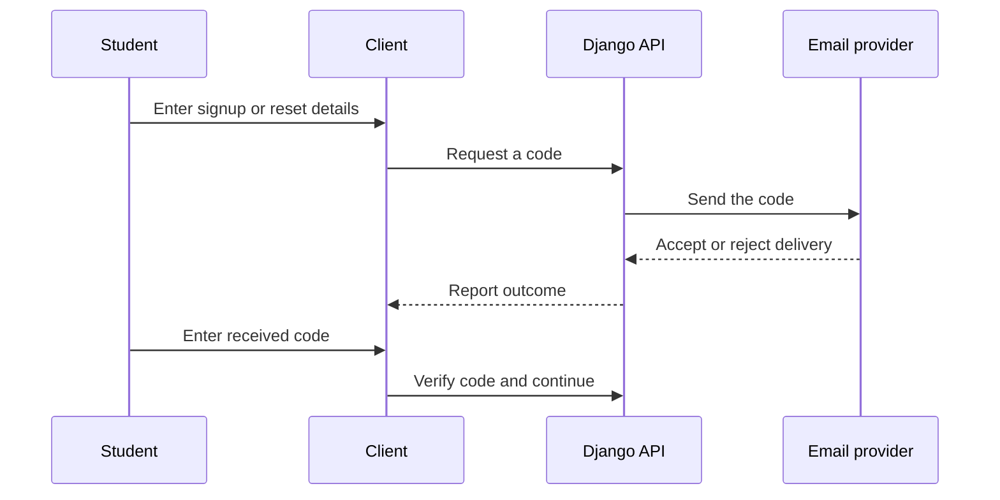
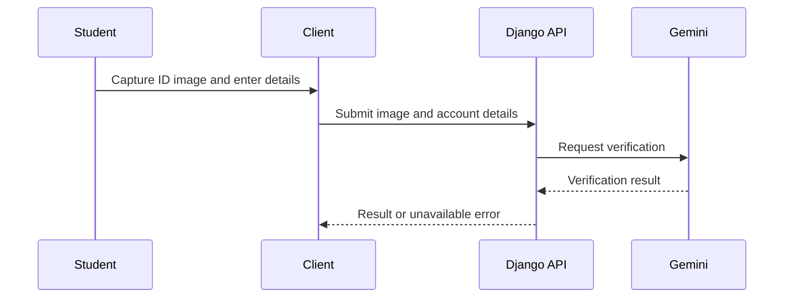
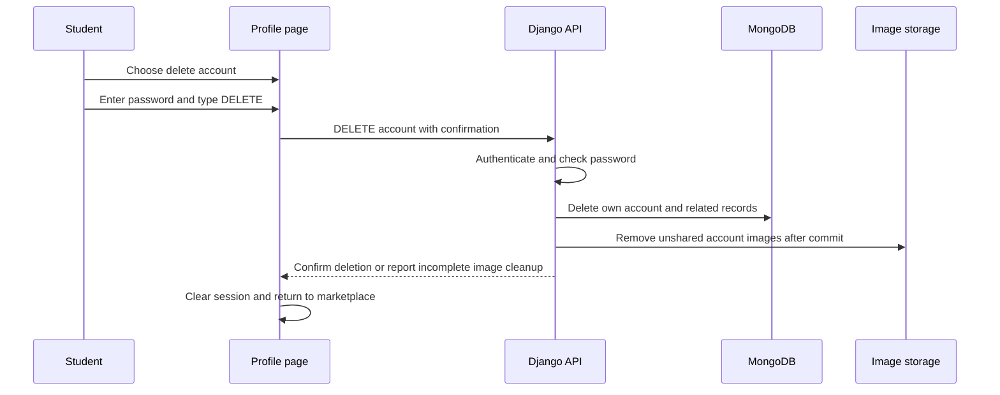

# Main flows

For signup, the client submits the verified code again with the final registration
request. The API checks that the same code is still valid and unlocked, then consumes
its record once before creating the account. A resend replaces the previous code.
An email provider accepting a request does not guarantee inbox delivery. Password
reset has a separate code and flow.

Actual access and persistence also depend on server-side validation and the chosen
provider's configuration. See [personal setup](PERSONAL_SETUP.md).

An authenticated buyer can upgrade the same account by submitting an ID card.
The server checks the card against the account's registration number and name and
checks the university through the configured verification service. The upgrade
does not request a new password, selfie or fresh email code. It preserves the
existing profile photo; initial seller signup remains a separate flow.

The removal includes the user's listings, saved items, messages and offers,
including conversations and offers involving other users. A wrong password or
missing confirmation leaves the account intact. Stored image cleanup runs after
the database commit and may require support if it cannot complete.
