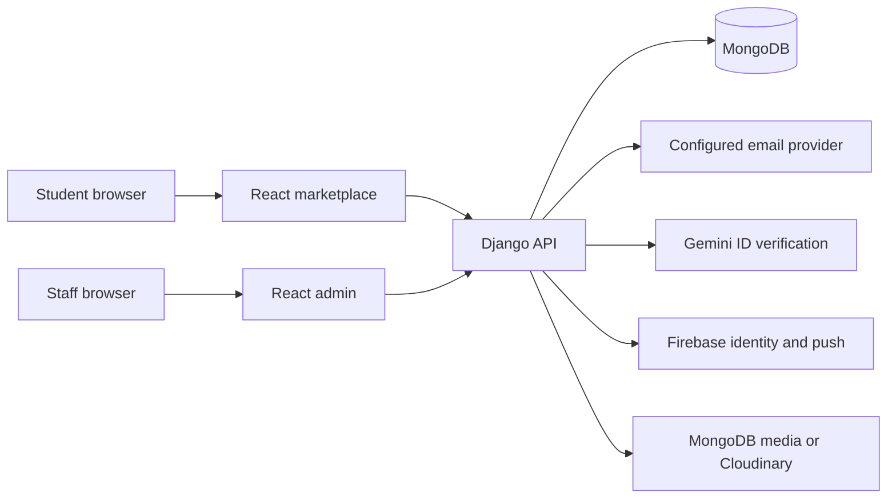
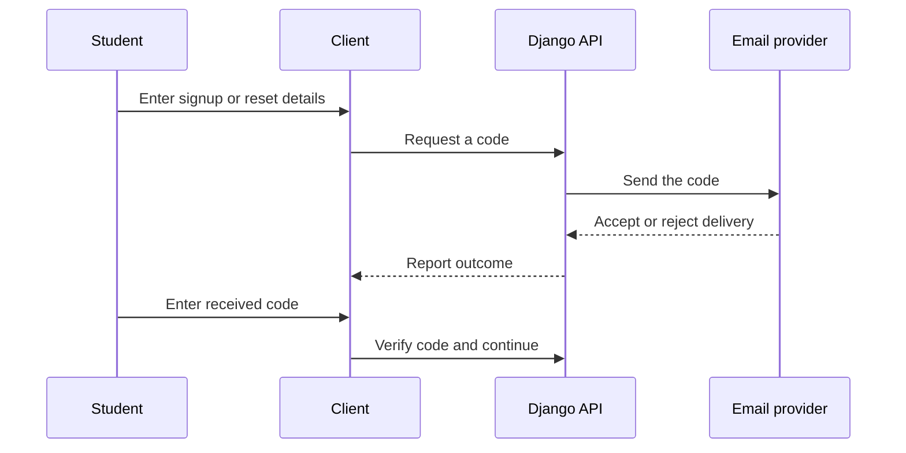
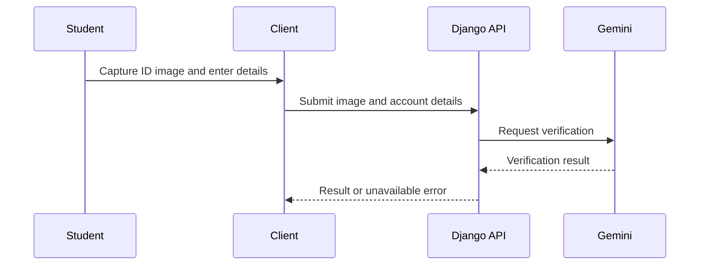

# Main flows

Actual access and persistence also depend on server-side validation and the chosen
provider's configuration. See [personal setup](PERSONAL_SETUP.md).

An authenticated buyer can upgrade the same account by submitting an ID card.
The server checks the card against the account's registration number and name and
checks the university through the configured verification service. The upgrade
does not request a new password, selfie or fresh email code. It preserves the
existing profile photo; initial seller signup remains a separate flow.
