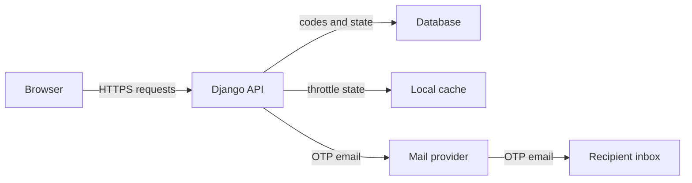

# Email verification threat model

## Executive summary

Signup and password reset depend on short-lived email codes. Their main risks are distributed guessing or email abuse against limits scoped to an individual server process, concurrent use of a code, and account enumeration through reset responses. Provider credentials and delivered codes also cross an external mail-service boundary. This is a focused source review, not a production penetration test.

## Scope and assumptions

- Scope: signup and password-reset endpoints, OTP persistence, application throttling, and configured email transports in `server/users/` and `server/server/settings.py`.
- Outside scope: ID verification, marketplace authorization, hosting infrastructure, client design, CI, and provider-side security.
- Assumption: anonymous internet users can reach the production API; email ownership is required before registration or reset. Production worker count, proxy IP handling, monitoring, and mailbox/provider delivery behavior are unverified and influence the likelihood of abuse.
- Assumption: attackers can submit requests and vary their IP address, but cannot read another person's email or directly modify server configuration or its database. A compromised mailbox, server, or provider changes the model.
- The owner requested no further questions; the above operational assumptions remain unconfirmed. Runtime code is reviewed; tests are supporting evidence, and build/CI assets are outside scope.

## System model

### Primary components

React signup/reset screens submit to Django REST endpoints (`server/users/urls.py`, `server/users/views.py`). Django validates requests, stores encrypted OTP records in its configured database, then calls the configured email transport (`server/users/serializers.py`, `server/users/models.py`, `server/users/email_service.py`).

### Data flows and trust boundaries

- Browser to API: email, registration number, password and code over HTTPS in production (TLS termination is an operational assumption). Anonymous requests undergo serializer validation and scoped throttling; cookie-authenticated requests also use CSRF enforcement (`server/users/authentication.py`).
- API to database: normalized email, encrypted OTP, timestamps, attempts, and user state through Django ORM; OTPs expire after ten minutes and are limited to five recorded incorrect attempts (`server/users/models.py`).
- API to mail provider: recipient and OTP cross to operator-selected Brevo/Resend over HTTPS or authenticated encrypted SMTP; provider secrets are server settings. A provider acceptance response is not proof of inbox delivery (`server/users/email_service.py`).
- Mail provider to recipient: email transports the OTP to the mailbox; confidentiality ultimately depends on provider and recipient mailbox security.
- Throttle state: DRF scoped throttles use Django's process-local cache; a multi-worker deployment does not share that cache (`server/server/settings.py`).

#### Diagram

## Assets and security objectives

| Asset | Why it matters | Security objective |
| --- | --- | --- |
| User accounts and passwords | Unauthorized reset grants account access | Integrity, confidentiality |
| Verification codes and mailbox ownership | Codes authorize signup or reset | Confidentiality, integrity |
| Provider API keys and SMTP credentials | Misuse can send mail at the owner's expense or reputation | Confidentiality, availability |
| Signup and reset capacity | Abuse can exhaust quotas and deny legitimate users | Availability |
| Registration numbers and email addresses | Matching pairs identify student accounts | Confidentiality |

## Attacker model

### Capabilities

An unauthenticated remote actor can submit and parallelize arbitrary signup, verification, and reset requests, including from multiple IPs. A normal user can view their own inbox and issue legitimate requests.

### Non-capabilities

The attacker is not assumed to control server secrets, transport endpoints, other users' inboxes, or the production database.

## Entry points and attack surfaces

| Surface | How reached | Trust boundary | Notes | Evidence |
| --- | --- | --- | --- | --- |
| Send and verify signup code | Anonymous POST | Browser to API | Shared signup scope; per-code attempt count | `server/users/urls.py`, `SendOTPView`, `VerifyOTPView` |
| Register | Anonymous POST | Browser to API and database | Requires verified, valid code and matching original OTP | `UserRegistrationSerializer.validate` |
| Request and complete password reset | Anonymous POST | Browser to API and database | Requires matching registration number and email | `ForgotPasswordRequestView`, `ForgotPasswordResetSerializer` |
| Mail transport | Server-side call | API to provider and inbox | HTTPS provider API or encrypted authenticated SMTP | `server/users/email_service.py` |

## Top abuse paths

1. Distributed attacker issues and guesses many codes across IPs and workers; independent caches and code replacement increase the total online guesses available.
2. Attacker submits parallel incorrect guesses against one OTP; non-atomic attempt updates can overwrite one another and weaken its five-attempt bound.
3. A holder of a valid reset code sends concurrent reset requests; validation and consumption are separated, potentially allowing more than one password change.
4. Attacker tests known registration-number/email pairs against reset initiation and distinguishes an existing or suspended account from a missing one.
5. Attacker repeatedly triggers code delivery or invalidation for a recipient, consuming provider quota or delaying a legitimate signup/reset. Provider or inbox compromise would additionally expose delivered codes.

## Threat model table

| ID | Source | Prerequisites | Threat action | Impact | Assets | Existing controls | Gaps | Recommended mitigation | Detection | Likelihood | Impact severity | Priority |
| --- | --- | --- | --- | --- | --- | --- | --- | --- | --- | --- | --- | --- |
| TM-001 | Remote attacker | Public API; multiple IPs or workers | Distribute guesses and request new codes | Possible account takeover | Account and code integrity | Ten-minute lifetime, five attempts per record; scoped throttles (`models.py`, `settings.py`) | LocMem cache is per process; new code resets attempts | Use shared atomic per-IP and per-identity limits spanning code issuance; make attempt updates atomic | Aggregate failed attempts and send rates without logging codes | Medium: distribution is feasible but exact deployment is unknown | High: reset permits account access | high |
| TM-002 | Remote attacker | Ability to send concurrent requests | Race counter updates | Additional guesses and weaker lockout | Code integrity | Five-attempt check (`VerifyOTPView`, `ForgotPasswordResetSerializer`) | Read-modify-write increments are not atomic | Guard and increment attempts atomically; test parallel requests against actual database | Alert on high concurrency per identity | Medium: concurrency is easy; exploitability depends on DB | High: may enable account takeover in combination with guessing | high |
| TM-003 | Code holder | Valid code and concurrent reset requests | Race validation and consumption | Multiple password updates from one code | Account integrity | Validity and user matching (`ForgotPasswordResetSerializer`) | Validation, password save, and OTP deletion are separate | Consume using an atomic conditional operation and bind reset to the verified record; verify compatibility with deployed database | Record reset outcome and request correlation without sensitive values | Low: valid code is required | Medium: can undermine single-use semantics | medium |
| TM-004 | Remote attacker | Candidate registration number and email | Compare reset response messages | Confirms registered or suspended accounts | Student identity privacy | Pair required; scoped reset throttle (`ForgotPasswordRequestSerializer`, `settings.py`) | Different error responses expose status | Return the same outward response for matching and nonmatching valid inputs; preserve internal diagnostics | Monitor enumeration patterns with privacy-preserving identifiers | Medium: pair testing is straightforward | Medium: disclosure can facilitate targeted abuse | medium |
| TM-005 | Remote attacker | Public send endpoint and recipient address | Trigger repeated deliveries or invalidate pending codes | Inbox nuisance, quota exhaustion and delayed access | Availability and sender reputation | Scoped throttle; provider failure reported (`SendOTPView`) | Limits are process-local; reset initiation invalidates previous code before delivery | Shared per-recipient/IP issuance cooldowns; conditionally remove failed newly issued codes without deleting a newer concurrent request | Monitor provider failures and identity-level send volume | Medium: requests are unauthenticated | Medium: quotas and signup availability can be affected | medium |
| TM-006 | External provider or mailbox compromise | Provider credential, provider, or inbox compromised | Read codes or send unauthorized email | Account compromise or sender abuse | Codes and provider credentials | HTTPS or encrypted SMTP, secrets from settings, sanitized transport errors (`email_service.py`) | Email is ultimately accessible to provider and recipient mailbox; delivery is not guaranteed | Restrict and rotate keys, verify sender domain, avoid code logging, monitor provider usage | Alert on unexpected send volume and auth failures | Low: external compromise is not assumed | High: codes or credentials may be stolen | medium |

## Criticality calibration

- Critical: broad unauthenticated account takeover or exposure of all account data.
- High: realistic takeover of a targeted account, or materially increased likelihood of successful OTP guessing.
- Medium: account enumeration, repeated reset interference, provider quota exhaustion, or conditional code reuse.
- Low: limited non-sensitive metadata exposure or transient failures that do not weaken account security.

## Focus paths for security review

| Path | Why it matters | Related threats |
| --- | --- | --- |
| `server/users/views.py` | Issues, verifies, and consumes OTPs; coordinates email delivery | TM-001 to TM-005 |
| `server/users/serializers.py` | Validates identity and reset codes; exposes account status | TM-001 to TM-004 |
| `server/users/models.py` | Defines OTP expiry, state, and attempt limits | TM-001 to TM-003 |
| `server/users/email_service.py` | Handles provider secrets and transmission of codes | TM-005, TM-006 |
| `server/server/settings.py` | Configures throttling and process-local cache | TM-001, TM-005 |
| `server/users/session_security.py` | Revokes existing sessions after password reset | TM-003 |

## Notes on use

All discovered in-scope entry points and trust boundaries are represented above. Recommendations are based on source review; production controls, effective proxy configuration, parallel-race behavior, and external delivery were not tested in this review. Reassess findings against the final implementation and deployed architecture.
