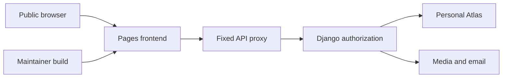

## Executive summary

This model covers the new public Pages-to-Django boundary. Credentials, private media
and account integrity depend on the existing Django checks and correct backend
configuration. The proxy currently returns unavailable responses because no backend
is configured. No live authenticated deployment is asserted.

## Scope and assumptions

Scope: `deploy/cloudflare/pages-worker.js`, `scripts/build_pages.mjs`, the two React
entry points and the Django settings/authentication boundary. Assumptions follow the
user's request for a public personal class project with separate admin, buyer and
seller test accounts. The user requested no additional questions, so unresolved
configuration is recorded rather than inferred as working. The original/team
repositories and unrelated hosted services are outside scope. Backend credentials,
media/email configuration and outbound database access remain unresolved.

## System model

### Primary components

The build script packages the existing React applications. The Pages Worker proxies
only API/media paths. Django authenticates requests (`users/authentication.py`),
checks sessions (`users/session_security.py`), and uses MongoDB configured in
`server/server/settings.py`. Media uploads use `marketplace/cloudinary_upload.py`.

### Data flows and trust boundaries

- Browser → Pages: public HTML/JS over HTTPS. Build output is public and cannot hold secrets.
- Browser → Worker → Django: passwords, JWTs, cookies, form data and media over HTTPS.
  The fixed upstream is validated; Origin is preserved, redirects are not followed and
  private responses are not cached. Django remains responsible for authorization,
  CSRF, validation and throttling.
- Django → Atlas: database records and credentials through the existing TLS-enabled
  MongoDB driver. Least-privilege database user and IP restrictions must be configured.
- Django → Cloudinary/Resend: uploads and email through existing integrations.
  These are currently unconfigured locally; successful calls are not claimed.
- Build/source → Pages: only generated frontend assets are uploaded; server credentials
  and ignored local configuration are excluded. Deployment access is privileged.

#### Diagram

## Assets and security objectives

| Asset | Why it matters | Objective |
| --- | --- | --- |
| Passwords and sessions | Prevent account takeover | C I |
| Private ID images and chats | Protect student privacy | C |
| Listings, offers and admin state | Prevent unauthorized changes | I |
| Database/provider credentials | Prevent access outside the application | C I |
| Hosting and API capacity | Keep service usable within free quotas | A |

## Attacker model

### Capabilities

Any internet user can call public routes and send forged headers, query parameters,
form data and repeated requests. A signed-in buyer/seller can attempt cross-user access.

### Non-capabilities

A normal visitor cannot change Pages runtime variables, deploy source, access server
environment values or bypass Atlas authentication. Compromised maintainer accounts are
not assumed, but deploying malicious client code would defeat frontend confidentiality.

## Entry points and attack surfaces

| Surface | How reached | Boundary | Notes | Evidence |
| --- | --- | --- | --- | --- |
| API/media proxy | Public HTTP | Browser to backend | Fixed upstream; credentials forwarded | `pages-worker.js:18` |
| Account APIs | Proxied `/api/auth` | Anonymous to account | Existing JWT/session/CSRF checks | `users/authentication.py` |
| Upload APIs | Authenticated forms | User data to storage | Existing image normalization and provider | `marketplace/cloudinary_upload.py` |
| Static JS | Public asset paths | Build to visitors | Must contain no backend credentials | `scripts/build_pages.mjs` |
| Host environment | Maintainer dashboard | Maintainer to infrastructure | Upstream and provider configuration | `CLOUDFLARE_DEPLOYMENT.md` |

## Top abuse paths

1. Visitor adds an attacker URL in a query → tries to move the proxy target → tokens
   could leak if request data selected the upstream. The worker uses only its configured origin.
2. Attacker sends forged forwarding headers → attempts to influence Django's host/origin
   handling → poisoned URLs or weakened origin checks. Proxy strips forwarding headers.
3. Buyer requests seller/admin data → tries to bypass role checks → unauthorized state
   changes. Django must reject the request independently of the frontend.
4. Visitor repeats private-media requests → attempts to retrieve another user's cached
   image → privacy loss. Worker marks responses no-store; Django still must authorize media.
5. Attacker floods API requests or large uploads → consumes free quotas → service outage.
   Django throttling exists; worker-level abuse controls are not implemented in this change.

## Threat model table

| ID | Source | Prerequisites | Action | Impact | Assets | Existing controls | Gaps | Mitigation | Detection | Likelihood | Severity | Priority |
| --- | --- | --- | --- | --- | --- | --- | --- | --- | --- | --- | --- | --- |
| TM-001 | Visitor | Reach proxy | Change target or follow redirect with auth | Credential leak | Sessions | Fixed HTTPS origin, manual redirects in Worker | Live auth pending | Test real redirects/cookies | Host logs | low | high | medium |
| TM-002 | Signed-in user | Backend connected | Read/change another user's data | Privacy or integrity loss | Accounts/media | Django role/session checks | Live cross-user tests blocked | Run buyer/seller/admin negative cases | Audit logs | medium | high | high |
| TM-003 | Visitor | Backend connected | Repeated traffic/uploads | Quota exhaustion | Availability | DRF throttles in settings | No edge rate limiter | Monitor quotas and test throttles | Provider metrics | medium | medium | medium |
| TM-004 | Maintainer mistake | Build/deploy access | Publish a server secret in JS | Database/provider compromise | Credentials | Dist-only upload; ignored env files | Future config changes need review | Keep server secrets out of VITE variables | Source/asset review | low | high | medium |
| TM-005 | Visitor | Private media exists | Recover a cached private response | Student data disclosure | Media | Worker no-store and Django media checks | Real media acceptance pending | Test two users and cache headers | Access logs | low | high | medium |

Likelihood is qualitative and conditional on the backend becoming reachable; controls
are source-reviewed, not proven in a live authenticated environment.

## Criticality calibration

- Critical: unauthenticated admin takeover or unrestricted Atlas credential disclosure.
- High: cross-user private ID disclosure or buyer modification of another seller's listing.
- Medium: free-quota exhaustion or a deployment error that makes sign-in unavailable.
- Low: non-sensitive version disclosure or a harmless broken static navigation link.

## Focus paths for security review

| Path | Why it matters | Threats |
| --- | --- | --- |
| `deploy/cloudflare/pages-worker.js` | Destination, cookies, redirects and caching | TM-001 TM-005 |
| `server/users/authentication.py` | JWT and CSRF enforcement | TM-002 |
| `server/marketplace/media_security.py` | Private document access | TM-002 TM-005 |
| `server/server/settings.py` | Origins, TLS, throttles and credentials | TM-003 TM-004 |
| `scripts/build_pages.mjs` | Public asset boundary | TM-004 |

## Notes on use

The model distinguishes current frontend hosting from the intended backend flow.
Public routes, build uploads, provider boundaries and known assumptions are covered.
Re-evaluate after backend provisioning and real role/account/media tests; this model
does not certify the whole application as secure.
