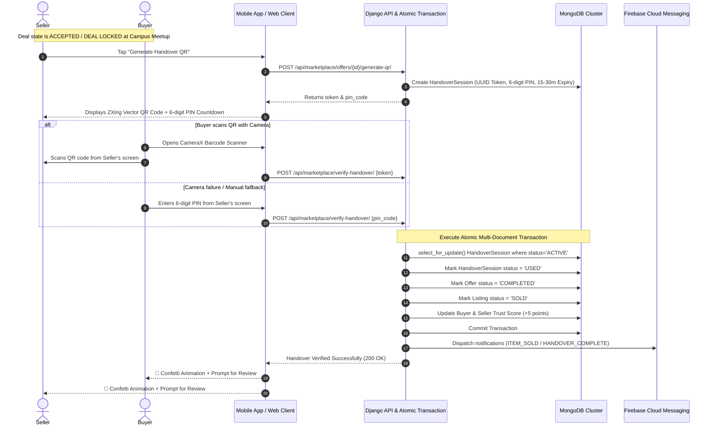
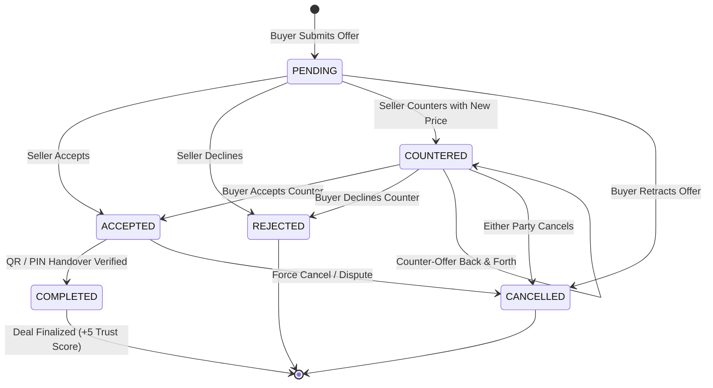
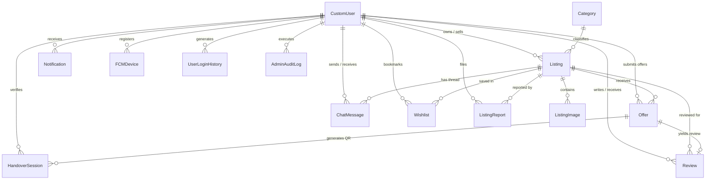

# 📘 CampusXChange (CampXChange / LPUTrade) — Master Software Engineering Documentation

> **Document Version**: 2.0 (Master Comprehensive Edition)  
> **Target Platforms**: Android Mobile Application (Kotlin + Jetpack Compose) & Web Application (React + Vite + Tailwind CSS)  
> **Backend Architecture**: Django REST Framework (DRF) + Django Channels + MongoDB (`django_mongodb_backend`) + Redis + Cloudinary + FCM  
> **Document Purpose**: Single consolidated blueprint covering System Architecture, System Design, Data Layer, Security Layer, Complete Data Models, and End-to-End Operational Workflows.

---

## 📑 Table of Contents

1. [Executive Summary & Product Vision](#1-executive-summary--product-vision)
2. [High-Level System Architecture](#2-high-level-system-architecture)
3. [System Design & Core Engineering Modules](#3-system-design--core-engineering-modules)
   - [3.1 The Physical Handover & QR/PIN Verification Engine (USP)](#31-the-physical-handover--qrpin-verification-engine-usp)
   - [3.2 Negotiation & Bargaining State Machine](#32-negotiation--bargaining-state-machine)
   - [3.3 Dual-Path Onboarding & Student Identity Verification (OCR + Live Selfie)](#33-dual-path-onboarding--student-identity-verification-ocr--live-selfie)
   - [3.4 Dual-Device Isolated Session Management (1 Web + 1 Android)](#34-dual-device-isolated-session-management-1-web--1-android)
   - [3.5 Real-Time Bidirectional Chat & In-App Messaging](#35-real-time-bidirectional-chat--in-app-messaging)
   - [3.6 Media Processing & CDN Delivery Pipeline](#36-media-processing--cdn-delivery-pipeline)
   - [3.7 Algorithmic Trust Score Engine](#37-algorithmic-trust-score-engine)
4. [Data Layer Architecture](#4-data-layer-architecture)
   - [4.1 Database Engine & MongoDB Connection Infrastructure](#41-database-engine--mongodb-connection-infrastructure)
   - [4.2 BSON ObjectId Architecture & Client Fallback Resolvers](#42-bson-objectid-architecture--client-fallback-resolvers)
   - [4.3 High-Throughput Connection Pooling & Resilience](#43-high-throughput-connection-pooling--resilience)
   - [4.4 In-Memory Micro-Caching & Automated Cache Invalidation](#44-in-memory-micro-caching--automated-cache-invalidation)
   - [4.5 Multi-Document ACID Transactions in MongoDB](#45-multi-document-acid-transactions-in-mongodb)
   - [4.6 Complete Entity Relationship Diagram (ERD)](#46-complete-entity-relationship-diagram-erd)
5. [Complete Data Models & Schemas](#5-complete-data-models--schemas)
   - [5.1 `users` App Models](#51-users-app-models)
   - [5.2 `marketplace` App Models](#52-marketplace-app-models)
6. [Security Layer Architecture](#6-security-layer-architecture)
   - [6.1 Data Security Shield (`DataSecurityMiddleware`)](#61-data-security-shield-datasecuritymiddleware)
   - [6.2 Cryptographic Subsystem (Fernet AES-CBC / HMAC-SHA256)](#62-cryptographic-subsystem-fernet-aes-cbc--hmac-sha256)
   - [6.3 `CookieJWTAuthentication` & Hybrid Session Token Delivery](#63-cookiejwtauthentication--hybrid-session-token-delivery)
   - [6.4 Brute-Force Rate Limiting & Account Lockouts](#64-brute-force-rate-limiting--account-lockouts)
   - [6.5 Forensic Login Tracking (`UserLoginHistory`)](#65-forensic-login-tracking-userloginhistory)
   - [6.6 DPDP Act Compliance & Student PII Protection](#66-dpdp-act-compliance--student-pii-protection)
   - [6.7 Role-Based Access Control (RBAC) & 12 Modular Admin Permissions](#67-role-based-access-control-rbac--12-modular-admin-permissions)
7. [Complete End-to-End Operational Workflows](#7-complete-end-to-end-operational-workflows)
   - [Flow 1: Student Onboarding & Discovery (Mobile & Web)](#flow-1-student-onboarding--discovery-mobile--web)
   - [Flow 2: Seller Listing Creation & Catalog Publishing](#flow-2-seller-listing-creation--catalog-publishing)
   - [Flow 3: Price Bargaining, Counter-Offers & Deal Locking](#flow-3-price-bargaining-counter-offers--deal-locking)
   - [Flow 4: Campus Meetup, QR/PIN Handover & Atomic Transaction Completion](#flow-4-campus-meetup-qrpin-handover--atomic-transaction-completion)
   - [Flow 5: Real-Time Messaging & Chat Sync](#flow-5-real-time-messaging--chat-sync)
   - [Flow 6: Push Notifications & Campus-Wide Broadcasts](#flow-6-push-notifications--campus-wide-broadcasts)
   - [Flow 7: Post-Deal Peer Ratings & Trust Score Accrual](#flow-7-post-deal-peer-ratings--trust-score-accrual)
   - [Flow 8: Admin Governance, Content Moderation & Audit Logs](#flow-8-admin-governance-content-moderation--audit-logs)
8. [Cross-Platform Technology Matrix](#8-cross-platform-technology-matrix)

---

## 1. 📌 Executive Summary & Product Vision

**CampusXChange (CampXChange / LPUTrade)** is an enterprise-grade, closed-loop, peer-to-peer campus marketplace created specifically for verified university students and academic staff.

Unlike general open classifieds (such as OLX, Facebook Marketplace, or Quikr) where buyers and sellers encounter anonymous scammers, shipping hassles, spam bots, and counterfeit goods, **CampusXChange operates inside the physical perimeter of a university campus**.

### Key Differentiators & USPs
1. **Zero Anonymous Access**: Only students with an authorized university domain email (`@lpu.in`, `@thapar.edu`, etc.) or physical student ID card verified via OCR and facial selfies can transact.
2. **On-Campus In-Person Handover**: Items are delivered personally at campus landmarks (e.g., *Uni-Mall*, *BH-4*, *Block 34*, *Central Library*). Zero shipping costs or packaging waste.
3. **Cryptographic QR & PIN Handover Protocol**: Eliminates peer-to-peer disputes. Sellers generate a high-entropy, dynamic ZXing Vector QR Code and 6-digit numeric PIN; buyers scan or enter the PIN on meetup. An atomic backend transaction simultaneously marks the item `SOLD`, marks the offer `COMPLETED`, increments both parties' Trust Scores, and triggers celebration confetti.
4. **Dynamic Price Bargaining Engine**: Instead of an impersonal "Add to Cart", students negotiate price and terms using an interactive Offer/Counter-Offer state machine.
5. **DPDP Compliance & Identity Protection**: Raw student contact numbers are protected, real full names are masked (e.g., `Rohan S.`), and chats are contained in-app.
6. **Dual-Device Session Isolation**: A student can stay logged into **exactly 1 Web Browser** and **1 Android Phone** concurrently without interference, while concurrent logins on the same client type automatically terminate prior sessions.

---

## 2. 🏛️ High-Level System Architecture

CampusXChange adopts a modern decoupled client-server architecture. A unified **Django REST Framework** API engine serves both the **Android Mobile App** and the **Vite + React Web Applications**, with real-time events facilitated via **Django Channels** and **Redis**.

```text
                                  ┌───────────────────────────┐
                                  │   Verified Student / Staff │
                                  └─────────────┬─────────────┘
                                                │
                       ┌────────────────────────┴────────────────────────┐
                       ▼                                                 ▼
            📱 Android Mobile App                             🌐 Web Applications
            (Kotlin + Jetpack Compose)                        (React 18 + Vite + Tailwind)
            - MVVM & Clean Architecture                       - Student Web App (client/)
            - Hilt Dependency Injection                       - Admin Governance Portal (admin/)
            - Retrofit 2 + OkHttp 4                           - TanStack Query + Axios
            - CameraX & ML Kit ID OCR                         - Responsive Glassmorphic UI
                       │                                                 │
                       │ [HTTPS + X-App-Security-Key + Bearer JWT]       │ [HTTPS + HttpOnly Cookies + JWT]
                       └────────────────────────┬────────────────────────┘
                                                │
                                                ▼
                                ┌────────────────────────────────┐
                                │      Edge / Cloud Gateway      │
                                │   (Reverse Proxy / CORS / TLS) │
                                └───────────────┬────────────────┘
                                                │
                                                ▼
                                ┌────────────────────────────────┐
                                │    Django Security Shield      │
                                │    - DataSecurityMiddleware    │
                                │    - Fernet AES-CBC Decryption │
                                │    - CookieJWTAuthentication   │
                                └───────────────┬────────────────┘
                                                │
                                                ▼
                     ┌──────────────────────────────────────────────────────┐
                     │          Django REST API & WebSocket Core            │
                     │  - Users & RBAC Service (Dual-Device Sessions)       │
                     │  - Marketplace Catalog & Search Service              │
                     │  - Bargaining Engine & Handover QR Orchestrator      │
                     │  - LocMem / In-Memory Micro-Caching Layer            │
                     │  - Channels WebSocket Consumer (Asynchronous Events) │
                     └──────┬───────────────┬───────────────┬────────┬──────┘
                            │               │               │        │
         ┌──────────────────┴──┐     ┌──────┴──────┐  ┌─────┴──┐ ┌───┴────────────────┐
         ▼                     ▼     ▼             ▼  ▼        ▼ ▼                    ▼
┌──────────────────┐  ┌────────────┐ ┌───────────┐ ┌──────────┐ ┌──────────────────────┐
│  MongoDB Engine  │  │   Redis    │ │Cloudinary │ │ Firebase │ │  Google ML Kit       │
│ django_mongodb   │  │ Pub/Sub    │ │ Media CDN │ │   FCM    │ │  (On-Device Android) │
│ - BSON ObjectId  │  │ Chat State │ │ Optim.    │ │ Mobile   │ │  - Text Recognition  │
│ - Multi-Doc ACID │  │ Channels   │ │ WebP/CDN  │ │ Push     │ │  - Student ID OCR    │
│ - Connection Pool│  │ Lock Cache │ │ Transforms│ │ Alerts   │ │  - CameraX Selfies   │
└──────────────────┘  └────────────┘ └───────────┘ └──────────┘ └──────────────────────┘
```

### Architectural Network Topology
- **Mobile Client**: Direct HTTPS REST communication using `OkHttp 4` with custom interceptors injects `X-App-Security-Key` and `Authorization: Bearer <token>`.
- **Web App**: Communicates via Axios with `withCredentials: true`. Session tokens reside in secure `HttpOnly`, `SameSite=Lax` cookies, shielding against XSS token harvesting.
- **Backend Service**: Containerized Python/Django application running ASGI/WSGI.
- **Persistence Layer**: MongoDB cluster (Atlas or local replica set) connected via `django_mongodb_backend` supporting full ACID multi-document transactions.

---

## 3. ⚙️ System Design & Core Engineering Modules

### 3.1 The Physical Handover & QR/PIN Verification Engine (USP)
Because CampusXChange operates within physical campus borders, delivery fraud (e.g., buyer takes an item but claims they never received it, or seller takes money without releasing the product) is completely eliminated by an **atomic QR and PIN verification protocol**.



#### Key Handover Design Rules:
1. **Expiration Safeguard**: Handover sessions expire after a strict 15–30 minute window. Expired sessions reject verification attempts.
2. **Brute Force Lockout**: The session tracks `failed_attempts`. If more than 5 incorrect PINs are submitted, the session is invalidated to prevent guessing.
3. **Concurrency Protection**: The verification endpoint executes inside `with transaction.atomic()` with row-locking (`select_for_update()`) to prevent double-spending or replay attacks.

---

### 3.2 Negotiation & Bargaining State Machine
The core transaction model is governed by an asynchronous negotiation engine modeled as a strict finite state machine (FSM).



- **Deal Locking**: When an offer moves to `ACCEPTED`, the underlying Listing transitions to `PENDING` (Reserved), signaling other buyers that the product is held.
- **Concurrent Deals**: Multiple buyers can have `PENDING` offers on an active listing, but once one offer is `ACCEPTED`, no other offer can be accepted unless the first deal is cancelled.

---

### 3.3 Dual-Path Onboarding & Student Identity Verification (OCR + Live Selfie)
Campus safety requires stringent KYC while maintaining frictionless onboarding for casual buyers.

```text
                       ┌────────────────────────────────────────┐
                       │          New Student Register          │
                       └───────────────────┬────────────────────┘
                                           │
                    ┌──────────────────────┴──────────────────────┐
                    ▼                                             ▼
        [ BUYER ONBOARDING ]                           [ SELLER ONBOARDING ]
        (Fast 3-Step Flow)                             (Thorough 5-Step KYC)
        1. Reg No + Name + Email + Phone               1. Personal & Contact Details
        2. 6-Digit Email OTP Verification              2. Student ID Card OCR Scan
        3. Set Password & Auto-Login                   3. Live CameraX Facial Selfie
                    │                                  4. 6-Digit Email OTP Verification
                    │                                  5. Set Password & Auto-Login
                    │                                             │
                    ▼                                             ▼
            ROLE: BUYER                                   ROLE: SELLER
            - Browse & Search                             - Full Marketplace Access
            - Send Offers & Chat                          - Publish & Sell Listings
            - Wishlist & Inquire                          - Verified Badge & Trust Points
                    │                                             │
                    └───────────► UPGRADE TO SELLER ◄─────────────┘
                                 (Verify ID + Selfie anytime)
```

1. **Google ML Kit OCR**: On Android, Google ML Kit Text Recognition (`com.google.mlkit:text-recognition`) parses physical university ID cards on-device, extracting registration number, full name, and university credentials before uploading.
2. **CameraX Selfie Capture**: High-resolution face capture verifies the student's physical identity against the student ID card.
3. **Domain Whitelist Validation**: Email must terminate in an approved institutional domain (`@lpu.in`, `@thapar.edu`, etc.). Domain lists are maintained dynamically in the admin dashboard.

---

### 3.4 Dual-Device Isolated Session Management (1 Web + 1 Android)
Campus students routinely switch between their campus Wi-Fi laptop and their mobile phone. CampusXChange implements an intelligent **Device-Isolated Session Architecture**:

- Every user record stores independent session records:
  - Web: `web_session_id`, `web_session_device`, `web_session_created_at`
  - Android: `android_session_id`, `android_session_device`, `android_session_created_at`
- **Simultaneous Cross-Platform Freedom**: A student can remain logged into their laptop browser AND their Android phone simultaneously.
- **Intra-Platform Revocation**: If a student logs in on a second Android device, the previous Android session is revoked immediately without disturbing the active Web session.
- **Enforcement**: `CookieJWTAuthentication` inspects the embedded `session_id` and `client_type` claims in the token. If the token's session ID doesn't match the current active session in the database, the request is rejected with `401 Session Terminated`.

---

### 3.5 Real-Time Bidirectional Chat & In-App Messaging
- **Context-Bound Threads**: Every conversation is tied directly to a specific `Listing`, preventing confusion over which item is being discussed.
- **Django Channels & WebSockets**: Provides sub-second message delivery when both users are actively chatting.
- **LocMem Micro-Cache**: Inbox summaries (`cxc_user_conversations_<user_id>`) are cached for 10 seconds and automatically evicted upon new incoming messages via post-save signals.
- **Offline Delivery**: If a recipient is disconnected from the WebSocket, a Firebase Cloud Messaging (FCM) push notification is dispatched instantly with a deep link to the chat thread.

---

### 3.6 Media Processing & CDN Delivery Pipeline
1. **No Bloat in Database**: Images are never saved as raw binary blobs in MongoDB.
2. **Cloudinary Integration**: Images uploaded from Android or Web are compressed and sent directly to Cloudinary.
3. **Automatic WebP Conversion & Thumbnailing**: The CDN delivers responsive WebP transformations with aggressive browser caching headers.
4. **Primary Image Resolution**: `ListingImage` enforces a single `is_primary=True` photo per listing for high-speed grid rendering.

---

### 3.7 Algorithmic Trust Score Engine
To discourage campus bad behavior, students possess a dynamic **Trust Score (0 to 100)** computed automatically via `CustomUser.calculate_trust_score()`:

$$\text{Trust Score} = \min\Big(100, \max\big(0, S_{\text{email}} + S_{\text{id}} + S_{\text{selfie}} + S_{\text{trades}} + S_{\text{reviews}}\big)\Big)$$

Where:
- $S_{\text{email}} = +5$ (College email authenticated)
- $S_{\text{id}} = +5$ (Physical student ID card verified)
- $S_{\text{selfie}} = +3$ (Profile photo/selfie captured)
- $S_{\text{trades}} = 5 \times N_{\text{completed}}$ ($+5$ points for every completed peer transaction)
- $S_{\text{reviews}}$:
  - If $\text{Avg Rating} \ge 4.5$: $+ \min(15, 3 \times N_{\text{reviews}})$
  - If $3.5 \le \text{Avg Rating} < 4.5$: $+ \min(8, 2 \times N_{\text{reviews}})$
  - If $\text{Avg Rating} < 2.5$: $- \min(15, 3 \times N_{\text{reviews}})$ (penalty deduction)

---

## 4. 🗄️ Data Layer Architecture

### 4.1 Database Engine & MongoDB Connection Infrastructure
CampusXChange utilizes **MongoDB** as its primary persistence engine, wired into the Django ORM using `django_mongodb_backend`. This provides document-oriented flexibility and dynamic querying while retaining standard Django models, managers, and migrations.

Configured in [`server/server/settings.py`](file:///c:/Users/anshu/OneDrive/Desktop/Projects/LPUTrade/server/server/settings.py#L140-L167):
```python
MONGODB_URI = os.environ.get('MONGODB_URI', 'mongodb://localhost:27017/campxchange')
MONGODB_NAME = os.environ.get('MONGODB_NAME', 'campxchange')

_mongo_options = {
    'maxPoolSize': int(os.environ.get('MONGO_MAX_POOL_SIZE', 50)),
    'minPoolSize': int(os.environ.get('MONGO_MIN_POOL_SIZE', 0)),
    'maxIdleTimeMS': 30000,
    'serverSelectionTimeoutMS': int(os.environ.get('MONGO_TIMEOUT_MS', 5000)),
    'connectTimeoutMS': 5000,
    'socketTimeoutMS': 15000,
    'waitQueueTimeoutMS': 5000,
    'retryWrites': True,
    'retryReads': True,
}

if 'mongodb+srv' in MONGODB_URI or 'ssl=true' in MONGODB_URI.lower():
    _mongo_options['tlsCAFile'] = certifi.where()

DATABASES = {
    'default': {
        'ENGINE': 'django_mongodb_backend',
        'HOST': MONGODB_URI,
        'NAME': MONGODB_NAME,
        'OPTIONS': _mongo_options,
        'CONN_MAX_AGE': int(os.environ.get('CONN_MAX_AGE', 0)),
    }
}
```

---

### 4.2 BSON ObjectId Architecture & Client Fallback Resolvers
- Primary keys in MongoDB are 12-byte / 24-character hexadecimal BSON `ObjectId` strings (e.g., `6712ab8f9024c01d4a3ef711`).
- Models inherit `django_mongodb_backend.fields.ObjectIdAutoField`.
- **Client Fallback Layer**: To maintain backward compatibility with legacy mobile views or numerical slug queries, API views and serializers use smart resolvers that test whether an incoming identifier is an integer index or a valid 24-hex string before invoking the ORM filter.

---

### 4.3 High-Throughput Connection Pooling & Resilience
- **Connection Pool**: Defaults to 50 concurrent worker sockets with a 30-second idle connection lifecycle (`maxIdleTimeMS = 30000`).
- **TLS Hardening**: Connections to MongoDB Atlas use Mozilla's official trusted CA certificate bundle (`certifi.where()`).
- **Failover Recovery**: Network glitches and transient cluster elections are absorbed transparently via `retryWrites=True` and `retryReads=True`.

---

### 4.4 In-Memory Micro-Caching & Automated Cache Invalidation
Configured using Django's high-speed memory cache backend:
```python
CACHES = {
    'default': {
        'BACKEND': 'django.core.cache.backends.locmem.LocMemCache',
        'LOCATION': 'campxchange-locmem-cache',
        'TIMEOUT': 300,
        'OPTIONS': {
            'MAX_ENTRIES': 2000,
            'CULL_FREQUENCY': 3,
        }
    }
}
```

| Cache Key Pattern | TTL | Contents | Invalidation Trigger |
|---|---|---|---|
| `cxc_public_default_active_listings` | 15s | High-traffic homepage listing cards | Listing post-save / post-delete signal |
| `cxc_user_conversations_<user_id>` | 10s | User's active inbox thread summaries | ChatMessage post-save for sender & recipient |
| `cxc_public_active_banners` | 120s | Top homepage promotion banners | Banner save / delete in Admin |

---

### 4.5 Multi-Document ACID Transactions in MongoDB
When finalizing physical handovers, multiple documents across separate collections must mutate atomically:
1. `HandoverSession` transitions to `USED`
2. `Offer` transitions to `COMPLETED`
3. `Listing` transitions to `SOLD`
4. Both users' `trust_score` are recalculated and committed
5. System `Notification` records are generated for both parties

Implemented in [`server/marketplace/views.py`](file:///c:/Users/anshu/OneDrive/Desktop/Projects/LPUTrade/server/marketplace/views.py#L1983):
```python
with transaction.atomic():
    session = HandoverSession.objects.select_for_update().get(token=token)
    session.status = 'USED'
    session.save()

    offer = session.offer
    offer.status = 'COMPLETED'
    offer.save()

    listing = offer.listing
    listing.status = 'SOLD'
    listing.save()
```
MongoDB runs this inside a replica-set multi-document transaction, guaranteeing **all-or-nothing atomicity** with zero orphan states.

---

### 4.6 Complete Entity Relationship Diagram (ERD)



---

## 5. 📦 Complete Data Models & Schemas

### 5.1 `users` App Models ([`server/users/models.py`](file:///c:/Users/anshu/OneDrive/Desktop/Projects/LPUTrade/server/users/models.py))

#### 1. `CustomUser` (Extends `AbstractUser`)
Represents all system users (Buyers, Sellers, Campus Moderators, Super Admins).
- `id`: `ObjectIdAutoField` (Primary Key).
- `username`: Unique username / registration handle.
- `email`: `EmailField` (Unique, required institutional email).
- `full_name`: `CharField(max_length=255)` (Real name of student).
- `college_domain`: `CharField(max_length=255)` (e.g., `lpu.in`, `thapar.edu`).
- `is_verified_student`: `BooleanField(default=False)` (Email OTP verification status).
- `is_id_verified`: `BooleanField(default=False)` (Physical student ID card approval).
- `id_card_image`: `TextField` (Base64 data or Cloudinary URL).
- `id_card_data`: `JSONField` (OCR text extracted from student ID).
- `profile_photo`: `TextField` (Base64 live selfie or Cloudinary URL).
- `profile_picture_url`: `URLField` (CDN avatar link).
- `phone_number`: `CharField(max_length=15, unique=True, null=True)`.
- `trust_score`: `IntegerField(default=0, 0-100)`.
- `role`: `CharField(choices=['BUYER', 'SELLER'], default='BUYER')`.
- `admin_role`: `CharField(choices=['SUPER_ADMIN', 'MODERATOR', 'ID_VERIFIER'], default='MODERATOR')`.
- `admin_permissions`: `JSONField(default=list)` (Custom assigned module permission keys).
- `web_session_id`: `CharField(max_length=64)` (Active browser session UUID).
- `web_session_device`: `CharField(max_length=255)` (Browser and OS user-agent).
- `web_session_created_at`: `DateTimeField`.
- `android_session_id`: `CharField(max_length=64)` (Active Android app session UUID).
- `android_session_device`: `CharField(max_length=255)` (Android device model).
- `android_session_created_at`: `DateTimeField`.
- `last_login_method`: `CharField(choices=['PASSWORD', 'GOOGLE'], default='PASSWORD')`.
- `google_id`: `CharField(max_length=255, unique=True, null=True)`.
- **Database Indexes**: `['role', 'is_id_verified']`, `['-date_joined']`.

#### 2. `OTPVerification`
Manages encrypted one-time passwords for student email verification.
- `email`: `EmailField(unique=True)`.
- `otp`: `CharField(max_length=255)` (Fernet AES encrypted code).
- `created_at`: `DateTimeField(auto_now_add=True)`.
- `is_verified`: `BooleanField(default=False)`.
- `attempts`: `PositiveIntegerField(default=0)` (Max: 5 attempts before lockout).
- **Methods**: `is_valid()` (10-minute expiry), `is_locked()`, `get_plain_otp()`.

#### 3. `PasswordResetToken`
- `email`: `EmailField(db_index=True)`.
- `token`: `CharField(max_length=255, unique=True)` (Cryptographic UUID).
- `created_at`: `DateTimeField(auto_now_add=True)`.
- `is_used`: `BooleanField(default=False)`.
- **Methods**: `is_valid(timeout_seconds=900)` (15-minute validity).

#### 4. `PasswordResetOTP`
- `user`: `ForeignKey(CustomUser, on_delete=CASCADE, null=True)`.
- `email`: `EmailField(db_index=True)`.
- `reg_no`: `CharField(max_length=64, db_index=True)`.
- `otp`: `CharField(max_length=255)` (Fernet AES encrypted).
- `created_at`: `DateTimeField(auto_now_add=True)`.
- `is_verified`: `BooleanField(default=False)`.
- `attempts`: `PositiveIntegerField(default=0)`.

#### 5. `UserLoginHistory`
Forensic audit trail of student authentication attempts.
- `user`: `ForeignKey(CustomUser, null=True, on_delete=CASCADE)`.
- `email_attempted`: `EmailField`.
- `reg_no_attempted`: `CharField(max_length=64)`.
- `login_method`: `CharField(choices=['PASSWORD', 'GOOGLE'])`.
- `client_type`: `CharField(max_length=20)` (`'web'` or `'android'`).
- `ip_address`: `GenericIPAddressField`.
- `user_agent`: `TextField`.
- `device_info`: `CharField(max_length=255)`.
- `status`: `CharField(choices=['SUCCESS', 'FAILED'])`.
- `failure_reason`: `CharField(max_length=100)`.
- `created_at`: `DateTimeField(auto_now_add=True, db_index=True)`.
- **Database Indexes**: `['login_method', 'status']`, `['-created_at']`.

---

### 5.2 `marketplace` App Models ([`server/marketplace/models.py`](file:///c:/Users/anshu/OneDrive/Desktop/Projects/LPUTrade/server/marketplace/models.py))

#### 1. `Category`
- `name`: `CharField(max_length=100)`.
- `slug`: `SlugField(unique=True)`.
- `icon`: `CharField(max_length=50, default='Package')` (Lucide icon string).

#### 2. `Listing`
Product listings created by verified campus sellers.
- `seller`: `ForeignKey(CustomUser, on_delete=CASCADE, related_name='listings')`.
- `category`: `ForeignKey(Category, on_delete=SET_NULL, null=True)`.
- `title`: `CharField(max_length=255)`.
- `description`: `TextField`.
- `price`: `DecimalField(max_digits=10, decimal_places=2, default=0)`.
- `original_price`: `DecimalField(max_digits=10, decimal_places=2, null=True)`.
- `sale_end_time`: `DateTimeField(null=True, blank=True)`.
- `is_trusted`: `BooleanField(default=False)`.
- `is_negotiable`: `BooleanField(default=True)`.
- `transaction_type`: `CharField(choices=['SELL', 'DONATE', 'EXCHANGE'], default='SELL')`.
- `is_exchange_allowed`: `BooleanField(default=False)`.
- `exchange_preferences`: `CharField(max_length=255, null=True)`.
- `rent_period`: `CharField(max_length=20, default='month')`.
- `condition`: `CharField(choices=['NEW', 'LIKE_NEW', 'GOOD', 'FAIR', 'POOR'], default='GOOD')`.
- `location`: `CharField(max_length=255)` (e.g., `BH-4`, `Uni-Mall`, `Block 34`).
- `contact_preference`: `CharField(choices=['ALL', 'WHATSAPP', 'CALL', 'CHAT', 'MEETUP'], default='ALL')`.
- `contact_phone`: `CharField(max_length=20, null=True)`.
- `contact_whatsapp`: `CharField(max_length=20, null=True)`.
- `status`: `CharField(choices=['ACTIVE', 'PENDING', 'SOLD', 'HIDDEN'], default='ACTIVE')`.
- `views_count`: `PositiveIntegerField(default=0)`.
- `created_at`, `updated_at`: `DateTimeField`.
- **Computed Property**: `discount_percentage`.
- **Database Indexes**: `['status', '-created_at']`, `['category', 'status']`, `['seller', 'status']`, `['price', 'status']`, `['-created_at']`.

#### 3. `ListingImage`
- `listing`: `ForeignKey(Listing, on_delete=CASCADE, related_name='images')`.
- `image_url`: `TextField` (Cloudinary CDN URL or Base64 URI).
- `is_primary`: `BooleanField(default=False)`.
- `created_at`: `DateTimeField(auto_now_add=True)`.

#### 4. `Offer`
Negotiation contract and counter-offer ledger.
- `buyer`: `ForeignKey(CustomUser, on_delete=CASCADE, related_name='offers_made')`.
- `listing`: `ForeignKey(Listing, on_delete=CASCADE, related_name='offers')`.
- `offer_amount`: `DecimalField(max_digits=10, decimal_places=2)`.
- `counter_amount`: `DecimalField(max_digits=10, decimal_places=2, null=True)`.
- `seller_note`: `TextField(blank=True, default='')`.
- `buyer_message`: `TextField(blank=True, default='')`.
- `is_exchange_offer`: `BooleanField(default=False)`.
- `exchange_item_title`: `CharField(max_length=255, null=True)`.
- `status`: `CharField(choices=['PENDING', 'ACCEPTED', 'REJECTED', 'COUNTERED', 'COMPLETED', 'CANCELLED'], default='PENDING')`.
- `created_at`, `updated_at`: `DateTimeField`.
- **Database Indexes**: `['listing', 'status']`, `['buyer', '-created_at']`, `['status']`, `['-created_at']`.

#### 5. `HandoverSession`
Cryptographic meetup verification token.
- `offer`: `ForeignKey(Offer, on_delete=CASCADE, related_name='handover_sessions')`.
- `token`: `UUIDField(default=uuid.uuid4, unique=True, editable=False)`.
- `pin_code`: `CharField(max_length=6, db_index=True)` (6-digit numeric OTP).
- `expires_at`: `DateTimeField` (15-30 minute expiry).
- `status`: `CharField(choices=['ACTIVE', 'USED', 'EXPIRED', 'CANCELLED'], default='ACTIVE')`.
- `failed_attempts`: `PositiveIntegerField(default=0)` (Max: 5 attempts).
- `created_at`: `DateTimeField(auto_now_add=True)`.
- `completed_at`: `DateTimeField(null=True, blank=True)`.
- **Methods**: `is_valid()`.

#### 6. `Notification`
Real-time user alert dispatch.
- `recipient`: `ForeignKey(CustomUser, on_delete=CASCADE, related_name='notifications')`.
- `sender`: `ForeignKey(CustomUser, on_delete=SET_NULL, null=True, blank=True)`.
- `notification_type`: `CharField(choices=['BUY_REQUEST', 'REQUEST_ACCEPTED', 'REQUEST_REJECTED', 'HANDOVER_READY', 'ITEM_SOLD', 'DEAL_CANCELLED', 'BROADCAST', 'DIRECT_WARNING', 'OFFER_COUNTERED', 'NEW_REVIEW', 'NEW_CHAT_MESSAGE', 'GENERAL'])`.
- `priority`: `CharField(choices=['NORMAL', 'HIGH', 'URGENT'], default='NORMAL')`.
- `title`: `CharField(max_length=255)`.
- `message`: `TextField`.
- `listing`: `ForeignKey(Listing, null=True, blank=True)`.
- `link`: `CharField(max_length=255, default='')`.
- `is_read`: `BooleanField(default=False)`.
- `created_at`: `DateTimeField(auto_now_add=True)`.
- **Database Indexes**: `['recipient', 'is_read', '-created_at']`, `['recipient', '-created_at']`.

#### 7. `FCMDevice`
Hardware push notification tokens.
- `user`: `ForeignKey(CustomUser, on_delete=CASCADE, related_name='fcm_devices')`.
- `registration_id`: `CharField(max_length=512, unique=True, db_index=True)`.
- `device_type`: `CharField(choices=['WEB', 'ANDROID', 'IOS'], default='WEB')`.
- `device_name`: `CharField(max_length=150)`.
- `is_active`: `BooleanField(default=True)`.
- `created_at`, `updated_at`: `DateTimeField`.
- **Database Indexes**: `['user', 'is_active']`, `['registration_id']`.

#### 8. `BroadcastLog`
Campus-wide administrative push records.
- `sender`: `ForeignKey(CustomUser, null=True)`.
- `target_audience`: `CharField(choices=['ALL', 'SELLERS', 'BUYERS', 'UNVERIFIED'])`.
- `priority`: `CharField(choices=['NORMAL', 'HIGH', 'URGENT'])`.
- `title`, `message`, `link`: Text attributes.
- `recipients_count`: `PositiveIntegerField`.
- `created_at`: `DateTimeField(auto_now_add=True)`.

#### 9. `Wishlist`
- `user`: `ForeignKey(CustomUser, on_delete=CASCADE)`.
- `listing`: `ForeignKey(Listing, on_delete=CASCADE)`.
- `added_at`: `DateTimeField(auto_now_add=True)`.
- **Constraint**: `unique_together = ('user', 'listing')`.

#### 10. `ListingReport`
Student moderation alerts for policy violations.
- `reporter`: `ForeignKey(CustomUser)`.
- `listing`: `ForeignKey(Listing, null=True)`.
- `reported_user`: `ForeignKey(CustomUser, null=True)`.
- `reason`: `CharField(max_length=255)`.
- `details`: `TextField(max_length=2000)`.
- `status`: `CharField(choices=['PENDING', 'RESOLVED', 'DISMISSED'], default='PENDING')`.
- `created_at`, `resolved_at`: `DateTimeField`.

#### 11. `PlatformSetting`
Dynamic runtime configuration (domain lists, maintenance switches).
- `key`: `CharField(max_length=100, unique=True)`.
- `value`: `TextField`.
- `updated_at`: `DateTimeField(auto_now=True)`.

#### 12. `AdminAuditLog`
Immutable governance ledger.
- `admin_user`: `ForeignKey(CustomUser, null=True)`.
- `admin_username`: `CharField(max_length=150)`.
- `action`: `CharField(choices=[26 action types e.g., USER_BAN, LISTING_DELETE, STAFF_PROMOTE...], db_index=True)`.
- `target_type`, `target_id`, `target_repr`: String pointers.
- `details`: `JSONField(default=dict)`.
- `ip_address`: `GenericIPAddressField`.
- `user_agent`: `CharField(max_length=255)`.
- `created_at`: `DateTimeField(auto_now_add=True, db_index=True)`.

#### 13. `Review`
Peer review submitted after physical handover.
- `deal`: `ForeignKey(Offer, on_delete=CASCADE, related_name='reviews')`.
- `listing`: `ForeignKey(Listing, on_delete=CASCADE)`.
- `reviewer`: `ForeignKey(CustomUser, related_name='reviews_given')`.
- `reviewed_user`: `ForeignKey(CustomUser, related_name='reviews_received')`.
- `rating`: `PositiveSmallIntegerField(validators=[1 to 5])`.
- `comment`: `TextField`.
- `quick_tags`: `JSONField(default=list)` (e.g., `["Smooth Handover", "Polite", "Item as Described"]`).
- `created_at`: `DateTimeField(auto_now_add=True, db_index=True)`.
- **Constraint**: `unique_together = ('deal', 'reviewer')`.

#### 14. `ChatMessage`
In-app peer-to-peer chat thread.
- `listing`: `ForeignKey(Listing, on_delete=CASCADE, related_name='chat_messages')`.
- `sender`: `ForeignKey(CustomUser, related_name='sent_chat_messages')`.
- `recipient`: `ForeignKey(CustomUser, related_name='received_chat_messages')`.
- `message`: `TextField`.
- `is_read`: `BooleanField(default=False, db_index=True)`.
- `created_at`: `DateTimeField(auto_now_add=True, db_index=True)`.
- **Database Indexes**: `['sender', 'recipient', '-created_at']`, `['listing', '-created_at']`, `['recipient', 'is_read']`.

#### 15. `Banner`
Homepage hero banner carousel slides.
- `title`: `CharField(max_length=200)`.
- `subtitle`: `CharField(max_length=300)`.
- `badge_text`: `CharField(max_length=60, default='Featured')`.
- `image_url`: `TextField` (Cloudinary CDN URL).
- `link_url`: `CharField(max_length=500)`.
- `button_text`: `CharField(max_length=50, default='Explore Now')`.
- `is_active`: `BooleanField(default=True, db_index=True)`.
- `display_order`: `PositiveIntegerField(default=0, db_index=True)`.
- `created_at`, `updated_at`: `DateTimeField`.
- **Ordering**: `['display_order', '-created_at']`.

---

## 6. 🔒 Security Layer Architecture

CampusXChange incorporates enterprise-grade multi-layer security engineered to prevent unauthorized scrapers, token tampering, replay attacks, session hijacking, and brute-force cracking.

```text
                                 Incoming HTTP / HTTPS Request
                                              │
                                              ▼
                    ┌──────────────────────────────────────────────────┐
                    │               LAYER 1: PERIMETER                 │
                    │            DataSecurityMiddleware                │
                    │   - Checks X-App-Security-Key header             │
                    │   - Constant-time HMAC comparison                │
                    │   - Blocks unauthenticated crawlers / bot tools  │
                    └─────────────────────────┬────────────────────────┘
                                              │ Valid Header
                                              ▼
                    ┌──────────────────────────────────────────────────┐
                    │             LAYER 2: AUTHENTICATION              │
                    │             CookieJWTAuthentication              │
                    │   - Web: Reads HttpOnly Cookie 'access_token'    │
                    │   - Android: Reads 'Authorization: Bearer'       │
                    │   - Validates cryptographic signature            │
                    └─────────────────────────┬────────────────────────┘
                                              │ Valid Token
                                              ▼
                    ┌──────────────────────────────────────────────────┐
                    │         LAYER 3: SESSION ISOLATION GUARD         │
                    │   - Matches token.session_id with User table     │
                    │   - Permits 1 Web + 1 Android session            │
                    │   - Concurrent intra-device logins auto-revoked  │
                    └─────────────────────────┬────────────────────────┘
                                              │ Active Session
                                              ▼
                    ┌──────────────────────────────────────────────────┐
                    │             LAYER 4: FIELD-LEVEL CRYPTO          │
                    │                 crypto.py Fernet                 │
                    │   - OTPs stored as 'enc::...' AES-CBC ciphertext │
                    │   - Decrypted only in memory during check        │
                    │   - Brute-force lockout after 5 failed tries     │
                    └─────────────────────────┬────────────────────────┘
                                              │
                                              ▼
                    ┌──────────────────────────────────────────────────┐
                    │        LAYER 5: ROLE-BASED ACCESS CONTROL        │
                    │   - Student Permissions: BUYER vs SELLER         │
                    │   - Admin Permissions: 12 Fine-Grained Modules   │
                    └──────────────────────────────────────────────────┘
```

### 6.1 Data Security Shield (`DataSecurityMiddleware`)
Defined in [`server/server/middleware.py`](file:///c:/Users/anshu/OneDrive/Desktop/Projects/LPUTrade/server/server/middleware.py):
- Intercepts all requests arriving at `/api/` endpoints.
- Verifies the incoming `X-App-Security-Key` header against `DATA_SECURITY_KEY` configured in `.env`.
- Uses **constant-time HMAC string comparison** (`hmac.compare_digest`) to prevent timing side-channel attacks.
- Exempts CORS preflights (`OPTIONS`), health probes (`/api/ping/`), and test suites.
- If missing or mismatched on production networks, rejects the connection with `403 Forbidden` before consuming database or application resources.

---

### 6.2 Cryptographic Subsystem (Fernet AES-CBC / HMAC-SHA256)
Implemented in [`server/server/crypto.py`](file:///c:/Users/anshu/OneDrive/Desktop/Projects/LPUTrade/server/server/crypto.py):
- **Symmetric Encryption**: Employs Fernet (128-bit AES in CBC mode with PKCS7 padding and HMAC-SHA256 authentication).
- **Key Derivation**: Automatically derives a 32-byte URL-safe base64 key from `DATA_SECURITY_KEY` or `SECRET_KEY`.
- **Transparent Detection**: All encrypted database fields (such as `OTPVerification.otp` and `PasswordResetOTP.otp`) are stored with the prefix `enc::`. Plaintext strings can be evaluated safely without crashes.

```python
def encrypt_data(plain_text: str) -> str:
    fernet = get_fernet()
    encrypted_bytes = fernet.encrypt(plain_text.encode('utf-8'))
    return f"enc::{encrypted_bytes.decode('utf-8')}"
```

---

### 6.3 `CookieJWTAuthentication` & Hybrid Session Token Delivery
Defined in [`server/users/authentication.py`](file:///c:/Users/anshu/OneDrive/Desktop/Projects/LPUTrade/server/users/authentication.py):
- **Web Clients**: Receive JWTs stored in browser `HttpOnly`, `SameSite=Lax`, `Secure` cookies. Script injection (XSS) cannot read or exfiltrate the authentication token.
- **Android Clients**: Transmit standard `Authorization: Bearer <token>` headers stored securely inside Android Jetpack DataStore / EncryptedSharedPreferences.
- **Seamless Public Fallback**: Public catalog endpoints allow anonymous guests to browse listings without errors; invalid or expired tokens gracefully degrade to `AnonymousUser`.

---

### 6.4 Brute-Force Rate Limiting & Account Lockouts
- **OTP Verification Safeguard**: Both `OTPVerification` and `PasswordResetOTP` maintain an `attempts` counter. If 5 failed codes are entered, the token is permanently locked (`is_locked() == True`).
- **Handover PIN Guard**: `HandoverSession` records `failed_attempts`. 5 consecutive incorrect PIN inputs immediately invalidate the meetup token.

---

### 6.5 Forensic Login Tracking (`UserLoginHistory`)
Every authentication request (both successful and failed) generates an immutable forensic audit log:
- Records `client_type` (`web` vs `android`), `ip_address`, `user_agent`, `device_info`, and timestamps.
- Records structured failure reasons (e.g., `UNREGISTERED_EMAIL`, `INVALID_CREDENTIALS`, `ACCOUNT_SUSPENDED`, `SESSION_REVOKED`).
- Enables immediate detection and IP blocking of credential stuffing attacks.

---

### 6.6 DPDP Act Compliance & Student PII Protection
In accordance with India's **Digital Personal Data Protection (DPDP) Act**:
1. **Name Masking**: Public user cards display masked student names (e.g., *Aarav Sharma* is shown as *Aarav S.*) to prevent stalking.
2. **Phone Number Obfuscation**: Direct student phone numbers are withheld by default. Contact is routed through in-app chat unless the student explicitly selects `contact_preference = 'WHATSAPP'` or `'CALL'`.
3. **Ephemeral OCR Processing**: ID cards scanned on Android are analyzed on-device via Google ML Kit; sensitive OCR text is redacted before sending to the backend.

---

### 6.7 Role-Based Access Control (RBAC) & 12 Modular Admin Permissions
Administrative staff are granted granular privileges across **12 isolated permission modules**:

```python
ADMIN_PERMISSIONS_CATALOG = [
    {'key': 'dashboard',     'label': 'Dashboard Overview',     'group': 'Core'},
    {'key': 'analytics',     'label': 'Analytics & Growth',     'group': 'Monitoring'},
    {'key': 'students',      'label': 'Students & Verification','group': 'Community'},
    {'key': 'listings',      'label': 'Listings & Catalog',     'group': 'Operations'},
    {'key': 'deals',         'label': 'Deals & Handovers',      'group': 'Operations'},
    {'key': 'categories',    'label': 'Category Management',    'group': 'Operations'},
    {'key': 'banners',       'label': 'Banner Slideshow',       'group': 'Operations'},
    {'key': 'reports',       'label': 'Reports & Moderation',   'group': 'Operations'},
    {'key': 'notifications', 'label': 'Campus Broadcasts',      'group': 'Community'},
    {'key': 'audit_logs',    'label': 'Audit Trail',            'group': 'Governance'},
    {'key': 'system_health', 'label': 'System Health',          'group': 'Governance'},
    {'key': 'team',          'label': 'Staff Team (RBAC)',      'group': 'Governance'},
    {'key': 'settings',      'label': 'Platform Settings',      'group': 'Governance'},
]
```

- **`SUPER_ADMIN`**: Unrestricted access across all 12 modules.
- **`MODERATOR`**: Restricted to `['dashboard', 'listings', 'deals', 'categories', 'banners', 'reports']`.
- **`ID_VERIFIER`**: Restricted to `['dashboard', 'students']` for student ID KYC verification.
- **Immutable Audit Logging**: Every staff action generates an `AdminAuditLog` record documenting the admin, IP, modified record, and JSON payload change diff.

---

## 7. 🔄 Complete End-to-End Operational Workflows

### Flow 1: Student Onboarding & Discovery (Mobile & Web)
1. **Launch & Discovery**: Guest opens the Android App or Web App. The app fetches active categories and cached listing feed (`cxc_public_default_active_listings`).
2. **Registration**: Student taps "Register" and selects Buyer or Seller track:
   - Enters full name, student registration number, phone number, and college email (e.g., `211094@lpu.in`).
   - Backend sends an encrypted 6-digit OTP to the student's email inbox via SMTP.
3. **Verification**: Student enters the OTP. Backend validates OTP within the 10-minute expiry window and marks `is_verified_student = True`.
4. **Session Creation**: Backend issues a JWT containing a unique `session_id`. Web stores it in an `HttpOnly` cookie; Android stores it in Jetpack DataStore.
5. **Discovery & Inspection**: Buyer searches for items (e.g., *"Engineering Graphics Drafter"*), applies filters (category, price range, condition, hostel location), and views the Product Detail Page (PDP) with full-screen pinch-to-zoom images.

---

### Flow 2: Seller Listing Creation & Catalog Publishing
1. **KYC Verification**: If the user is a `BUYER`, they are prompted to upgrade to `SELLER`. The Android app opens CameraX to capture their student ID card (parsed via Google ML Kit OCR) and a live selfie.
2. **Listing Details**: The seller taps "Add Listing", fills in title, description, category, item condition (`NEW`, `LIKE_NEW`, `GOOD`, `FAIR`), and campus location (e.g., *BH-4 Ground Floor*).
3. **Trading Modality**: Seller selects transaction type (`SELL`, `DONATE`, `EXCHANGE`), asking price, original MRP, and sets `is_negotiable = True/False`.
4. **Image Upload**: Up to 5 photos are taken and uploaded to Cloudinary.
5. **Publish & Cache Invalidation**: The listing is saved as `ACTIVE`. A Django post-save signal immediately purges `cxc_public_default_active_listings` from the LocMem cache, ensuring the new product appears on all student feeds instantly.

---

### Flow 3: Price Bargaining, Counter-Offers & Deal Locking
1. **Making an Offer**: Buyer taps "Make an Offer" on the PDP, enters a proposed amount (e.g., ₹450 for a ₹600 item), and adds an optional note (*"Can meet at Uni-Mall at 5 PM"*).
2. **Offer Created**: An `Offer` record is created with status `PENDING`.
3. **Seller Alert**: Seller receives a push notification and views the offer in their "Offers Received" dashboard.
4. **Negotiation Loop**:
   - Seller can tap **Accept** $\rightarrow$ Offer moves to `ACCEPTED`.
   - Seller can tap **Decline** $\rightarrow$ Offer moves to `REJECTED`.
   - Seller can enter a **Counter-Offer** (e.g., ₹500) $\rightarrow$ Offer moves to `COUNTERED`.
   - Buyer is notified and can counter again or accept.
5. **Deal Locked**: Once either party accepts, the Offer status is set to `ACCEPTED`, and the Listing status changes to `PENDING` (Reserved), locking the product from competing buyers.

---

### Flow 4: Campus Meetup, QR/PIN Handover & Atomic Transaction Completion
1. **Campus Meeting**: Both students meet at the agreed campus location (e.g., *Central Library steps*).
2. **Seller Screen**: Seller opens the accepted order and taps **"Generate Handover QR"**.
   - Backend creates a `HandoverSession` with a high-entropy UUID token and a 6-digit numeric PIN (valid for 15-30 minutes).
   - Seller's screen displays a dynamic ZXing Vector QR Code and the 6-digit PIN.
3. **Buyer Screen**: Buyer taps **"Scan Handover QR"**, opening the CameraX barcode scanner.
4. **Scan or Fallback PIN**:
   - Buyer scans the QR code on the seller's phone screen.
   - If the camera fails or lighting is poor, buyer manually enters the 6-digit PIN.
5. **Backend Verification**: Backend runs an atomic transaction (`select_for_update()`):
   - Validates session is `ACTIVE` and unexpired.
   - Updates `HandoverSession.status = 'USED'`.
   - Updates `Offer.status = 'COMPLETED'`.
   - Updates `Listing.status = 'SOLD'`.
   - Increments Trust Score by $+5$ points for both students.
   - Dispatches FCM notifications.
6. **Celebration**: Both mobile screens display a full-screen 🎉 Confetti celebration animation and redirect to the Peer Review page.

---

### Flow 5: Real-Time Messaging & Chat Sync
1. **Thread Initialization**: Buyer taps "Chat with Seller" from a listing.
2. **Context Association**: The WebSocket connection joins room `chat_listing_<id>_<buyer_id>_<seller_id>`.
3. **Real-Time Exchange**: Messages are relayed across Django Channels through the Redis channel layer.
4. **Persistence & Cache Reset**: Each message is persisted to the `ChatMessage` collection. LocMem inbox summaries for both participants are purged.
5. **Push Notification Fallback**: If the recipient is offline, an FCM notification delivers the message payload directly to the device tray.

---

### Flow 6: Push Notifications & Campus-Wide Broadcasts
1. **Hardware Registration**: On first login, Android and Web clients register their FCM push token via `POST /api/marketplace/fcm-devices/`.
2. **Event Triggers**: Automated alerts trigger on key events:
   - `BUY_REQUEST`: Seller notified of incoming offer.
   - `REQUEST_ACCEPTED`: Buyer notified to meet for handover.
   - `ITEM_SOLD`: Both parties notified of deal completion.
   - `NEW_REVIEW`: User notified of peer feedback.
3. **Campus Broadcasts**: Admin staff dispatch emergency alerts or campus announcements via `BroadcastLog`. Notifications are filtered by target audience (`ALL`, `SELLERS`, `BUYERS`, `UNVERIFIED`).

---

### Flow 7: Post-Deal Peer Ratings & Trust Score Accrual
1. **Review Submission**: Immediately following handover completion, both buyer and seller are prompted to rate each other (1 to 5 stars) and select quick feedback tags (e.g., *"Prompt Meetup"*, *"Accurate Description"*, *"Friendly"*).
2. **Uniqueness Constraint**: The database enforces `unique_together = ('deal', 'reviewer')`, preventing review spam or duplicate ratings.
3. **Dynamic Trust Score Recalculation**: Upon review submission, `calculate_trust_score()` recalculates the recipient's trust score, incorporating their new average rating into their public profile badge.

---

### Flow 8: Admin Governance, Content Moderation & Audit Logs
1. **Moderation Queue**: Flagged listings and user reports submitted via `ListingReport` appear in the Admin Portal moderation queue.
2. **Enforcement Actions**: Staff can hide listings, delete prohibited items, ban abusive accounts, or force-cancel stale handover sessions.
3. **Audit Trail**: Every administrative action automatically generates an immutable `AdminAuditLog` entry recording the admin user, target entity, timestamp, IP address, and JSON before/after state diff.

---

## 8. 📊 Cross-Platform Technology Matrix

| System Component | Android Mobile Application | Web Application (Client) | Admin Governance Portal | Backend API Server |
|---|---|---|---|---|
| **Core Framework** | Kotlin 1.9+ | React 18 | React 18 | Python 3.11+ / Django 6.1 |
| **UI Toolkit** | Jetpack Compose + Material 3 | Tailwind CSS + Vite | Tailwind CSS + Vite | Django REST Framework (DRF) |
| **State Management** | ViewModel + StateFlow (MVI/UDF) | React Context + Local State | React Context + Local State | Django ORM / Python Instances |
| **Asynchronous Engine**| Kotlin Coroutines & Flows | TanStack Query + Promises | TanStack Query + Promises | ASGI + asyncio + Celery/Channels |
| **Dependency Injection**| Hilt (Dagger) | Module Imports / Context | Module Imports / Context | Django Apps Registry |
| **Networking** | Retrofit 2 + OkHttp 4 | Axios (`withCredentials`) | Axios (`withCredentials`) | WSGI / ASGI Web Server |
| **Local Persistence** | Jetpack DataStore / EncryptedPrefs| LocalStorage / SessionStorage | LocalStorage / SessionStorage | MongoDB Atlas via `django_mongodb_backend` |
| **Real-Time Layer** | OkHttp WebSocket + FCM | Native WebSocket + FCM | Native WebSocket | Django Channels + Redis |
| **Hardware & Sensors**| CameraX + Google ML Kit OCR | HTML5 File Input / Canvas | HTML5 File Input | Pillow / Python Image Processing |
| **Security Shield** | OkHttp `X-App-Security-Key` | Axios Interceptor Header | Axios Interceptor Header | `DataSecurityMiddleware` + Fernet AES |
| **Authentication** | Bearer JWT (DataStore) | HttpOnly Secure Cookie | HttpOnly Secure Cookie | SimpleJWT + `CookieJWTAuthentication` |
| **Image CDN** | Coil Compose (Cloudinary URLs) | Native `` (Cloudinary CDN) | Native `` (Cloudinary CDN) | Cloudinary Python SDK |
| **Icons & Visuals** | Material Symbols / Compose Icons | Lucide React | Lucide React | Lucide Icon Slugs in Category Model |

---

## 🏁 Summary & Conclusion

This **`master.md`** document represents the comprehensive, unified engineering blueprint for the **CampusXChange (LPUTrade / CampXChange)** platform. 

By unifying a **MongoDB document-relational data layer**, **multi-layer zero-trust security shield**, **dual-device session isolation**, **on-device ML Kit OCR identity verification**, and an **atomic in-person QR handover protocol**, CampusXChange provides an unprecedented, dispute-free peer-to-peer trading ecosystem tailored specifically for modern university campuses.
